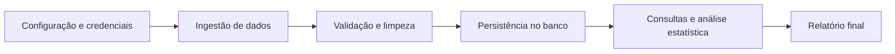

# Pipeline de Monitoramento e Análise de Dados Ambientais

## Visão geral

Este projeto tem como objetivo coletar, validar, persistir e analisar dados ambientais de estações de monitoramento. O fluxo principal do sistema segue uma arquitetura em camadas, com foco em separar responsabilidades entre configuração, domínio, persistência e análise.

A solução trabalha com dados obtidos exclusivamente por uma API REST, armazenando registros em banco relacional e gerando estatísticas úteis para identificação de padrões e outliers.

## Fluxo principal



## Arquitetura adotada

A proposta do projeto é uma arquitetura em camadas, com as seguintes responsabilidades:

1. Configuração e ambiente
   - carregamento de variáveis de ambiente
   - proteção de credenciais e endpoints

2. Modelo de domínio
   - entidades como `Cidade`, `Operador`, `Estacao` e `Leitura`

3. Serviços e regras de negócio
   - ingestão do JSON bruto
   - normalização de strings numéricas, booleanas e datas
   - validação e limpeza
   - análise estatística
   - geração de relatórios

4. Persistência e acesso a dados
   - conexão com o banco
   - criação de tabelas
   - consultas e gravações

5. Orquestração da aplicação
   - execução do pipeline completo

## Estrutura conceitual do projeto

```text
Data-Science-Ia/
├── docs/
│   ├── arquitetura.md
│   ├── diagrama-sequencia.md
│   ├── manual-execucao.md
│   └── modelagem-banco.md
├── src/
│   ├── database/
│   ├── models/
│   ├── repository/
│   ├── services/
│   ├── main.py
│   ├── .env
│   ├── .env.example
│   └── requirements.txt
├── README.md
├── projeto_modulo_1.md
├── estrutura.png
└── .gitignore
```

## Documentação técnica

Esta visão geral está alinhada com os documentos detalhados do projeto:

- [docs/arquitetura.md](docs/arquitetura.md) — arquitetura em camadas e organização dos módulos
- [docs/diagrama-sequencia.md](docs/diagrama-sequencia.md) — comunicação e fluxo de execução entre classes
- [docs/modelagem-banco.md](docs/modelagem-banco.md) — estrutura relacional do banco
- [docs/contrato-dados.md](docs/contrato-dados.md) — contrato do JSON de entrada e regras de normalização
- [docs/dicionario-dados.md](docs/dicionario-dados.md) — tipos, unidades e regras dos campos
- [docs/requisitos.md](docs/requisitos.md) — requisitos funcionais e regras de negócio
- [docs/analise-estatistica.md](docs/analise-estatistica.md) — métricas, agrupamentos e outliers
- [docs/seguranca-lgpd.md](docs/seguranca-lgpd.md) — tratamento de dados e credenciais
- [docs/versionamento.md](docs/versionamento.md) — branches e evolução do contrato
- [docs/manual-execucao.md](docs/manual-execucao.md) — instruções de execução

## Objetivo do sistema

O projeto busca:

- coletar dados ambientais em diferentes fontes
- limpar e validar registros inconsistentes
- persistir as informações em banco relacional
- gerar consultas e estatísticas por estação, período e parâmetro
- identificar outliers e apoiar análise exploratória dos dados

## Contrato atual de entrada

O sistema recebe registros ambientais com campos de cidade, operador, estação e leitura. A fonte atual envia números e booleanos como strings, por exemplo `"20.5"` e `"true"`.

O pipeline converte esses valores para os tipos internos antes de validar e persistir. O contrato completo, as regras de qualidade e o dicionário de campos estão em [docs/contrato-dados.md](docs/contrato-dados.md) e [docs/dicionario-dados.md](docs/dicionario-dados.md).

Os registros incluem dados meteorológicos e de qualidade da água, como temperatura, pressão, vento, pH, oxigênio dissolvido, condutividade e turbidez.

## Status

A documentação está organizada em camadas para facilitar entendimento do sistema e da evolução do projeto. O README atua como visão geral, enquanto a documentação detalhada concentra os aspectos técnicos e de arquitetura.
