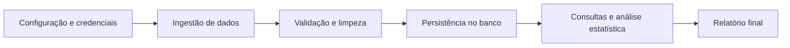

# Pipeline de Monitoramento e Análise de Dados Ambientais

O enunciado da Parte 1 está em [docs/projeto_modulo_1.md](docs/projeto_modulo_1.md) e o da Parte 2 (projeto final) em [docs/projeto_final.pdf](docs/projeto_final.pdf). O que muda na Parte 2, as decisões e o estado da implementação estão em [docs/analise-implementacao.md](docs/analise-implementacao.md).

## Visão geral

Este projeto tem como objetivo coletar, validar, persistir e analisar dados ambientais de estações de monitoramento. O fluxo principal do sistema segue uma arquitetura em camadas, com foco em separar responsabilidades entre configuração, domínio, persistência e análise.

A solução trabalha com dados obtidos exclusivamente por uma API REST, armazenando registros em banco relacional e gerando estatísticas úteis para identificação de padrões e outliers.

## Fluxo principal



## Arquitetura adotada

A proposta do projeto é uma arquitetura em camadas, com as seguintes responsabilidades:

1. Configuração e ambiente
   - carregamento de variáveis de ambiente
   - proteção de credenciais e endpoints

2. Modelo de domínio
   - entidades como `Cidade`, `Operador`, `Estacao` e `Leitura`

3. Serviços e regras de negócio
   - ingestão do JSON bruto
   - normalização de strings numéricas, booleanas e datas
   - validação e limpeza
   - análise estatística
   - geração de relatórios

4. Persistência e acesso a dados
   - conexão com o banco
   - criação de tabelas
   - consultas e gravações

5. Orquestração da aplicação
   - execução do pipeline completo

## Estrutura do projeto

```text
Data-Science-Ia/
├── data_lake/                  # Data Lakehouse
│   ├── bronze/                 # dados brutos, como chegam da ingestão
│   ├── silver/                 # dados limpos e validados
│   └── gold/                   # dados agregados para análise
├── docs/
│   ├── diagramas/              # atividade, contexto e sequência
│   ├── analise-implementacao.md
│   ├── arquitetura.md
│   ├── contrato-dados.md
│   ├── dicionario-dados.md
│   ├── manual-execucao.md
│   ├── modelagem-banco.md
│   └── ...
├── logs/                       # logs de execução e de rejeitados (fora do Git)
├── src/
│   ├── api/                    # API FastAPI que disponibiliza o dataset
│   ├── cli/                    # interface de consulta no terminal (rich)
│   ├── database/               # conexão e transação (o schema vem de sql/)
│   ├── ingestion/              # cliente da API e funções de importação
│   ├── models/                 # modelos Pydantic das entidades
│   ├── repository/             # acesso ao banco por entidade
│   ├── services/               # normalização, validação, análise e relatório
│   ├── config.py               # carregamento das variáveis de ambiente
│   ├── logger.py               # configuração única de logs
│   └── security.py             # anonimização (SHA-256) e criptografia (Fernet) de dados pessoais
├── sql/
│   ├── migrations/               # alterações incrementais do schema (VNNN__descricao.sql)
│   ├── ddl_banco_relacional.sql  # estado completo e atual do schema
│   ├── dml_populacao.sql         # carga de dados
│   └── queries_analiticas.sql    # consultas analíticas
├── tests/
│   ├── unit/                   # testes sem banco e sem rede
│   ├── integration/            # SQL Server descartável; ignorados sem configuração
│   └── test_quality_stat.py    # testes de qualidade e estatística
├── main.py                     # inicialização (iniciar_aplicacao), CLI e orquestração do pipeline (run_pipeline)
├── requirements.txt
├── .env.example
└── README.md
```

## Documentação técnica

Esta visão geral está alinhada com os documentos detalhados do projeto:

- [docs/arquitetura.md](docs/arquitetura.md) — arquitetura em camadas e organização dos módulos
- [docs/diagramas/diagrama-sequencia.md](docs/diagramas/diagrama-sequencia.md) — comunicação e fluxo de execução entre classes
- [docs/diagramas/diagrama-atividade.md](docs/diagramas/diagrama-atividade.md) — fluxo do processo e tratamento de falhas
- [docs/diagramas/diagrama-contexto.md](docs/diagramas/diagrama-contexto.md) — entradas e saídas do sistema
- [docs/modelagem-banco.md](docs/modelagem-banco.md) — estrutura relacional, restrições e idempotência
- [docs/contrato-dados.md](docs/contrato-dados.md) — contrato do JSON de entrada e regras de normalização
- [docs/dicionario-dados.md](docs/dicionario-dados.md) — tipos, unidades e regras dos campos
- [docs/requisitos.md](docs/requisitos.md) — requisitos funcionais e regras de negócio
- [docs/analise-estatistica.md](docs/analise-estatistica.md) — métricas, agrupamentos e outliers
- [docs/analise-implementacao.md](docs/analise-implementacao.md) — o que muda com o novo banco 3FN (Parte 2) e relatórios de implementação por fase
- [docs/todo-idempotencia.md](docs/todo-idempotencia.md) — fases de idempotência, campos nulos e log de rejeitados
- [docs/plano-testes.md](docs/plano-testes.md) — estratégia e cenários de teste
- [docs/seguranca-lgpd.md](docs/seguranca-lgpd.md) — tratamento de dados e credenciais
- [docs/versionamento.md](docs/versionamento.md) — branches e evolução do contrato
- [docs/manual-execucao.md](docs/manual-execucao.md) — instruções de execução

## Testes

Os testes usam `pytest` e ficam em `tests/`. Para executá-los, a partir da pasta `Data-Science-Ia`:

```bash
python -m pytest tests
```

Os testes unitários não dependem da API, do banco nem das chaves do `.env`; incluem os de segurança (`test_security.py`) e de logs (`test_logger.py`). Os de integração só rodam com um SQL Server de teste configurado. O guia completo, os comandos e a matriz de cenários estão em [docs/plano-testes.md](docs/plano-testes.md).

## Objetivo do sistema

O projeto busca:

- coletar dados ambientais pela API REST configurada
- limpar e validar registros inconsistentes
- persistir as informações em banco relacional
- gerar consultas e estatísticas por estação, período e parâmetro
- identificar outliers e apoiar análise exploratória dos dados

## Contrato atual de entrada

O sistema recebe registros ambientais com campos de cidade, operador, estação e leitura. A fonte atual envia números e booleanos como strings, por exemplo `"20.5"` e `"true"`.

O pipeline converte esses valores para os tipos internos antes de validar e persistir. O contrato completo, as regras de qualidade e o dicionário de campos estão em [docs/contrato-dados.md](docs/contrato-dados.md) e [docs/dicionario-dados.md](docs/dicionario-dados.md).

Os registros incluem dados meteorológicos e de qualidade da água, como temperatura, pressão, vento, pH, oxigênio dissolvido, condutividade e turbidez.

## Status

A aplicação usa uma API FastAPI local para servir JSON simulado, opção permitida pelo enunciado, mas usa Azure SQL em vez de SQLite ou PostgreSQL, opções citadas no trabalho. Permanecem parciais a anonimização/exclusão de identificadores, a apresentação de IQR como métrica, a agregação SQL por estação e a criação do schema em banco vazio. As pendências e o plano de implementação estão em [docs/analise-implementacao.md](docs/analise-implementacao.md) e [docs/todo-idempotencia.md](docs/todo-idempotencia.md).
