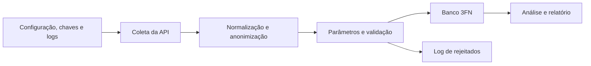

# Pipeline de Monitoramento e Análise de Dados Ambientais

O enunciado da Parte 1 está em [docs/projeto_modulo_1.md](docs/projeto_modulo_1.md) e o da Parte 2 (projeto final) em [docs/projeto_final.pdf](docs/projeto_final.pdf). O que muda na Parte 2, as decisões e o estado da implementação estão em [docs/analise-implementacao.md](docs/analise-implementacao.md).

## Visão geral

Pipeline de dados ambientais de estações de monitoramento: coleta as leituras por uma API REST, normaliza, anonimiza os dados pessoais dos operadores, valida cada registro, grava de forma idempotente num banco relacional 3FN (Azure SQL). Tudo o que não é importado fica registrado num log de rejeitados. O Data Lake (Bronze, Silver e Gold) não será implementado neste projeto.

## Fluxo principal



## O que está implementado (Parte 2)

| Etapa | Situação |
|---|---|
| Configuração e segurança | `.env` com `FONTE_DADOS`, banco e chaves; CPF e nome em hash SHA-256/HMAC, e-mail criptografado (Fernet) |
| Logs | Log da execução e log de rejeitados em `logs/`, sem dado pessoal |
| Normalização | Payload novo (cabeçalho + uma medição por parâmetro), parâmetros descobertos pelo `*_tipo_codigo` |
| Parâmetros | Parâmetro novo cadastrado automaticamente, sem faixa |
| Validação | Um resultado por registro (`valido`, `campos_nulos`, `itens_invalidos`, `motivos`); completude, acurácia, referência e unicidade |
| Banco | Modelo 3FN mantido por SQL (DDL, migrations e DML); gravação idempotente por `MERGE` e substituição de partição estação + dia |
| Análise e relatório | Média, mediana, desvio padrão, variância e IQR por estação e parâmetro; anomalias por IQR ou Z-Score com indicador de alerta de qualidade, registradas em `WARNING` no log; consultas equivalentes em `sql/queries_analiticas.sql` |
| CLI | Consulta por município → estação → período, com exportação em CSV |
| Data Lake | Não será implementado (a pasta `data_lake/` fica só como estrutura) |

O andamento por fase está em [docs/todo-idempotencia.md](docs/todo-idempotencia.md), e os relatórios em [docs/analise-implementacao.md](docs/analise-implementacao.md).

## Como executar

```bash
pip install -r requirements.txt
python -m uvicorn src.api.app:app          # API com o dataset (outro terminal)
python main.py --ingestao                  # ingestão: banco + logs
python main.py --analise                   # estatística e anomalias (log); filtros --estacao, --inicio, --fim
python main.py                             # CLI de consulta
python -m pytest tests                     # testes
```

Antes da primeira execução, crie o `.env` a partir do `.env.example` e prepare o banco com `sql/ddl_banco_relacional.sql` e `sql/dml_populacao.sql`. O passo a passo está em [docs/manual-execucao.md](docs/manual-execucao.md).

## Estrutura do projeto

```text
Data-Science-Ia/
├── data_lake/                  # Data Lakehouse
│   ├── bronze/                 # dados brutos, como chegam da ingestão
│   ├── silver/                 # dados limpos e validados
│   └── gold/                   # dados agregados para análise
├── docs/
│   ├── diagramas/              # atividade, contexto e sequência
│   ├── analise-implementacao.md
│   ├── arquitetura.md
│   ├── contrato-dados.md
│   ├── dicionario-dados.md
│   ├── manual-execucao.md
│   ├── modelagem-banco.md
│   └── ...
├── logs/                       # logs de execução e de rejeitados (fora do Git)
├── src/
│   ├── api/                    # API FastAPI que disponibiliza o dataset
│   ├── cli/                    # interface de consulta no terminal (rich)
│   ├── database/               # conexão e transação (o schema vem de sql/)
│   ├── ingestion/              # cliente da API e funções de importação
│   ├── models/                 # modelos Pydantic das entidades
│   ├── repository/             # acesso ao banco por entidade
│   ├── services/               # normalização, validação, análise e relatório
│   ├── config.py               # carregamento das variáveis de ambiente
│   ├── logger.py               # configuração única de logs
│   └── security.py             # anonimização (SHA-256) e criptografia (Fernet) de dados pessoais
├── sql/
│   ├── migrations/               # alterações incrementais do schema (VNNN__descricao.sql)
│   ├── ddl_banco_relacional.sql  # estado completo e atual do schema
│   ├── dml_populacao.sql         # carga de dados
│   └── queries_analiticas.sql    # consultas analíticas
├── tests/
│   ├── unit/                   # testes sem banco e sem rede
│   ├── integration/            # SQL Server descartável; ignorados sem configuração
│   └── test_quality_stat.py    # testes de qualidade e estatística
├── main.py                     # inicialização, CLI, ingestão (--ingestao) e análise (--analise)
├── requirements.txt
├── .env.example
└── README.md
```

## Documentação técnica

Esta visão geral está alinhada com os documentos detalhados do projeto:

- [docs/arquitetura.md](docs/arquitetura.md) — arquitetura em camadas e organização dos módulos
- [docs/diagramas/diagrama-sequencia.md](docs/diagramas/diagrama-sequencia.md) — comunicação e fluxo de execução entre classes
- [docs/diagramas/diagrama-atividade.md](docs/diagramas/diagrama-atividade.md) — fluxo do processo e tratamento de falhas
- [docs/diagramas/diagrama-contexto.md](docs/diagramas/diagrama-contexto.md) — entradas e saídas do sistema
- [docs/modelagem-banco.md](docs/modelagem-banco.md) — estrutura relacional, restrições e idempotência
- [docs/contrato-dados.md](docs/contrato-dados.md) — contrato do JSON de entrada e regras de normalização
- [docs/dicionario-dados.md](docs/dicionario-dados.md) — tipos, unidades e regras dos campos
- [docs/requisitos.md](docs/requisitos.md) — requisitos funcionais e regras de negócio
- [docs/analise-estatistica.md](docs/analise-estatistica.md) — métricas, regras IQR e Z-Score, indicador de alerta e como executar
- [docs/analise-implementacao.md](docs/analise-implementacao.md) — o que muda com o novo banco 3FN (Parte 2) e relatórios de implementação por fase
- [docs/todo-idempotencia.md](docs/todo-idempotencia.md) — fases de idempotência, campos nulos, log de rejeitados e Analytics
- [docs/plano-testes.md](docs/plano-testes.md) — estratégia e cenários de teste
- [docs/seguranca-lgpd.md](docs/seguranca-lgpd.md) — tratamento de dados e credenciais
- [docs/versionamento.md](docs/versionamento.md) — branches e evolução do contrato
- [docs/manual-execucao.md](docs/manual-execucao.md) — instruções de execução

## Testes

Os testes usam `pytest` e ficam em `tests/`. Para executá-los, a partir da pasta `Data-Science-Ia`:

```bash
python -m pytest tests
```

Os testes unitários não dependem da API, do banco nem das chaves do `.env`; incluem os de segurança (`test_security.py`) e de logs (`test_logger.py`). Os de integração só rodam com um SQL Server de teste configurado. O guia completo, os comandos e a matriz de cenários estão em [docs/plano-testes.md](docs/plano-testes.md).

## Contrato de entrada

Cada registro da API é um ciclo de leitura de uma estação: estado, município, estação, operador (com CPF, nome completo e e-mail) e, para cada parâmetro, o valor, a unidade, o código do tipo e a hora da medição. O payload atual tem 9.888 registros e 11 parâmetros. O contrato completo está em [docs/contrato-dados.md](docs/contrato-dados.md), e os campos em [docs/dicionario-dados.md](docs/dicionario-dados.md).

## Status

- O banco `impacta` está igual ao DDL, com as migrations V001 e V002 e o DML de domínio (27 estados e 11 parâmetros) aplicados.
- A ingestão foi validada no banco real com o dataset completo carregado duas vezes, dentro de uma transação desfeita ao final: 9.806 leituras e 104.582 medições, sem nenhuma duplicidade.
- **Próximos passos:**
  - primeira carga real e conferência no banco `impacta` (fase 9; as conferências já passam nos testes de integração);
  - decisão do time sobre a regra IQR na precipitação (IQR = 0 sinaliza toda chuva; ver [docs/analise-estatistica.md](docs/analise-estatistica.md)).
- Analytics no modelo 3FN concluído (fases 12 a 17): 1.824 anomalias no dataset atual, conferidas contra o SQL no banco de teste.
- O Data Lake não será implementado neste repositório.
- A aplicação usa Azure SQL; o enunciado da Parte 1 citava SQLite ou PostgreSQL.
