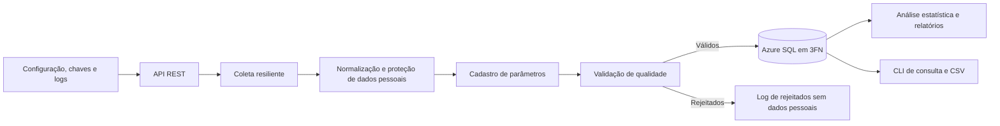
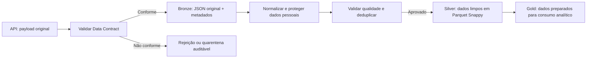

# Monitoramento e Análise de Dados Ambientais

Pipeline acadêmico para ingestão de leituras de estações ambientais, validação de qualidade, persistência relacional e análise de anomalias. Este README reúne a arquitetura, o dicionário de dados, a instalação e o runbook para operar a implementação atual.

O enunciado do projeto final está em [docs/projeto_final.pdf](docs/projeto_final.pdf). A implementação atual deste repositório é a Parte 2: API REST, pipeline Python e banco relacional Azure SQL. O Data Lake (Bronze, Silver e Gold) é parte da arquitetura-alvo descrita no enunciado, mas ainda não está integrado ao `main.py`.

## Índice

- [Arquitetura](#arquitetura)
- [Dicionário de dados](#dicionário-de-dados)
- [Instalação](#instalação)
- [Runbook operacional](#runbook-operacional)
- [Testes](#testes)
- [Estrutura do repositório](#estrutura-do-repositório)
- [Documentação complementar](#documentação-complementar)

## Arquitetura

### Implementação atual



`main.py` coordena a execução. Os módulos mantêm as responsabilidades separadas:

| Camada | Componentes | Responsabilidade |
|---|---|---|
| Configuração e segurança | `src/config.py`, `src/security.py` | Ler configuração do ambiente; proteger CPF, nome e e-mail; não expor segredos. |
| Observabilidade | `src/logger.py` | Criar log da execução e log de rejeitados, evitando dados pessoais. |
| Entrada | `src/api/`, `src/ingestion/data_client.py` | Servir o dataset de exemplo e consumi-lo por HTTP com timeout, retentativas e limite de chamadas. |
| Serviços | `src/services/` | Normalizar, descobrir parâmetros, validar regras de qualidade, calcular métricas e formatar relatórios. |
| Domínio e persistência | `src/models/`, `src/repository/`, `src/database/`, `sql/` | Representar entidades e gravar o modelo relacional em transação. O schema é administrado por SQL. |
| Interface | `src/cli/`, `main.py` | Iniciar ingestão, gerar análise e oferecer consultas interativas. |

### Arquitetura-alvo do projeto final

O enunciado descreve o processamento em camadas. Quando implementado, o fluxo deverá preservar a separação entre o payload original e os dados tratados:



Bronze deve guardar o conteúdo aprovado pelo contrato sem normalizar ou anonimizar, com metadados de ingestão e política append-only. Como pode conter dados pessoais em claro, requer acesso restrito e retenção controlada. Silver deve conter dados limpos, deduplicados e protegidos. A organização de Gold deve seguir os produtos analíticos definidos para a entrega. Essas camadas ainda não são gravadas pelo pipeline existente; a pasta `data_lake/` é apenas estrutura de diretórios.

### Pipeline de ingestão existente

Ao executar `python main.py --ingestao`, `run_pipeline()`:

1. Busca o lote em `GET {FONTE_DADOS}/api/v1/data-set`.
2. Normaliza os registros: limpa textos, converte tipos e organiza medições em `itens`.
3. Protege os dados pessoais: CPF e nome viram hashes; e-mail é criptografado com Fernet.
4. Cadastra parâmetros novos quando encontrados.
5. Valida completude, faixas, referências e unicidade.
6. Registra rejeições sem incluir dados pessoais nos logs.
7. Grava registros aceitos no Azure SQL dentro da transação do lote.

`ValidationService.validate_data()` recebe **registros normalizados**. Ele não valida sozinho a estrutura do JSON bruto. O módulo `src/services/data_contract_service.py` contém a função estrutural independente `validar_contrato()`, mas ela ainda não está conectada ao `run_pipeline()`.

## Dicionário de dados

Cada objeto JSON representa um ciclo de leitura de uma estação. Além dos campos do cabeçalho, cada parâmetro `X` é representado por campos dinâmicos. Texto vazio é tratado como nulo na normalização; campos vitais nulos podem invalidar a leitura. O contrato detalhado está em [docs/contrato-dados.md](docs/contrato-dados.md).

### Cabeçalho do registro

| Campo recebido | Tipo esperado | Regra e uso |
|---|---|---|
| `registro_codigo` | Texto | Identificador único da leitura; chave natural da tabela `Leituras`. Vital. |
| `data_hora_ciclo` | Texto ISO 8601 | Instante do ciclo; convertido para data/hora. Vital. |
| `cidade_codigo` | Texto | Código geográfico; atualmente não persiste no banco. |
| `cidade_nome` | Texto | Nome alternativo do município quando `municipio` não está disponível. |
| `cidade_estado` | Texto | Sigla da UF, normalizada para maiúsculas e conferida com `Estados`. Vital. |
| `municipio` | Texto | Município de estação e operador; pode usar `cidade_nome` como fallback. Vital após normalização. |
| `estacao_codigo` | Texto | Identificador da estação. Vital e único no cadastro. |
| `estacao_nome` | Texto | Nome da estação. Vital. |
| `estacao_latitude` | Número | Latitude entre -90 e 90. Vital. |
| `estacao_longitude` | Número | Longitude entre -180 e 180. Vital. |
| `estacao_ativa` | Booleano | Informação da fonte não persistida atualmente. |
| `estacao_tipo` | Texto | Informação da fonte não persistida atualmente. |
| `operador_codigo` | Texto | Identificador do operador. Vital. |
| `operador_nome_completo` | Texto | Não persiste em claro; transforma-se em `nome_hash`. Vital. |
| `operador_cpf` | Texto | Não persiste em claro; pontuação é removida e gera-se `cpf_hash`. Vital. |
| `operador_email` | Texto | Não persiste em claro; gera-se `email_criptografado` reversível. Vital. |
| `operador_ativo` | Booleano | Informação da fonte não persistida atualmente. |

### Campos dinâmicos de medição

Para cada parâmetro `X` reconhecido por `X_tipo_codigo`:

| Campo | Tipo esperado | Significado e tratamento |
|---|---|---|
| `X` | Número ou nulo | Valor medido; deve ser finito. Nulos e valores fora da faixa descartam o item, não necessariamente a leitura inteira. |
| `X_tipo_codigo` | Texto | Código do parâmetro; ex. `TIP-PH`. Pode cadastrar um parâmetro novo. |
| `X_unidade_medida` | Texto | Unidade da medição, quando fornecida. |
| `X_codigo` | Texto | Código da medição da fonte; não persistido atualmente. |
| `data_hora_leitura_X` | Texto ISO 8601 | Instante da medição; informativo e não persistido atualmente. |

Exceções de nomenclatura de unidade aceitas: `oxigenio_dissolvido_medida` e `velocidade_unidade_medida` para `velocidade_vento`.

| Campo `X` | Código | Unidade | Faixa de validação |
|---|---|---|---|
| `temperatura_agua` | `TIP-TAG` | °C | 0 a 45 |
| `ph` | `TIP-PH` | pH | 0 a 14 |
| `temperatura` | `TIP-TMP` | °C | -40 a 60 |
| `umidade` | `TIP-UMI` | % | 0 a 100 |
| `pressao` | `TIP-PRE` | hPa | 870 a 1085 |
| `precipitacao` | `TIP-CHU` | mm | >= 0 |
| `velocidade_vento` | `TIP-VEN` | km/h | 0 a 200 |
| `radiacao_solar` | `TIP-RAD` | W/m² | 0 a 1500 |
| `oxigenio_dissolvido` | `TIP-OXI` | mg/L | 0 a 20 |
| `condutividade` | `TIP-CON` | µS/cm | >= 0 |
| `turbidez` | `TIP-TUR` | NTU | >= 0 |

Faixas e convenções completas: [docs/dicionario-dados.md](docs/dicionario-dados.md) e `sql/dml_populacao.sql`.

### Modelo relacional

O banco operacional está em 3FN. `Estados` contém UFs; `Municipios` referencia `Estados`; `Estacoes` e `Operadores` referenciam `Municipios`; `Leituras` referencia estação e operador; `Leitura_Itens` liga leituras a parâmetros e armazena valores medidos. CPF e nome são armazenados como hashes e e-mail como token Fernet. Detalhes de chaves, índices e colunas: [docs/modelagem-banco.md](docs/modelagem-banco.md).

## Instalação

### Pré-requisitos

- Windows, Linux ou macOS.
- Python 3.10 ou superior e `pip`.
- Azure SQL acessível pela máquina; string de conexão com permissões necessárias.
- Acesso ao endpoint da API configurado em `FONTE_DADOS`. Para uso local com o dataset fornecido, execute a API do próprio projeto.
- `sqlcmd`, SQL Server Management Studio ou Azure Data Studio para preparar o banco.

> A implementação usa Azure SQL. O enunciado anterior citava SQLite ou PostgreSQL; confirme com a orientação do curso que a tecnologia adotada é aceita.

### Ambiente Python

Na raiz de `Data-Science-Ia`, crie e ative um ambiente virtual:

```powershell
py -3 -m venv .venv
.\.venv\Scripts\Activate.ps1
python -m pip install --upgrade pip
pip install -r requirements.txt
```

Se o PowerShell bloquear a ativação, permita scripts apenas no processo atual e tente novamente:

```powershell
Set-ExecutionPolicy -Scope Process -ExecutionPolicy RemoteSigned
.\.venv\Scripts\Activate.ps1
```

Em Linux/macOS:

```bash
python3 -m venv .venv
source .venv/bin/activate
python -m pip install --upgrade pip
pip install -r requirements.txt
```

### Configuração de ambiente e chaves

1. Copie `.env.example` para `.env` na raiz do projeto.
2. Preencha a string de conexão, a URL da API e as chaves. Não inclua `.env` no Git nem compartilhe segredos em logs ou mensagens.

```env
AZURE_SQL_CONNECTIONSTRING="Server=tcp:<servidor>.database.windows.net,1433;Database=<banco>;UID=<usuario>;PWD=<senha>;Encrypt=yes;TrustServerCertificate=no"
FONTE_DADOS="http://127.0.0.1:8000"
CHAVE_CRIPTOGRAFIA="<chave-fernet-compartilhada-fora-do-git>"
CHAVE_HASH="<segredo-compartilhado-opcional>"
```

Gere uma chave Fernet com:

```powershell
python -c "from cryptography.fernet import Fernet; print(Fernet.generate_key().decode())"
```

`CHAVE_CRIPTOGRAFIA` é obrigatória. `CHAVE_HASH` é opcional; quando definida, CPF e nome usam HMAC-SHA256, caso contrário usam SHA-256. Todas as máquinas que compartilham o banco precisam das mesmas chaves: a troca da chave Fernet impede descriptografar e-mails já gravados. Guarde-as em um cofre seguro.

| Variável | Obrigatória | Uso |
|---|---|---|
| `AZURE_SQL_CONNECTIONSTRING` | Sim | Conexão com Azure SQL. |
| `FONTE_DADOS` | Sim | Base da API de ingestão; limite de 100 caracteres porque também é gravada em `Leituras.fonte`. |
| `CHAVE_CRIPTOGRAFIA` | Sim | Chave Fernet para proteção reversível do e-mail. |
| `CHAVE_HASH` | Não | Segredo para HMAC-SHA256 de CPF e nome; vazio usa SHA-256 puro. |
| `PASTA_LOGS` | Não | Sobrescreve a pasta de logs; usado também em testes. |

Não configure `DB_HOST`, `DB_PORT`, `DB_USER` ou `DB_PASSWORD`: o código atual não os lê.

### Preparação do banco

O schema é controlado pelos scripts de `sql/`; a aplicação não cria nem altera tabelas.

**Banco novo e vazio:** execute o DDL e depois o DML. Atenção: o DDL começa com `DROP TABLE IF EXISTS` e remove tabelas/dados existentes; use apenas em banco descartável ou vazio.

```powershell
sqlcmd -S <servidor>.database.windows.net -d <banco> -U <usuario> -P <senha> -f 65001 -i sql/ddl_banco_relacional.sql
sqlcmd -S <servidor>.database.windows.net -d <banco> -U <usuario> -P <senha> -f 65001 -i sql/dml_populacao.sql
```

**Banco existente com dados:** não execute o DDL. Aplique somente migrations pendentes, na ordem, e execute o DML idempotente para sincronizar estados e parâmetros. Consulte [docs/manual-execucao.md](docs/manual-execucao.md) e confirme o estado do banco antes da operação.

## Runbook operacional

Os comandos abaixo são executados a partir da raiz `Data-Science-Ia`, com o ambiente virtual ativo. A ingestão, análise e CLI são processos separados.

### 1. Verificações antes da carga

- Confirme que `.env` existe e contém `AZURE_SQL_CONNECTIONSTRING`, `FONTE_DADOS` e `CHAVE_CRIPTOGRAFIA` válidos.
- Confirme conectividade e permissões no Azure SQL; não use o DDL destrutivo em banco com dados.
- Confirme que o endpoint configurado em `FONTE_DADOS` responde e fornece uma lista de objetos JSON.
- Garanta espaço e acesso restrito à pasta `logs/`.

### 2. Iniciar a API local de dados

Em um terminal, na raiz do projeto:

```powershell
python -m uvicorn src.api.app:app --host 127.0.0.1 --port 8000
```

Em outro terminal, verifique os endpoints:

```powershell
Invoke-RestMethod http://127.0.0.1:8000/health
Invoke-RestMethod http://127.0.0.1:8000/api/v1/data-set | Select-Object -First 1
```

Para uma API remota, não é necessário iniciar o servidor local; a URL em `FONTE_DADOS` deve apontar ao endpoint disponível.

### 3. Abrir o dashboard Flask

Com a API de dados rodando no terminal anterior, inicie a interface Flask em outro terminal:

```powershell
python -m flask --app src.ui.app run --host 127.0.0.1 --port 5000
```

Abra `http://127.0.0.1:5000`. O dashboard permite executar a ingestão e explorar as medições por estação, parâmetro e período, com gráfico navegável por semana, mês e ano, tabelas paginadas e exportação do recorte filtrado em CSV. A visualização consulta somente dados analíticos do banco. Detalhes na seção 6 de `docs/manual-execucao.md`.

### 4. Executar a ingestão

```powershell
python main.py --ingestao
```

Acompanhe o resumo final do pipeline e os arquivos mais recentes:

```powershell
Get-ChildItem logs | Sort-Object LastWriteTime -Descending | Select-Object -First 5 Name,Length,LastWriteTime
Get-Content (Get-ChildItem logs\pipeline_*.log | Sort-Object LastWriteTime | Select-Object -Last 1) -Tail 30
Get-Content (Get-ChildItem logs\rejeitados_*.log | Sort-Object LastWriteTime | Select-Object -Last 1) -Tail 30
```

O log de rejeitados não deve conter CPF, nome, e-mail, hashes, tokens ou segredos. A carga relacional é idempotente: reexecutar o mesmo período substitui as leituras da partição estação + dia, em vez de duplicá-las. O pipeline atual grava no banco, não em Bronze/Silver/Gold.

### 5. Analisar dados

```powershell
python main.py --analise
python main.py --analise --estacao EST-RJ-001
python main.py --analise --inicio 2026-06-01 --fim 2026-06-30
python main.py --analise --inicio 2026-06-01
```

O intervalo é inclusivo; informar apenas `--inicio` analisa aquele dia. Métricas e anomalias são escritas no log. Os alertas indicam IQR, Z-Score ou ambos. Consultas SQL equivalentes estão em `sql/queries_analiticas.sql`.

### 6. Consultar e exportar

```powershell
python main.py
```

Na CLI, selecione município, estação e período. A opção de exportação salva `estatisticas.csv` e `anomalias.csv` em `relatorios/`.

### 7. Encerrar operação

- Interrompa o servidor Uvicorn com `Ctrl+C` no terminal em que ele está rodando.
- Guarde ou rotacione os logs segundo a política do time; restrinja acesso e não envie logs com dados pessoais.
- Registre horário, fonte, contagens do resumo e incidentes operacionais, sem copiar credenciais ou dados pessoais.

### Diagnóstico rápido

| Sintoma | Verificações |
|---|---|
| Aplicação encerra na inicialização | Confirme as variáveis obrigatórias no `.env`; a chave Fernet deve ser válida. Não publique o valor da chave. |
| API indisponível ou carga vazia | Confira `FONTE_DADOS`, `/health`, disponibilidade HTTP e se o endpoint devolve uma lista JSON. |
| Falha ao conectar ao banco | Confira servidor, banco, credenciais, firewall/rede e permissões; nunca cole a string de conexão em logs. |
| Leitura rejeitada | Consulte `rejeitados_*.log` para campo e motivo. A mensagem deve omitir os valores pessoais. |
| Parâmetro não reconhecido | Confira `*_tipo_codigo`, unidade e sincronização em `Parametros`; um parâmetro novo pode ser cadastrado sem faixa. |
| E-mail não pode ser descriptografado | Confirme que está sendo usada a mesma `CHAVE_CRIPTOGRAFIA` da gravação. Não gere uma substituta para tentar ler tokens antigos. |
| Resultado inesperado após reprocessar | Compare o resumo e a partição estação + dia; consulte `docs/todo-idempotencia.md` e `docs/analise-implementacao.md`. |

## Testes

Execute a suíte a partir da raiz do projeto:

```powershell
python -m pytest tests
```

Os testes unitários não precisam da API nem do banco Azure. Os testes de integração dependem de SQL Server de teste e podem ser ignorados quando não há configuração própria. Para subconjuntos:

```powershell
python -m pytest tests/unit
python -m pytest tests/integration
```

Não execute testes de integração contra o banco de produção. Consulte [docs/plano-testes.md](docs/plano-testes.md) para pré-requisitos, cenários e resultados esperados.

## Estrutura do repositório

```text
Data-Science-Ia/
├── data_lake/             # pastas Bronze/Silver/Gold; persistência ainda não integrada
├── docs/                   # requisitos, arquitetura, runbook, contratos e diagramas
├── logs/                   # logs de execução e rejeitados; fora do Git
├── src/
│   ├── api/                # API FastAPI para disponibilizar o dataset
│   ├── cli/                # consulta interativa e exportação
│   ├── database/           # conexão e transações com Azure SQL
│   ├── ingestion/          # cliente HTTP e importação relacional
│   ├── models/             # modelos das entidades
│   ├── repository/         # persistência por entidade
│   └── services/           # normalização, contrato, validação e análise
├── sql/                    # DDL, migrations, DML e consultas analíticas
├── tests/                  # testes unitários e de integração
├── main.py                 # ponto de entrada e orquestração
├── requirements.txt
└── .env.example            # nomes e formato das variáveis, sem segredos reais
```

## Documentação complementar

- [docs/projeto_final.pdf](docs/projeto_final.pdf) — enunciado do projeto final.
- [docs/arquitetura.md](docs/arquitetura.md) — arquitetura detalhada e limites da implementação.
- [docs/contrato-dados.md](docs/contrato-dados.md) — estrutura de entrada, normalização e resultados da validação.
- [docs/dicionario-dados.md](docs/dicionario-dados.md) — tipos, campos, unidades, faixas e perfil do dataset.
- [docs/manual-execucao.md](docs/manual-execucao.md) — instruções operacionais e administração SQL detalhadas.
- [docs/modelagem-banco.md](docs/modelagem-banco.md) — entidades, chaves e relacionamentos do banco 3FN.
- [docs/seguranca-lgpd.md](docs/seguranca-lgpd.md) — proteção de dados pessoais, segredos e logs.
- [docs/analise-estatistica.md](docs/analise-estatistica.md) — métricas e regras de anomalia.
- [docs/plano-testes.md](docs/plano-testes.md) — estratégia de testes.
- [docs/diagramas/diagrama-contexto.md](docs/diagramas/diagrama-contexto.md), [docs/diagramas/diagrama-atividade.md](docs/diagramas/diagrama-atividade.md) e [docs/diagramas/diagrama-sequencia.md](docs/diagramas/diagrama-sequencia.md) — diagramas da solução.

Para decisões, requisitos funcionais e acompanhamento das fases, consulte também `docs/requisitos.md`, `docs/analise-implementacao.md` e `docs/todo-idempotencia.md`.
