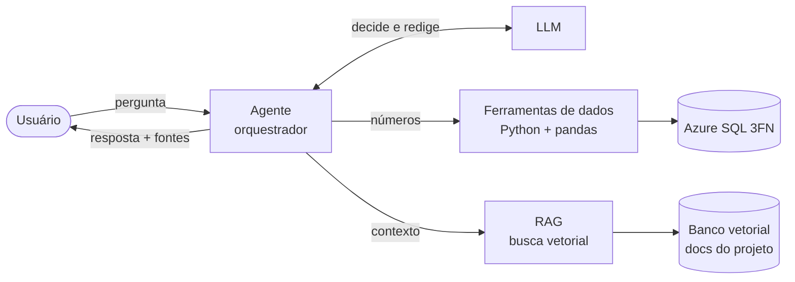
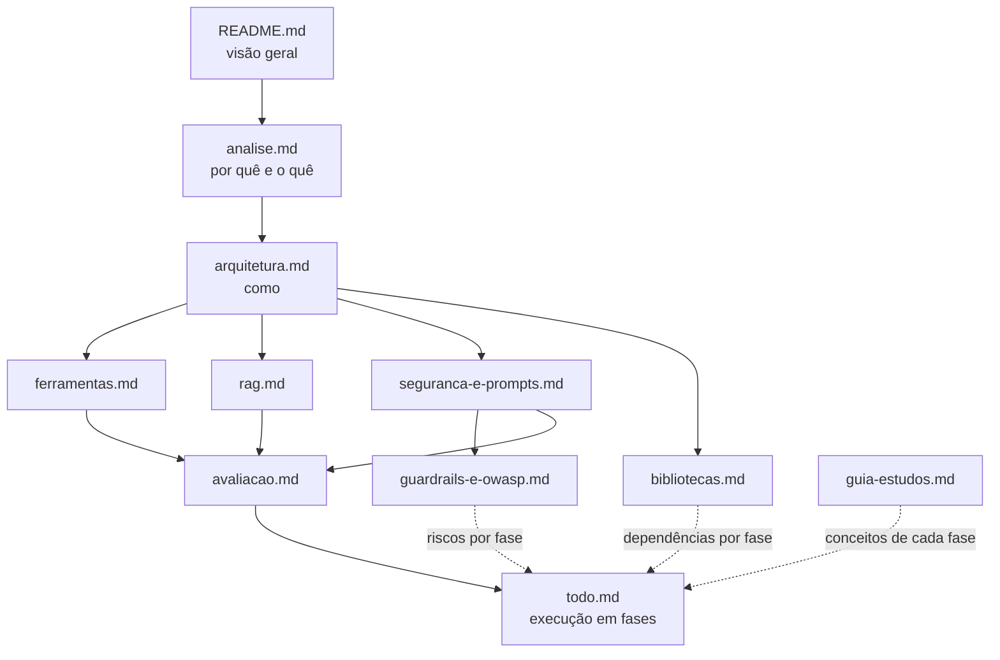

# Agente analítico de dados ambientais

Chat em linguagem natural que responde perguntas sobre as medições das estações, as análises estatísticas e as regras do projeto. Exemplos: "qual foi o pH médio em junho?", "houve anomalias de turbidez na última semana?", "por que a chuva gera tantos alertas IQR?".

O agente **não calcula nada sozinho**. Ele usa um LLM para entender a pergunta, decidir quais **ferramentas** (funções Python do projeto) chamar e redigir a resposta. Os números vêm sempre do banco Azure SQL, pelas funções que já existem (`LeituraRepository`, `AnaliticsService`). As explicações vêm da documentação do projeto, recuperada por **RAG** (embeddings + banco vetorial).

> **Status (21/10/2026):** Fases 0 a 12 concluídas e **testadas com o LLM real** (OpenAI `gpt-4.1-mini`, DA11; o adaptador do Claude Haiku 5.5 continua disponível). O agente responde pela CLI (`python main.py --pergunta "..."` e `--agente`) e pela página `/agente` do dashboard:
> - números vêm de 9 ferramentas de dados só de leitura, inclusive testes de hipótese, correlação e probabilidade;
> - regras e decisões vêm da documentação, por RAG (`python main.py --indexar`), em memória ou no ChromaDB (`AGENTE_VETORES`);
> - as políticas de segurança são aplicadas em código;
> - "que dias foram parecidos com 15/06?" é respondida pela ferramenta `dias_semelhantes`, sobre resumos diários indexados (`python main.py --indexar-dias`);
> - "como fica a temperatura nas próximas 6 horas?" é respondida pela ferramenta `prever`, com um modelo treinado no projeto (`python main.py --treinar-previsao`) e sempre com a margem de erro e a comparação com o baseline;
> - `python main.py --laudo` classifica as anomalias de um período (falha de sensor, evento real ou inconclusivo) em JSON validado, sinalizado como gerado por IA;
> - a qualidade é medida com um golden set de 52 perguntas (`python -m src.agente.avaliacao`). Na rodada real com o `gpt-4.1-mini`: precisão da seleção 0,98, recall 1,00, argumentos 1,00, **fidelidade numérica 100%**, recusa correta 100%, nenhum dado pessoal e latência mediana de 2,6 s. A meta de recuperação (hit@4 ≥ 0,85) não foi atingida.
>
> **Pendências:**
> 1. o usuário `agente_leitura` no Azure SQL. Até lá, os testes usam o banco local `agente_local` com autenticação do Windows **temporária**. O modo misto do SQL Express já foi gravado e passa a valer no próximo reinício do serviço; aí a conexão troca para o `agente_leitura`;
> 2. a comparação com um modelo maior (`python -m src.agente.avaliacao --modelo gpt-4.1`).
>
> O relatório de cada fase está em [analise.md § 11](analise.md#11-relatório-das-fases).

## Visão geral em um diagrama



## Exemplo de conversa (formato esperado)

> Os valores abaixo são **ilustrativos**. Mostram o formato da resposta, não resultados reais.

```text
Você: Qual foi o pH médio em junho e houve anomalias?

Agente: Em junho de 2026, na estação Estação Integrada Guanabara Norte (EST-RJ-001),
o pH médio foi 7,38 (mediana 7,37; desvio padrão 0,21; 1.402 medições).
Foram sinalizadas 11 anomalias de pH: 9 pela regra IQR e 2 por IQR+ZSCORE.
A mais extrema foi 9,30 em 03/06/2026 06:00 (Z-Score 4,10).

Fontes:
  • resumo_estatistico(parametros=["TIP-PH"], data_inicio=2026-06-01, data_fim=2026-06-30)
  • listar_anomalias(parametro="TIP-PH", data_inicio=2026-06-01, data_fim=2026-06-30)
```

## Documentos desta pasta

Ordem de leitura sugerida:

| # | Documento | Conteúdo |
|---|---|---|
| 1 | [analise.md](analise.md) | Problema, objetivos, perfil dos dados, casos de uso, comparação de abordagens, requisitos, decisões pendentes, riscos e relatório das fases |
| 2 | [arquitetura.md](arquitetura.md) | Componentes, estrutura de pastas, classes, loop do agente, diagramas de sequência, configuração e integração com o código existente |
| 3 | [ferramentas.md](ferramentas.md) | Catálogo de ferramentas com parâmetros, retorno e implementação, mais o padrão para criar ferramentas novas |
| 4 | [rag.md](rag.md) | Pipeline RAG: corpus, chunking, embeddings, banco vetorial, indexação idempotente e recuperação |
| 5 | [seguranca-e-prompts.md](seguranca-e-prompts.md) | System prompt, formato de resposta, guardrails, LGPD, prompt injection e custo |
| 6 | [guardrails-e-owasp.md](guardrails-e-owasp.md) | Conceitos de segurança com exemplos (política × guardrail, OWASP Top 10 para LLM) e as **políticas de segurança POL-01 a POL-13** que o código implementa |
| 7 | [bibliotecas.md](bibliotecas.md) | Cada biblioteca e tecnologia: para qual recurso, por que, alternativas descartadas, exemplo e versão conferida |
| 8 | [avaliacao.md](avaliacao.md) | Testes offline, conjunto de referência (golden set), métricas de qualidade e baselines |
| 9 | [guia-estudos.md](guia-estudos.md) | Mapa dos conceitos do módulo 3 para o código, padrão de documentação do código, exemplos executáveis e exercícios |
| 10 | [todo.md](todo.md) | Fases de implementação com tarefas, critérios de aceite e conceitos estudados em cada fase |



## Relação com o restante do projeto

O agente é uma camada **de leitura** em cima do que já existe. Ele não altera a ingestão, o schema nem a análise estatística.

| Usa do projeto | Para quê |
|---|---|
| `LeituraRepository.get_medicoes()` | Medições filtradas por estação, parâmetro e período |
| `AnaliticsService.analisar_medicoes()` | Estatísticas e anomalias (IQR, Z-Score), sem reescrever as regras |
| `EstacaoRepository`, `MunicipioRepository`, `ParametroRepository` | Cadastro de estações, municípios, parâmetros e faixas |
| `src/config.py`, `src/logger.py`, `src/security.py` | Configuração, log e proteção de dados pessoais centralizados ([seguranca-lgpd.md](../seguranca-lgpd.md)) |
| `docs/*.md` | Corpus do RAG |

As regras do [CLAUDE.md](../../CLAUDE.md) valem também aqui: schema só por SQL (migration), log só pelo `logger.py`, dado pessoal só pelo `security.py`, testes em toda lógica nova e documentação atualizada na mesma entrega.

## Glossário rápido

| Termo | Significado no agente |
|---|---|
| **LLM** | Modelo de linguagem que interpreta a pergunta, escolhe ferramentas e redige a resposta |
| **Token** | Unidade de texto processada pelo LLM. Define custo e limite de contexto ([ia_gen_1.py](../../../avanade-ds-ia/modulo-3/Fundamentos-IA-Gen/ia_gen_1.py)) |
| **Ferramenta (tool)** | Função Python com nome, descrição e parâmetros tipados, que o LLM pode pedir para executar |
| **Agente** | Laço "LLM decide → ferramenta executa → LLM lê o resultado" até haver resposta final |
| **Embedding** | Vetor numérico que representa o significado de um texto |
| **Chunk** | Pedaço de documento indexado no banco vetorial |
| **Banco vetorial** | Armazena embeddings e busca os mais parecidos por similaridade de cosseno |
| **RAG** | Retrieval-Augmented Generation: recuperar trechos relevantes e colocá-los no prompt |
| **Grounding** | Instruir o LLM a responder só com base no contexto e nos resultados fornecidos |
| **Alucinação** | Resposta plausível, porém inventada. É o principal risco que a arquitetura combate |
| **Golden set** | Conjunto de perguntas com resposta conhecida, usado para medir a qualidade do agente |
