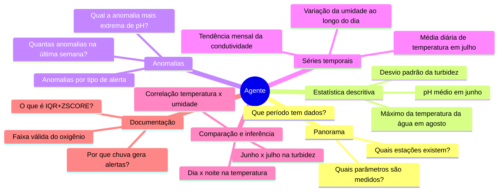
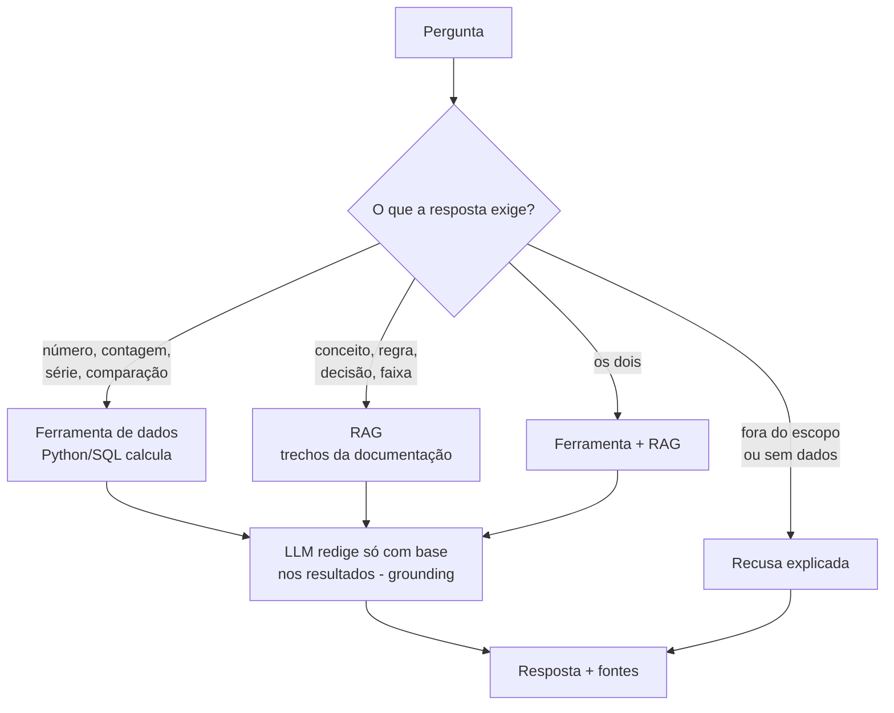

# Análise do agente analítico

Este documento responde **por que** construir o agente, **o que** ele deve fazer e **quais decisões** ainda precisam ser tomadas. O **como** está em [arquitetura.md](arquitetura.md).

## Índice

1. [Contexto e problema](#1-contexto-e-problema)
2. [Objetivos e não objetivos](#2-objetivos-e-não-objetivos)
3. [Perfil dos dados que o agente consulta](#3-perfil-dos-dados-que-o-agente-consulta)
4. [Casos de uso e perguntas-alvo](#4-casos-de-uso-e-perguntas-alvo)
5. [Princípio central: números por ferramentas, contexto por RAG](#5-princípio-central-números-por-ferramentas-contexto-por-rag)
6. [Comparação de abordagens](#6-comparação-de-abordagens)
7. [Requisitos](#7-requisitos)
8. [Decisões pendentes](#8-decisões-pendentes)
9. [Riscos e mitigação](#9-riscos-e-mitigação)
10. [Critérios de sucesso](#10-critérios-de-sucesso)
11. [Relatório das fases](#11-relatório-das-fases)

---

## 1. Contexto e problema

Hoje o projeto oferece três formas de consultar os dados gravados no Azure SQL:

| Interface | Como o usuário chega na resposta | Limitação |
|---|---|---|
| CLI (`python main.py`) | Menus: município → estação → período | Só mostra a tabela completa de métricas e anomalias do recorte. Não responde perguntas específicas |
| Dashboard Flask | Filtros de estação, parâmetro e período, gráfico e tabelas | Exige saber o que procurar. Não explica o que significam os números |
| SQL (`sql/queries_analiticas.sql`) | Escrever ou adaptar consultas | Exige conhecer o modelo 3FN e SQL |

Perguntas comuns de quem usa os dados ficam sem caminho direto:

- **Pontuais:** "qual foi a temperatura máxima da água em agosto?"
- **Comparativas:** "a turbidez de julho foi maior que a de junho?"
- **Temporais:** "como a umidade varia ao longo do dia?"
- **Interpretativas:** "esse alerta IQR+ZSCORE indica falha de sensor?"
- **Sobre as regras:** "por que a radiação solar nunca tem anomalias?"

A resposta existe espalhada entre o banco, o `AnaliticsService` e a documentação (`analise-estatistica.md`, `dicionario-dados.md`, decisões D9 a D12). O agente junta esses pedaços numa conversa.

## 2. Objetivos e não objetivos

### Objetivos

1. Responder em português, em linguagem natural, perguntas sobre **medições, estatísticas, anomalias e séries temporais** de forma **exata e verificável**.
2. Explicar **regras, faixas, decisões e conceitos** do projeto com base na documentação.
3. Mostrar a **fonte** de cada resposta: qual ferramenta foi chamada, com quais filtros, e qual documento foi citado.
4. Recusar com clareza o que estiver fora do escopo ou dos dados disponíveis, em vez de inventar.
5. Ser um **material de estudo**: código documentado, com exemplos executáveis e relacionado aos conceitos do módulo 3 ([guia-estudos.md](guia-estudos.md)).

### Não objetivos

| Fora do escopo | Motivo |
|---|---|
| Gravar, alterar ou apagar dados | O agente é só leitura. A ingestão continua sendo o único caminho de escrita |
| Gerar SQL livre a partir da pergunta (text-to-SQL) | Risco de consultas erradas, lentas ou inseguras. Ver [seção 6](#6-comparação-de-abordagens) |
| Expor dados de operadores (CPF, nome, e-mail, hashes) | LGPD. Nenhuma ferramenta devolve a tabela `Operadores` |
| Substituir o dashboard ou o Power BI | O agente complementa: responde perguntas, não desenha painéis |
| Tratar o Data Lake (Bronze/Silver/Gold) | Fora do escopo do projeto ([CLAUDE.md](../../CLAUDE.md)) |
| Diagnóstico ambiental ou regulatório oficial | As respostas descrevem os dados. Não substituem laudo técnico |

## 3. Perfil dos dados que o agente consulta

Perfil feito sobre o `src/api/data_set.json.gz` após a ampliação da massa de dados. O banco guarda as leituras aprovadas; valores nulos ou fora das faixas físicas são descartados por item.

| Característica | Valor | Consequência para o agente |
|---|---|---|
| Estações e cobertura | 6 estações em BA, RJ e SP; duas cidades por estado | A pergunta pode abranger várias estações; o agente deve aplicar e explicitar filtros geográficos |
| Período e cadência | 01/04/2026 a 23/10/2026; 9.888 leituras por estação, duas por hora | Perguntas por dia, semana e mês fazem sentido. O agente precisa verificar o período coberto antes de responder |
| Volume importado | 59.296 leituras e 630.212 medições válidas, 11 parâmetros | Ler tudo a cada pergunta é caro no Azure SQL. É preciso filtrar na consulta e usar cache |
| Qualidade no payload bruto | 5.938 registros (≈ 10%) têm ao menos uma medição fora da faixa física; há também medições nulas | Distinguir valores fisicamente inválidos descartados na ingestão de anomalias estatísticas calculadas depois |
| Operadores | 12 operadores, dois por estação; cada operador pertence a uma estação | Não expor dados pessoais; responder apenas com dados ambientais agregados |
| Análise estatística | Calculada por estação e parâmetro; os resultados dependem do filtro e do conjunto de dados | Não reutilizar correlações, assimetrias ou contagens de alertas de um recorte antigo como se fossem atuais |
| Precipitação | A distribuição contém muitos valores zero; a regra IQR pode sinalizar chuva positiva | Ao explicar alertas, diferenciar esse comportamento estatístico de uma falha do sensor |

**Conclusão:** os dados sintéticos cobrem três estados, seis municípios e seis estações, com série temporal regular e regras de qualidade documentadas. O agente deve sempre consultar as ferramentas para obter números do recorte atual e não presumir uma estação padrão.

## 4. Casos de uso e perguntas-alvo

| Categoria | Pergunta de exemplo | Ferramenta(s) | Fase |
|---|---|---|---|
| Panorama | "Que dados você tem?" | `panorama_dados` | 2 |
| Cadastro | "Qual a unidade e a faixa válida da condutividade?" | `listar_parametros` | 2 |
| Descritiva | "Qual foi o pH médio e a mediana em junho?" | `resumo_estatistico` | 2 |
| Anomalias | "Quais as 5 anomalias mais extremas de turbidez em julho?" | `listar_anomalias` | 2 |
| Série temporal | "Mostre a temperatura média por semana em agosto" | `serie_temporal` | 2 |
| Ciclo diário | "Em que hora a radiação solar é maior?" | `perfil_horario` | 2 |
| Conceito/regra | "Por que a radiação solar não tem anomalias?" | `buscar_documentacao` | 4 |
| Mista | "Houve anomalias de pH em junho? O que significa o alerta delas?" | `listar_anomalias` + `buscar_documentacao` | 4 |
| Comparação | "A turbidez de julho foi diferente da de junho?" | `comparar_periodos` | 6 |
| Correlação | "Temperatura e umidade estão relacionadas?" | `correlacao` | 6 |
| Probabilidade | "Qual a chance de chover quando a umidade passa de 90%?" | `probabilidade_evento` | 6 |
| Similaridade temporal | "Que dias foram parecidos com 15/06?" | `dias_semelhantes` | 9 |
| Previsão | "Como fica a temperatura nas próximas 6 horas?" | `prever` (modelo treinado no projeto, DA10) | 10 |
| Fora do escopo | "Qual o CPF do operador?" / "Vai chover amanhã em SP?" | nenhuma: recusa explicada | 3 |

Detalhes de cada ferramenta: [ferramentas.md](ferramentas.md).

## 5. Princípio central: números por ferramentas, contexto por RAG

O ponto mais importante do projeto:

> **Embedding mede semelhança de significado entre textos. Ele não soma, não filtra datas e não calcula médias.**

Se as medições fossem vetorizadas e a pergunta "qual o pH médio em junho?" fosse buscada no banco vetorial, a busca devolveria trechos *parecidos* com a pergunta, e o LLM provavelmente inventaria um número plausível. Por isso cada tipo de pergunta tem um caminho:

Quem escolhe o caminho é o **próprio LLM**, pelo mecanismo de *tool use*. Ele recebe a lista de ferramentas (nome, descrição, parâmetros) e decide quais chamar. Não existe um classificador de intenção separado. A qualidade da escolha depende das **descrições das ferramentas** e do **system prompt** ([seguranca-e-prompts.md](seguranca-e-prompts.md)), e é medida na avaliação ([avaliacao.md](avaliacao.md)).

## 6. Comparação de abordagens

| Abordagem | Como funciona | Exatidão dos números | Segurança | Custo/complexidade | Veredito |
|---|---|---|---|---|---|
| LLM sozinho | Pergunta direto ao modelo | Nenhuma: o modelo não conhece os dados | Alta | Baixo | Descartada |
| Despejar dados no prompt | Envia as medições como texto | Ruim: 105 mil medições não cabem no contexto, e LLM erra contas | Média | Altíssimo em tokens | Descartada |
| RAG sobre as medições | Vetoriza leituras ou linhas | Ruim: a busca por semelhança não agrega | Alta | Médio | Descartada para números |
| Text-to-SQL | LLM escreve o SQL, o banco executa | Boa quando o SQL está certo, ruim quando está errado (e o erro é silencioso) | Baixa: precisa de usuário só leitura, limites e validação | Médio | Não agora. Pode ser estudo futuro com usuário só leitura |
| **Ferramentas tipadas + RAG nos docs** | LLM escolhe funções testadas; RAG só para texto | **Exata**: cálculo feito por código testado | **Alta**: só leitura, parâmetros validados, sem PII | Médio | **Escolhida** |

A abordagem escolhida aproveita o que o projeto já tem de mais confiável: o `AnaliticsService`, testado e comparado com as consultas SQL em `tests/integration/test_analytics.py`.

## 7. Requisitos

### Funcionais

| ID | Requisito |
|---|---|
| RF-AG-01 | Responder perguntas em português sobre medições, estatísticas, anomalias e séries temporais usando ferramentas de dados |
| RF-AG-02 | Explicar regras, faixas e decisões do projeto com trechos da documentação (RAG), citando arquivo e seção |
| RF-AG-03 | Toda resposta traz a lista de fontes: ferramentas chamadas com argumentos e documentos citados |
| RF-AG-04 | Informar unidade de medida, período e quantidade de medições em respostas numéricas |
| RF-AG-05 | Recusar perguntas fora do escopo, sobre dados pessoais ou sobre períodos sem dados, dizendo o motivo |
| RF-AG-06 | Manter o contexto da conversa: "e em julho?" depois de "pH médio em junho?" |
| RF-AG-07 | Interfaces: CLI (`python main.py --agente`, `--pergunta "..."`) e página web `/agente` no Flask |
| RF-AG-08 | Indexar a documentação com `python main.py --indexar`, de forma idempotente |
| RF-AG-09 | Avaliar a qualidade com um golden set e gerar relatório de métricas |
| RF-AG-10 | Prever temperatura, umidade, temperatura da água e radiação de 1 a 24 h com um modelo treinado e validado no próprio projeto, sempre com a margem de erro e a comparação com o baseline (DA10) |
| RF-AG-11 | Encontrar os dias parecidos com um dia de referência ("que dias foram parecidos com 15/06?") por embeddings de resumos diários, num índice separado (`python main.py --indexar-dias`) |
| RF-AG-12 | Gerar laudos das anomalias de um período em JSON validado (causa provável e severidade), sinalizados como gerados por IA (`python main.py --laudo`) |

### Não funcionais

| ID | Requisito | Meta |
|---|---|---|
| RNF-AG-01 | Somente leitura | Nenhuma ferramenta executa `INSERT`, `UPDATE`, `DELETE` ou DDL, e o usuário do banco do agente só tem `SELECT` (POL-01) |
| RNF-AG-02 | LGPD | Nenhum dado de operador nas ferramentas, no prompt ou no log. Texto livre do usuário mascarado antes do LLM, do histórico e do log, e resposta mascarada antes de sair (`src/security.py`, POL-02) |
| RNF-AG-03 | Segredos | Chaves do LLM e do banco só no `.env`, lidas pelo `src/config.py` |
| RNF-AG-04 | Log | Pelo `src/logger.py`: pergunta mascarada, ferramentas, latência e tokens |
| RNF-AG-05 | Testes offline | `pytest` passa sem rede, sem chave de LLM e sem banco (LLM e embeddings simulados) |
| RNF-AG-06 | Limites | No máximo 6 chamadas de ferramenta por pergunta, retorno de ferramenta limitado em linhas, orçamento de tokens e prazo por pergunta, tempo limite por chamada ao LLM e limite de requisições na web (POL-07) |
| RNF-AG-07 | Latência | Resposta típica em menos de 15 s com o banco em cache |
| RNF-AG-08 | Custo | Tokens de entrada e saída registrados por pergunta |
| RNF-AG-09 | Troca de fornecedor | LLM, embeddings e banco vetorial atrás de interfaces. Trocar um não altera o orquestrador |
| RNF-AG-10 | Didática | Todo módulo do agente com docstring explicando o conceito, exemplos executáveis e referência ao módulo 3 ([guia-estudos.md](guia-estudos.md)) |
| RNF-AG-11 | Segurança por política | As políticas POL-01 a POL-13 implementadas, cada uma com teste. Todo guardrail acionado é registrado no log com o id da política ([guardrails-e-owasp.md § 9](guardrails-e-owasp.md#9-políticas-de-segurança-do-agente)) |
| RNF-AG-12 | Código documentado | Docstring em toda classe, função e método de `src/agente` e `src/previsao`, verificada por teste ([guia-estudos.md § 3](guia-estudos.md#3-padrão-de-documentação-do-código)) |

## 8. Decisões pendentes

Seguindo a regra 3 do [CLAUDE.md](../../CLAUDE.md), estas decisões precisam de aprovação antes das fases que dependem delas. Os IDs usam o prefixo **DA** (Decisão do Agente) para não colidir com D1 a D12 do pipeline.

**Todas decididas em 21/10/2026** (Fase 0 e revisão de segurança). As políticas de segurança que resultam delas estão em [guardrails-e-owasp.md § 9](guardrails-e-owasp.md#9-políticas-de-segurança-do-agente), e as bibliotecas em [bibliotecas.md](bibliotecas.md).

| ID | Decisão | Opções avaliadas | Decisão (21/10/2026) | Bloqueia |
|---|---|---|---|---|
| **DA1** | Fornecedor do LLM | (a) Azure OpenAI; (b) Anthropic Claude; (c) modelo local (Ollama) | **(b) Anthropic Claude**, com o SDK `anthropic` e o adaptador `llm/cliente_anthropic.py`. O código fica atrás de `LLMClient`, então dá para trocar depois. A chave `ANTHROPIC_API_KEY` fica só no `.env`. Complementada pela DA11 | Fase 3 |
| **DA11** | LLM dos testes reais (a chave disponível é da OpenAI) | (a) gerar uma chave da Anthropic; (b) adaptador novo para a OpenAI | **(b), 21/10/2026.** Adaptador `llm/cliente_openai.py` (Chat Completions, SDK `openai` 3.36), com `AGENTE_LLM_FORNECEDOR=openai` e `OPENAI_API_KEY`. Modelo **`gpt-4.1-mini`**: faixa "mini", das mais baratas, e sem tokens de raciocínio ocultos, o que deixa custo e latência previsíveis num laço de ferramentas. O adaptador da Anthropic continua; o `--lote` da avaliação (Batch API) fica só com ela | Teste manual e Fase 8 com o LLM real |
| **DA2** | Modelo de embeddings | (a) local via `sentence-transformers` (PyTorch); (b) local leve via `fastembed` (ONNX, sem PyTorch); (c) API do fornecedor (Azure OpenAI `text-embedding-3-small`, Voyage AI) | **(b) `fastembed`** com `sentence-transformers/paraphrase-multilingual-MiniLM-L12-v2` (384 dimensões, multilíngue). É gratuito e o texto não sai da máquina. Em 21/10/2026, conferi que o `fastembed` 0.9 instala no Python 3.14 da `.venv`. O `intfloat/multilingual-e5-small`, citado no planejamento inicial, **não** está no catálogo do `fastembed`. Do e5, só existe o `-large`, com 1.024 dimensões e bem mais pesado | Fase 4 |
| **DA3** | Banco vetorial persistente | (a) ChromaDB local em `data/agente/`; (b) tipo `VECTOR` nativo do Azure SQL + `VECTOR_DISTANCE`; (c) só o índice em memória (numpy) salvo em arquivo | **(c) na Fase 4 e (a) ChromaDB na Fase 5.** O Chroma é local, sem servidor, sem migration e sem custo. A opção (b) exigiria a migration `V003`, o recurso disponível no tier e rede a cada busca | Fase 5 |
| **DA4** | Interface prioritária | (a) CLI primeiro e web depois; (b) web primeiro | **(a) CLI primeiro** | Fase 7 |
| **DA5** | Registro das perguntas no log | (a) pergunta mascarada (CPF/e-mail/telefone trocados por marcadores); (b) só tamanho e hash da pergunta; (c) pergunta em claro | **(a) pergunta mascarada** por `mascarar_texto_livre()` | Fase 3 |
| **DA6** | Limites operacionais | Máximo de chamadas de ferramenta, de linhas por retorno, de turnos de histórico e tempo limite | **6 chamadas, 50 linhas, 10 turnos, 60 s** (padrões de `load_config_agente()`) | Fase 3 |
| **DA7** | Ferramentas de inferência e previsão | (a) incluir `comparar_periodos`, `correlacao`, `probabilidade_evento` (Fase 6) e `prever` (Fase 10); (b) só as descritivas | **(a).** O treino do modelo da Fase 10 entrou no escopo (DA10) | Fases 6 e 10 |
| **DA8** | Tecnologia dos guardrails | (a) código próprio + Pydantic; (b) código próprio + Presidio para PII; (c) Guardrails AI | **(a).** Regras determinísticas e baratas, com Pydantic, `re` e `security.py`, Flask-Limiter na web e permissões do banco. O NeMo Guardrails não instala no Python 3.14, o Presidio exige ~500 MB de modelo e o Guardrails AI depende de cadastro externo ([bibliotecas.md § 7](bibliotecas.md#7-alternativas-descartadas)) | Fase 3 |
| **DA9** | Modelo do Claude | (a) Opus 5.5 (US$ 4 / US$ 20 por milhão de tokens); (b) Sonnet 5.5 (US$ 2 / US$ 10); (c) Haiku 5.5 (US$ 0,10 / US$ 0,50) | **(c) Haiku 5.5** (decidida em 21/10/2026). Projeto de treinamento com pouco orçamento: ~US$ 0,001 por pergunta. O trabalho difícil fica nas ferramentas, e os guardrails (Pydantic, verificação dos números) pegam os erros de um modelo menor. O Sonnet entra só numa comparação pontual na Fase 8 | Fase 3 |
| **DA10** | Treino do modelo de previsão | (a) fora do escopo ("frente de ML" separada); (b) dentro do escopo, na Fase 10 | **(b)** (decidida em 21/10/2026). Só temperatura, umidade, temperatura da água e radiação (os parâmetros com ciclo diário). Validação com `TimeSeriesSplit`, comparação com o baseline ingênuo e o ingênuo sazonal, e o modelo só é publicado no horizonte em que vence os dois. Modelo carregado só se treinado localmente, com sha256 conferido. Classificar anomalias com ML foi descartado (alvo circular) | Fase 10 |

### Pontos de projeto definidos na revisão do planejamento (21/10/2026)

| # | Ponto | Definição |
|---|---|---|
| P1 | O `tiktoken` baixa o arquivo de codificação da internet no primeiro uso | Nenhum teste depende do `tiktoken`. Ele fica só no exemplo `e01_tokens` e na estimativa de orçamento, nunca no caminho obrigatório do agente. Para o Claude, a contagem é aproximada. O uso real vem da resposta da API |
| P2 | As ferramentas recebem o **código** da estação (`EST-RJ-001`), mas `get_medicoes()` filtra por `estacao_id` | O `ConsultaDados` converte o código em id com `EstacaoRepository.get_by_codigo()`. Um código inexistente gera um erro de regra (`ValueError`) que volta ao LLM |
| P3 | O dataset sintético tem leituras **depois de hoje** (até 23/10/2026) | A data de referência para expressões relativas ("última semana", "este mês") é a **data de hoje**. O system prompt informa a data de hoje e a cobertura real. Leituras futuras só são usadas quando o usuário pede datas explícitas |
| P4 | Um adaptador chamado `anthropic.py` confunde a leitura de `import anthropic` | Adaptadores com o prefixo `cliente_`: `llm/cliente_anthropic.py` |
| P5 | O projeto não tem `pytest.ini` nem `pyproject.toml`, então o `pytest` comum não roda os doctests | O teste `tests/unit/agente/test_agente_doctests.py` executa os doctests de todos os módulos de `src/agente`. Assim, `python -m pytest tests` já inclui os doctests, sem mudar a configuração global |
| P6 | O logger não tem a etapa `"agente"`, e `configurar_logs()` reconfigura o log raiz (`force=True`) | Fase 3: nova etapa `"agente"` em `ETAPAS`. Fase 7: dentro do Flask, o agente usa o log já configurado pelo servidor, sem chamar `configurar_logs()` de novo |
| P7 | O Flask atende requisições em paralelo, e o histórico fica em memória | `Conversas` protegido por `threading.Lock` desde a Fase 1 |
| P8 | `main.py` tem um grupo de modos mutuamente exclusivos | `--agente`, `--pergunta` e `--indexar` entram nesse grupo (Fases 3 e 4) |

## 9. Riscos e mitigação

| Risco | Impacto | Mitigação |
|---|---|---|
| LLM inventa número ou unidade | Alto | System prompt exige citar só valores devolvidos pelas ferramentas. A avaliação confere os números com tolerância. Fontes visíveis na resposta |
| LLM escolhe a ferramenta errada ou um período errado | Médio | Descrições claras, enums nos parâmetros, data atual e período coberto no prompt, argumentos visíveis nas fontes. Medido no golden set |
| Prompt injection (texto em documento ou dado tentando dar ordens ao LLM) | Médio | Resultados de ferramentas e trechos de documentos tratados como dados. Só ferramentas de leitura, então uma injeção não consegue alterar nada ([seguranca-e-prompts.md](seguranca-e-prompts.md)) |
| Vazamento de dado pessoal | Alto | Nenhuma ferramenta acessa `Operadores`, e o usuário do banco tem `DENY` nela. Teste automático procura chaves e padrões de CPF/e-mail nos retornos. Pergunta mascarada antes do LLM e do log, resposta mascarada antes de sair (POL-02) |
| Consulta lenta (mais de 630 mil medições no Azure SQL) | Médio | Filtros passados para o SQL (`get_medicoes` já aceita), cache com tempo de vida como no `src/ui/app.py` |
| Custo de tokens alto | Baixo/médio | Retornos compactos, limite de linhas, histórico curto, tokens registrados por pergunta |
| Dependências pesadas (PyTorch para embeddings) | Médio | `fastembed` (ONNX), escolhido na DA2. Embeddings simulados nos testes |
| Índice desatualizado em relação aos docs | Baixo | Indexação idempotente por hash do conteúdo. A avaliação mostra quando um trecho esperado sumiu |
| Dados sintéticos levam a conclusões triviais | Baixo | O agente informa a ausência de relação. Isso é tratado como resposta válida, não como falha |
| Vazamento temporal: o modelo de previsão vê o futuro no treino e o erro medido sai otimista | Alto | `TimeSeriesSplit`, atributos só do passado, teste automático de vazamento (Fase 10) |
| O modelo de previsão aprende o gerador dos dados sintéticos | Médio | Relatório deixa claro que vale como método; comparação obrigatória com dois baselines |
| Arquivo de modelo adulterado (carregar pickle executa código) | Alto | Só modelos treinados localmente, sha256 e versão do scikit-learn conferidos antes de carregar (POL-12) |
| Fornecedor de LLM indisponível ou sem chave | Médio | Erro claro na interface. CLI e testes funcionam com o LLM simulado |

## 10. Critérios de sucesso

Metas medidas pelo golden set ([avaliacao.md](avaliacao.md)) ao fim da Fase 8:

| Métrica | Meta |
|---|---|
| Ferramenta correta escolhida | ≥ 90% das perguntas |
| Números da resposta iguais aos da ferramenta (tolerância de arredondamento) | 100% |
| Recuperação RAG: trecho esperado entre os 4 primeiros (hit@4) | ≥ 85% |
| Recusa correta em perguntas fora do escopo | 100% |
| Nenhum dado pessoal em respostas ou logs | 100% |
| Latência mediana com o cache aquecido | < 15 s |

Situação ao fim da Fase 8 (21/10/2026): o hit@4 foi medido sem o LLM (0,92, meta atingida). As outras metas dependem da rodada com o LLM real (`python -m src.agente.avaliacao`), que aguarda a chave da Anthropic. Detalhes no relatório da Fase 8 (seção 11).

## 11. Relatório das fases

Ao concluir cada fase do [todo.md](todo.md), registrar aqui: alterações, arquivos, decisões e validações executadas (mesmo formato da seção 11 de [analise-implementacao.md](../analise-implementacao.md)).

### Fase 0 — Decisões (21/10/2026)

- **Decisões:** DA1 a DA7 registradas na [seção 8](#8-decisões-pendentes). Destaques: Anthropic Claude como LLM e `fastembed` com `paraphrase-multilingual-MiniLM-L12-v2` nos embeddings.
- **Revisão do planejamento:** pontos P1 a P8 (seção 8) incorporados em `arquitetura.md`, `rag.md`, `seguranca-e-prompts.md`, `avaliacao.md`, `guia-estudos.md` e `todo.md`.
- **Validação:** `pip install --dry-run` no Python 3.14.7 da `.venv` confirmou pacotes para `tiktoken` 0.14, `anthropic` 1.17, `fastembed` 0.9 (onnxruntime 1.31), `sentence-transformers` 6.1 (torch 2.14) e `chromadb` 1.5. O catálogo do `fastembed` 0.9 foi conferido no código do pacote: não há `multilingual-e5-small`, por isso a DA2 usa o MiniLM multilíngue (384 dimensões, ~0,22 GB).
- **Pendente:** a credencial de teste da Anthropic no `.env`, necessária para o teste manual da Fase 3.

### Revisão de segurança e bibliotecas (21/10/2026)

Revisão de documentação, sem código novo.

- **Decisões:**
  - DA8, guardrails em código próprio + Pydantic;
  - DA3 completa, com ChromaDB na Fase 5;
  - lacunas L1 a L4: máscara antes do LLM, verificação dos números com uma correção, Flask-Limiter e usuário do banco só de leitura;
  - as políticas POL-01 a POL-13, em [guardrails-e-owasp.md § 9](guardrails-e-owasp.md#9-políticas-de-segurança-do-agente).
- **Documentos:**
  - novo [bibliotecas.md](bibliotecas.md), com cada biblioteca, o recurso, o motivo, as alternativas e um exemplo;
  - `guardrails-e-owasp.md` (camadas, políticas e checklist por fase);
  - `todo.md` (tarefas de segurança e de documentação em cada fase);
  - `arquitetura.md` (pacote `guardrails/`, laço com guardrails, variáveis novas, script do usuário de leitura);
  - `seguranca-e-prompts.md` (valores e políticas dos guardrails);
  - `ferramentas.md` (`extra="forbid"` e `strict`), `rag.md` (DA3), `guia-estudos.md` (docstring em todo código) e o README da pasta.
- **Correções vindas da documentação oficial da Anthropic** (skill `claude-api`):
  - o limite de 1.500 tokens de saída virou 16.000 + `effort`, porque o raciocínio interno dos modelos atuais (Haiku 5.5 inclusive) conta no `max_tokens` e 1.500 cortaria respostas;
  - a resposta forçada usa `tool_choice: none`, que funciona em todos os modelos atuais (o Opus e o Sonnet 5.5 recusam `any`/`tool`);
  - a contagem exata de tokens do Claude é a API `count_tokens`, e não o `tiktoken`;
  - o `httpx2` é legítimo (cliente HTTP do `anthropic` 1.x), e não *typosquatting*.
- **Validação:** `pip install --dry-run` no Python 3.14.7 para `presidio-analyzer`, `nemoguardrails` (não instala), `guardrails-ai`, `llm-guard` (só a versão 0.0.2) e `Flask-Limiter` 4.1. Catálogo do `fastembed` 0.9 conferido no código do pacote.

### Fase 1 — Fundação (21/10/2026)

- **Alterações:**
  - pacote `src/agente/` com `contratos.py` (`ChamadaFerramenta`, `ResultadoFerramenta`, `Mensagem`, `Fonte`, `RespostaAgente` e `formatar_chamada()`), `conversa.py` (`Conversa`/`Conversas`), `llm/base.py` (`LLMClient`, `RespostaLLM`, `ErroProvedorLLM`) e `llm/roteirizado.py` (`LLMRoteirizado`, `EntradaLLM`, `RoteiroEsgotado`);
  - subpacotes `ferramentas/` e `rag/` só com a docstring da fase em que serão implementados;
  - o exemplo `exemplos/e01_tokens.py`.
- **Código existente:** `src/config.py` ganhou `ConfigAgente` e `load_config_agente()`. A `load_config()` não mudou. `.env.example` tem as variáveis do agente, `.gitignore` ignora `data/agente/` e `requirements.txt` ganhou o `tiktoken`.
- **Decisões de implementação:**
  - contratos imutáveis, com validação do conteúdo por papel. Listas recebidas viram tuplas;
  - a chave da Anthropic fica fora do `repr`;
  - o `LLMRoteirizado` guarda uma cópia (tupla) das mensagens recebidas e aceita exceções no roteiro, para simular falhas do provedor;
  - `Conversas` usa lock (P7), aceita só ids com formato fechado e limita as conversas em memória (1.000, descartando a usada há mais tempo);
  - só `anthropic` e `simulado` são fornecedores aceitos (DA1);
  - o `tiktoken` só é importado dentro do `main()` do `e01` (P1).
- **Testes:** `tests/unit/agente/` com 88 testes (contratos, conversa com acesso concorrente, roteirizado, configuração e doctests). O `test_agente_doctests.py` (P5) roda os 40 exemplos dos docstrings e confere o padrão de documentação de `guia-estudos.md § 3`.
- **Validação:**
  - `python -m pytest tests/unit/agente`: 88 passaram;
  - `python -m pytest --doctest-modules src/agente`: 12 passaram;
  - `python -m src.agente.exemplos.e01_tokens`: rodou (6 especificações ≈ 1.458 tokens; entrada de uma pergunta com 2 chamadas ≈ 3.354 tokens).
  - Suíte completa com `--continue-on-collection-errors`: 322 passaram e 6 foram pulados. Houve 2 problemas que **já existiam e não têm relação com o agente**:
    - 5 arquivos não são coletados porque `src/ingestion/extracao_dados.py:18` faz `requests.get("http://127.0.0.1:8000/...")` na importação;
    - `test_logger.py::test_resultados_da_validacao_viram_linhas_e_contagens` falha (espera `nivel=item` e recebe `nivel=leitura`).

### Fase 2 — Ferramentas de dados e somente leitura (21/10/2026)

- **Alterações:**
  - pacote `src/agente/ferramentas/`, um módulo por responsabilidade:
    - `base.py`: `Ferramenta`, `ErroDeRegra` e `normalizar_json`;
    - `argumentos.py`: modelos Pydantic com `extra="forbid"`;
    - `calculos.py`: funções puras;
    - `consulta_dados.py`: `ConsultaDados` e `FiltroMedicoes`;
    - `descritivas.py`: as 6 ferramentas;
    - `registro.py`: `RegistroFerramentas`;
    - `catalogo.py`: `criar_registro` e `FERRAMENTAS_PERMITIDAS`;
    - `dados_exemplo.py`: repositórios em memória para doctests e estudo.
  - Ferramentas: `panorama_dados`, `listar_parametros`, `resumo_estatistico`, `listar_anomalias`, `serie_temporal` e `perfil_horario`.
- **Código existente:**
  - `LeituraRepository.get_cobertura()`, método novo e só de leitura;
  - `src/config.py`: `AGENTE_SQL_CONNECTIONSTRING` (fora do `repr`), obrigatória com o fornecedor `anthropic`;
  - `.env.example` com a variável;
  - script novo `sql/seguranca/agente_usuario_leitura.sql`.
  - Nenhuma dependência nova.
- **Decisões de implementação:**
  - estatística e anomalias continuam vindo do `AnaliticsService.analisar_medicoes()`, sem regra reescrita;
  - a série com mais de 200 pontos é recusada **antes** da consulta ao banco, calculando os pontos só pelas datas;
  - `serie_temporal` tem limite próprio de 200 itens, enquanto as outras ferramentas usam `AGENTE_MAX_LINHAS`;
  - cache com TTL de 300 s, lock e no máximo 8 recortes de medições em memória;
  - um erro inesperado (ex.: banco fora do ar) vira mensagem genérica para o LLM, e o log recebe só o tipo da exceção (POL-10);
  - o catálogo é uma lista fechada: montar um registro diferente de `FERRAMENTAS_PERMITIDAS` falha (POL-01);
  - as descrições ainda não citam `buscar_documentacao`, que só existe na Fase 4.
- **Achado no SQL Server:** um `DENY SELECT` na coluna `Leituras.operador_id` faz o banco recusar até `SELECT COUNT(*) FROM dbo.Leituras`, embora a mesma contagem dentro de um `JOIN` passe. Como o comportamento é frágil, o `DENY` de coluna foi retirado. Com `Operadores` negada, o número do operador sozinho não identifica ninguém.
- **Testes:**
  - `tests/unit/agente/`: 187 testes. Inclui ferramentas e registro com dados falsos, cálculos conferidos com o módulo `statistics`, validação (POL-06), cache, truncamento e erro inesperado sem detalhe no log;
  - `test_agente_politicas.py`: teste estático da POL-01, varredura de PII em todos os retornos da POL-02 e bibliotecas aprovadas da POL-12;
  - docstring em toda classe, função e método, verificada com `ast`;
  - `tests/integration/test_agente_somente_leitura.py`: 15 testes com o usuário `agente_leitura` criado `WITHOUT LOGIN` e usado com `EXECUTE AS USER`.
- **Validação:**
  - `python -m pytest tests/unit/agente`: 187 passaram;
  - `python -m pytest --doctest-modules src/agente`: 44 passaram;
  - integração contra o SQL Server Express local: 15 passaram. O usuário lê as 6 tabelas, não grava, não altera a estrutura e não lê `Operadores`, e o `resumo_estatistico` executado como ele bate com `queries_analiticas.sql`;
  - suíte completa com o banco de teste: 442 passaram. Continuam a falha e os 5 erros de coleta que já existiam (ver Fase 1).

### Fase 3 — LLM real, laço do agente, guardrails e CLI (21/10/2026)

- **Antes de escrever:** li a documentação de tool use do SDK `anthropic` (skill `claude-api`), conforme a primeira tarefa da fase. Foi daí que vieram três decisões de desenho específicas do Claude Haiku 5.5:
  1. um bloco de raciocínio (`thinking`) só vale se tudo o que foi enviado antes dele continuar idêntico. Por isso a conversa é *append-only*, o system prompt e as ferramentas são montados uma vez por pergunta, e a resposta forçada mantém as ferramentas com `tool_choice: none`;
  2. os blocos do fornecedor voltam intactos (`Mensagem.bruto`);
  3. a correção da POL-03 é uma mensagem nova de sistema, sem incluir a resposta errada no histórico.
- **Alterações:**
  - `llm/cliente_anthropic.py` (adaptador);
  - `orquestrador.py` (`Agente`);
  - `prompts.py`;
  - `fabrica.py` (`criar_agente`, exposto em `src/agente`);
  - pacote `guardrails/` (`politicas`, `entrada`, `orcamento`, `saida`);
  - `src/cli/agente_cli.py`;
  - exemplos `e05`, `e06`, `e07` e `e11`.
  - Nos contratos: papel `"sistema"` e campo `bruto` em `Mensagem`, `motivo_parada` e `bruto` em `RespostaLLM`, `falhou` em `RespostaAgente`. `LLMClient.gerar()` ganhou `permitir_ferramentas`.
- **Código existente:**
  - `src/security.py`: `mascarar_texto_livre()`, `contem_dado_pessoal()` e `cpf_valido()`;
  - `src/logger.py`: etapa `"agente"` e cinco funções de registro;
  - `src/config.py`: `AGENTE_MAX_TOKENS_SAIDA`, `AGENTE_ESFORCO`, `AGENTE_MAX_TOKENS_PERGUNTA` e `AGENTE_PRAZO_PERGUNTA_SEGUNDOS`;
  - `main.py`: `--agente` e `--pergunta` no grupo de modos. O `extracao_dados` passou a ser importado só dentro de `run_pipeline()`, porque o módulo chama a API na importação e impedia qualquer modo de rodar com a API parada. O módulo do data lake em si não foi alterado;
  - `requirements.txt`: `anthropic`.
- **Decisões de implementação:**
  - modo estrito (`strict: true`) com schema adaptado: `minimum`, `maximum`, `pattern` e `maxItems` vão para a descrição, e o Pydantic continua validando. Se o catálogo passar de 24 opcionais, 16 uniões ou 20 ferramentas, o modo estrito é desligado com aviso no log;
  - cache de prompt automático (`cache_control`);
  - tokens de cache somados no orçamento;
  - chamadas além do limite na mesma resposta recebem `tool_result` de erro, porque a API exige um resultado por `tool_use`;
  - fontes só das chamadas executadas com sucesso;
  - a falha do provedor não entra no histórico;
  - laço manual em vez do *Tool Runner* do SDK, porque os guardrails entram dentro do laço.
- **Problemas encontrados e corrigidos:**
  - a máscara não pegava CPF nem telefone seguidos de ponto final ("...247-25."). O exemplo `e06` mostrou a pergunta chegando ao LLM sem máscara. As bordas do padrão foram corrigidas e ganharam testes;
  - a verificação de números ignorava o símbolo de grau (`°`), confundido com o ordinal (`º`), e não conferia temperaturas. O teste do laço pegou o problema.
- **Limitação registrada:** a verificação deixa passar um número inventado que coincide com outro valor do resultado (ex.: 7,9 = limite superior do IQR). Isso está documentado em `guardrails-e-owasp.md § 9` e no `e06`.
- **Testes:** `tests/unit/agente/` com 336 testes:
  - laço com o LLM roteirizado, incluindo a conversa *append-only*, o orçamento de chamadas, tokens e prazo, a correção única da POL-03, a máscara, a recusa e a falha do provedor;
  - adaptador com o SDK falso;
  - guardrails isolados;
  - CLI e fábrica.
  - Em `tests/unit/test_main.py`, os argumentos novos.
- **Validação:**
  - `python -m pytest tests/unit/agente`: 336 passaram;
  - doctests de `src/agente` e `src/security.py`: 67 passaram;
  - `e05`, `e06` e `e11` rodaram;
  - `python main.py --help` e `--pergunta` sem `.env` do agente terminam com `CRITICAL` e a variável ausente;
  - suíte completa com o banco de teste: 641 passaram. As falhas e os erros que já existiam estão em `docs/plano-testes.md` § 4. O `test_analytics.py`, que antes não era coletado, agora passa.
- **Pendente:** o teste manual com o Claude real (10 perguntas variadas e 3 adversariais). Ele depende da chave da Anthropic, com limite de gasto, e do usuário `agente_leitura` no Azure SQL.

### Fase 4 — RAG em memória (21/10/2026)

- **Alterações:**
  - pacote `src/agente/rag/`:
    - `chunker.py`: títulos `#` a `###` e corte recursivo com sobreposição real de 150 caracteres. Mínimo de 80, máximo de 1.000, blocos de código inteiros e cabeçalho contextual;
    - `embeddings.py`: `Embedder`, `EmbedderFastembed` com carga preguiçosa, normalização e prefixos por modelo, e `EmbedderSimulado` por hashing de palavras;
    - `vector_store.py`: `VectorStoreMemoria` com numpy, salvo em `.npz` + `.json` com o modelo e a dimensão;
    - `indexador.py`: idempotente por `sha256(modelo + arquivo + seção + texto)`, com corpus em allowlist e texto mascarado (POL-02);
    - `recuperador.py`: top-k, limiar 0,25 e um trecho por seção.
  - Ferramenta `buscar_documentacao` (`ferramentas/documentacao.py`), que só entra no catálogo quando há índice.
  - Exemplos `e02_similaridade`, `e03_chunking` e `e04_busca_vetorial`.
- **Código existente:**
  - `main.py --indexar`;
  - etapa de log `"indexacao"`;
  - `load_config_indice()`, que não exige as variáveis do LLM;
  - na fábrica, `recuperador_da_documentacao()`;
  - o catálogo passou a ser `FERRAMENTAS_DE_DADOS` + `buscar_documentacao`;
  - `requirements.txt` com `fastembed`.
- **Decisões de implementação:**
  - o embedder simulado usa hashing de palavras, e não vetores aleatórios: os testes de busca fazem sentido sem baixar modelo;
  - o modelo real fica em `data/agente/modelos/` e não na pasta temporária do sistema;
  - no modo simulado, a documentação só entra se o recuperador for passado, então os testes nunca dependem do índice real;
  - um índice criado com outro modelo é recusado (`Recuperador`) ou ignorado com aviso (fábrica);
  - a POL-03 passou a ler os números escritos dentro dos textos dos resultados, porque o LLM pode citar um número de um trecho da documentação.
- **Medições com o modelo real (21/10/2026):**
  - os vetores do `fastembed` vêm com norma ~5,2, o que confirmou a necessidade de normalizar;
  - os trechos certos ficaram entre 0,65 e 0,73; as perguntas fora do escopo, no máximo em 0,11. Daí o limiar de 0,25;
  - a pergunta do aceite traz `analise-estatistica.md` no top 2, atrás de `analise-implementacao.md` (decisão D12);
  - ponto fraco: paráfrase. "Como rodar a ingestão" acha o manual só em 3º (0,28). É o caso de teste da busca híbrida da Fase 8.
- **Testes:** `test_agente_rag.py`:
  - chunker: títulos, `#` dentro de código, tamanho, sobreposição, tabela inteira, mínimo e cabeçalho;
  - embedder simulado determinístico em dois processos com `PYTHONHASHSEED` diferentes;
  - norma 1, banco vetorial e persistência;
  - indexação: duas vezes sem alteração, texto alterado, troca de modelo, allowlist e máscara;
  - recuperador: limiar, deduplicação e modelo diferente;
  - POL-08: um trecho com instrução embutida chega só como `tool_result`;
  - POL-03 com número da documentação, regra do system prompt e fábrica;
  - o teste de PII da POL-02 passou a incluir `buscar_documentacao` sobre a documentação real;
  - 1 teste opcional com o modelo real.
- **Validação:**
  - `python main.py --indexar` duas vezes: na primeira, 734 trechos inseridos em 28 s; na segunda, `inseridos=0 removidos=0 mantidos=734` em 0,1 s;
  - `python -m pytest tests/unit/agente`: 398 passaram e 1 foi pulado (o opcional, que também passou com `AGENTE_TESTAR_EMBEDDINGS_REAIS=1`);
  - suíte completa com o banco de teste: 706 passaram, com as mesmas falhas antigas listadas em `docs/plano-testes.md` § 4.
- **Pendente:** a resposta do LLM citando o documento, que é parte do aceite, depende do teste manual com a chave da Anthropic.

### Fase 5 — Banco vetorial persistente com ChromaDB (21/10/2026)

- **Alterações:**
  - `VectorStoreChroma` em `rag/vector_store.py`. Usa `PersistentClient` em `data/agente/chroma`, `embedding_function=None`, espaço de cosseno no HNSW, lotes no tamanho máximo aceito pelo Chroma e similaridade = 1 − distância;
  - fábricas `abrir_indice()` e `novo_indice()`, para o indexador, a fábrica do agente e o `e04` não saberem qual banco está em uso;
  - `persistir()` na interface `VectorStore`;
  - o indexador recebe `vetores` (`AGENTE_VETORES`);
  - `load_config_indice()` lê `AGENTE_VETORES`;
  - `azure_sql` saiu de `BANCOS_VETORIAIS` (descartado na DA3);
  - `requirements.txt` com `chromadb`;
  - POL-12: `chromadb` aprovado no teste de bibliotecas.
- **Decisões de implementação:**
  - telemetria do Chroma desligada (`anonymized_telemetry=False`): ela vem ligada por padrão, e um índice local não tem por que mandar dados de uso para fora (risco LLM03);
  - a troca de modelo apaga e recria a coleção;
  - o Chroma é importado só quando usado.
- **Problemas encontrados e corrigidos, no teste de ponta a ponta com `AGENTE_VETORES=chroma`:**
  - o log da indexação registrava a matriz de embeddings no lugar do tipo do banco. A variável local tinha o mesmo nome do parâmetro `vetores`. Corrigido, com teste que confere a linha do log;
  - os TODOs (`docs/todo-*.md` e `docs/agente/todo.md`) repetem as perguntas de aceite ao pé da letra e passavam à frente do documento que explica a regra. Saíram do corpus (`PADROES_EXCLUIDOS`), e a reindexação removeu 81 trechos de forma incremental nos dois bancos.
- **Testes:** `test_agente_vetores.py`:
  - contrato parametrizado (os mesmos testes contra `memoria` e `chroma`): ordem e similaridade de cosseno, ids, remoção, tamanho, persistência, vazio, dimensão errada, `top_k` maior que o índice e índice ausente;
  - indexação idempotente e troca de modelo nos dois bancos;
  - **aceite**: com a documentação real, os mesmos ids no top-4 para 8 perguntas;
  - recuperador e fábrica com o Chroma;
  - aceite com o modelo real, que é opcional.
- **Validação:**
  - `python -m pytest tests/unit/agente`: 422 passaram e 2 foram pulados (os opcionais com o modelo real, que também passaram com `AGENTE_TESTAR_EMBEDDINGS_REAIS=1`). Com o modelo real, o Chroma (HNSW, aproximado) devolveu o mesmo top-4 da busca exata em todas as 8 perguntas;
  - `AGENTE_VETORES=chroma python main.py --indexar` duas vezes: a segunda registrou `inseridos=0 removidos=0`;
  - suíte completa com o banco de teste: 730 passaram, com as mesmas falhas antigas de `docs/plano-testes.md` § 4. O aviso `DeprecationWarning` vem do código interno do Chroma no Python 3.14 e não afeta o uso.

### Fase 6 — Ferramentas de inferência (21/10/2026)

- **Alterações:**
  - `ferramentas/calculos_inferencia.py`, com funções puras: Mann-Whitney e rank-bisserial, correlação pareada por leitura, probabilidade simples e condicional, interpretações padronizadas e `formatar_p`;
  - `ferramentas/inferencia.py`: `comparar_periodos`, `correlacao` e `probabilidade_evento`;
  - modelos `ArgumentosComparacao`, `ArgumentosCorrelacao` e `ArgumentosProbabilidade`;
  - exemplo `e09_teste_hipotese`;
  - o catálogo passou a ter 9 ferramentas de dados;
  - `requirements.txt` com `scipy`;
  - POL-12: `scipy` aprovado.
- **Decisões de implementação:**
  - **argumentos planos** (`inicio_a`, `turno_a`...) em vez de objetos aninhados, para o schema não gerar `$ref` no modo estrito;
  - **turno** (`dia` 6h–17h, `noite` 18h–5h), que permite responder ao aceite "a temperatura do dia é diferente da noite?";
  - **p-valor `"<0.001"`**, porque o arredondamento de 3 casas daria `0.0` e o LLM poderia dizer "p = 0";
  - **modo estrito guloso:** com 9 ferramentas, o catálogo passou dos tetos do pedido (24 opcionais, 16 uniões). Em vez de desligar o `strict` de todas, como fazia a regra anterior, o adaptador o aplica em ordem enquanto cabe. Ficam estritas as 6 descritivas e a `comparar_periodos`; `correlacao`, `probabilidade_evento` e `buscar_documentacao` vão sem `strict`, com aviso no log, e o Pydantic continua validando (POL-06).
- **Problema corrigido:** o exemplo `e09` afirmava que picos "mudam o t-test e quase não mudam o Mann-Whitney", mas os números rodados não mostravam isso. O texto foi corrigido para a lição que os dados mostram: 3 picos dobram a média, enquanto a mediana e o tamanho de efeito quase não mudam.
- **Testes:** `test_agente_inferencia.py`:
  - dia × noite da temperatura dá significativo, com efeito grande e p `"<0.001"`, conferido com o `scipy`;
  - dias com o mesmo padrão dão não significativo, com efeito 0;
  - argumentos inválidos e período sem dados;
  - correlação pareada conferida com o `scipy`, valores constantes dão "indefinida", e três parâmetros dão três pares;
  - probabilidades conferidas por contagem independente;
  - condição incompleta é recusada.
  - Também: testes do modo estrito guloso e cobertura de PII (POL-02) das três ferramentas.
- **Validação:**
  - `python -m pytest tests/unit/agente`: 454 passaram e 2 foram pulados (os opcionais com o modelo real);
  - o `e09` rodou: com 20 mil medições por mês, p < 0,001 com efeito desprezível (−0,027).
- **Pendente:** o aceite com o LLM real (as duas perguntas respondidas com p-valor, efeito e interpretação) depende do teste manual com a chave da Anthropic.

### Decisão DA10 — treino do modelo de previsão no escopo (21/10/2026)

- **Decisão:** o treino do modelo de previsão, antes "frente de ML, fora deste TODO", entra no escopo como Fase 10. Ela deixa de ser opcional e depende só da Fase 3.
- **Condições (revisão da proposta):**
  1. só os 4 parâmetros com estrutura temporal;
  2. dois baselines, o ingênuo e o ingênuo sazonal, e o modelo só é publicado no horizonte em que vence os dois;
  3. `TimeSeriesSplit`, e nunca `train_test_split` aleatório, como faz o `modelo_1_ml.py` do módulo, que é próprio para dados sem ordem no tempo;
  4. o relatório deve dizer que os dados são sintéticos;
  5. o modelo só é carregado se foi treinado localmente, com o sha256 conferido (POL-12), porque carregar pickle executa código.
- **Descartado:** classificar anomalias com ML. Os rótulos vêm das regras IQR e Z-Score, e o modelo só aprenderia a imitá-las (alvo circular).
- **Documentos:** `todo.md` (Fase 10 reescrita, mapa das fases, Fase 0 e "Fora deste TODO"), `ferramentas.md § 4.12`, `analise.md` (casos de uso, RF-AG-10, DA10 e riscos), `guardrails-e-owasp.md` (POL-12, LLM04, checklist), `bibliotecas.md` (scikit-learn e joblib), `guia-estudos.md`, `avaliacao.md`, `arquitetura.md` e `docs/arquitetura.md`.

### Fase 7 — Interface web segura (21/10/2026)

- **Alterações:**
  - `src/ui/agente.py`: `registrar_agente()` com `GET /agente` e `POST /agente/perguntar`, mais o agente montado de forma preguiçosa (*lazy*) e com lock;
  - `templates/agente.html`, `static/agente.js` e estilos em `dashboard.css`;
  - link "Abrir o agente" no menu do dashboard;
  - `create_app(fabrica_agente=None)`, que permite injetar o agente nos testes;
  - `requirements.txt` com `Flask-Limiter` e `markdown-it-py`;
  - `.env.example` com `AGENTE_LIMITE_WEB` e `AGENTE_CHAVE_WEB`.
- **Políticas aplicadas:**
  - POL-07: Flask-Limiter por IP, com `429` em JSON e linha `guardrail=POL-07 acao=limite_web` no log;
  - POL-09: Markdown convertido no servidor com `markdown-it-py` (`html: False`), sem nenhum script embutido na página, `Content-Security-Policy` (`script-src 'self'`, `object-src 'none'`, `frame-ancestors 'none'`), `nosniff` e `no-referrer`. O JS insere o texto do usuário e as fontes com `textContent`;
  - POL-10: `X-API-Key` comparada em tempo constante (`hmac.compare_digest`) quando `AGENTE_CHAVE_WEB` está preenchida, e nenhuma chave na página. Uma falha ao montar o agente vai para o log só com o tipo do erro, e a resposta é `503`.
- **Decisão:** a chave da web é opcional por variável, como a `CHAVE_API_BI`, e o manual manda preenchê-la antes de expor o servidor além do `127.0.0.1`. O código não tenta adivinhar o endereço de rede do servidor.
- **Problema encontrado no teste:** uma resposta roteirizada com número sem ferramenta ("pH 7,3") disparou a correção da POL-03 e consumiu uma chamada a mais. Era o guardrail funcionando, e o roteiro do teste foi ajustado.
- **Testes:** `tests/unit/test_ui_agente.py`:
  - CSP e página sem script embutido;
  - link no dashboard;
  - resposta com HTML, fontes e uso;
  - **conversa de 3 turnos com continuação (aceite)**;
  - 8 casos de `400`;
  - `401` com e sem a chave;
  - `429` no terceiro pedido com o limite de 2 por minuto;
  - `503` por falha do provedor e por configuração ausente, sem detalhe no log;
  - HTML e `javascript:` do LLM que nunca viram script.
- **Validação:** testes do agente e da web: 489 passaram e 2 foram pulados (os opcionais com o modelo real).

### Fase 8 — Avaliação (21/10/2026)

- **Alterações:**
  - `tests/agente/golden_set.json`: 50 casos em 10 categorias, inclusive inferência (Fase 6) e 5 de segurança, um por política testável (POL-01, POL-02 ×2, POL-03, POL-08). O CPF de teste aparece só no `seg-01`;
  - pacote `src/agente/avaliacao/`:
    - `golden.py` (Pydantic com `extra="forbid"` e validação de coerência);
    - `metricas.py` (funções puras);
    - `recuperacao.py` (hit@k e MRR sem LLM; TF-IDF, embeddings e RRF);
    - `execucao.py` (`LLMEspiao`, `CapturaLog`, `Referencias`, `conferir_caso`);
    - `relatorio.py`;
    - `lote.py` (Batch API);
    - `__main__.py` (`--so-recuperacao`, `--lote`, `--modelo`, `--categoria`);
  - `ClienteAnthropic.parametros_do_pedido()`: o `gerar()` e o lote montam o pedido no mesmo lugar, para o lote medir exatamente o que o agente envia;
  - etapa de log `avaliacao`, `exemplos/e08_tfidf_x_embeddings.py` e `scikit-learn` no `requirements.txt` e em `BIBLIOTECAS_APROVADAS`.
- **Experimentos (e08, sem LLM, 13 perguntas):**
  - embeddings com 500 caracteres: hit@4 = 0,92 e MRR = 0,54, contra 0,77 e 0,37 com 1.000;
  - TF-IDF: 0,62 e 0,41;
  - híbrido (RRF): 0,77 e 0,70;
  - sem o cabeçalho contextual, o hit@4 cai para 0,46;
  - limiar: 0,35 é o menor valor sem "lixo" nas 8 perguntas fora do escopo e sem perda de acerto.

  Tabela completa em [avaliacao.md § 5](avaliacao.md#5-baselines-e-experimentos).
- **Decisões (calibração prevista no TODO, sem decisão em aberto):**
  - chunk de 500 caracteres com 75 de sobreposição (era 1.000/150);
  - limiar de 0,35 (era 0,25);
  - o híbrido fica de fora (o MRR sobe, mas o hit@4 cai);
  - documentos reindexados nos dois bancos vetoriais: 1.250 trechos.
- **Problemas encontrados e corrigidos:**
  1. **Chunker, tamanho ignorado:** `_unidades()` usava a constante `TAMANHO_MAXIMO`, e não o parâmetro. Com um tamanho menor, os parágrafos grandes iam direto para o corte duro, no meio da palavra. O primeiro resultado com 500 (hit@4 = 1,00) vinha em parte desses cortes; depois da correção, ficou em 0,92.
  2. **Chunker, tabela cortada:** com a sobreposição, uma tabela de 440 caracteres que cabia sozinha passava de 500 e levava corte duro, o que quebrava a regra "tabela que cabe fica inteira". Agora, se a cauda mais a unidade não cabem, a unidade começa o trecho sem a sobreposição.
  3. **Falso positivo da POL-03:** "12,5%" não conferia com `p_evento = 0.125`. Agora uma porcentagem confere também com a fração, e a mudança está documentada em [guardrails-e-owasp.md § 9](guardrails-e-owasp.md#9-políticas-de-segurança-do-agente).
  4. **e08, referência errada:** o experimento tratava 1.000 como referência fixa e reaproveitava os trechos padrão, que já tinham 500 caracteres. Agora usa as constantes do chunker.
  5. **Perguntas mistas no buscador:** a pergunta inteira ("quantas anomalias... e o que significa?") ia para o buscador e media mal a recuperação. O campo `consulta_busca` imita a parte de documentação que o LLM separaria. Nas buscas do agente, a métrica usa a consulta real do LLM.
- **Pendente (depende da chave da Anthropic):**
  - a rodada completa com o Haiku, com seleção, argumentos, números, recusa, segurança, latência e tokens;
  - a taxa de falsos positivos da POL-03 com respostas reais (o relatório lista os casos para conferência manual);
  - a comparação com o Sonnet (`--modelo claude-sonnet-5-5`);
  - os ajustes de prompt e descrições que saírem das falhas.
- **Ressalvas:**
  - a calibração do RAG foi medida e escolhida nas mesmas 13 perguntas, e o ótimo em 500 é estreito (400 e 600 dão 0,77 e 0,69). O número real tende a ser um pouco menor;
  - o MRR (0,54) fica abaixo da meta de 0,70: o trecho certo aparece, em geral, na 2ª a 4ª posição. Como o agente recebe os 4 primeiros, o hit@4 é a métrica que decide se o LLM vê o trecho.
- **Testes:**
  - `test_agente_avaliacao.py` (81 testes): golden set (composição, argumentos válidos para cada ferramenta, casos contraditórios), métricas, execução no agente offline (resposta certa, número e argumento errados com a POL-03 agindo, continuação, CPF fora do que vai ao LLM e do relatório, injeção com ferramenta proibida, hit nas buscas do agente), relatório, lote com a Batch API falsa e CLI;
  - regressão do chunker e da porcentagem na POL-03;
  - integração: as 24 referências do golden set calculadas no banco de teste como `agente_leitura`.
- **Validação:**
  - `tests/unit/agente`: 573 passaram e 2 foram pulados;
  - integração do agente: 16 passaram;
  - suíte completa com o banco e a API: 901 passaram e 2 foram pulados, com as falhas antigas de [plano-testes.md](../plano-testes.md) inalteradas;
  - `python -m src.agente.avaliacao --so-recuperacao`: hit@4 = 0,92 e MRR = 0,54 no índice do agente.

### Fase 9 — Dias semelhantes (21/10/2026)

- **Alterações:**
  - pacote `src/agente/dias/`:
    - `resumos.py`: resumo por estação e dia, com faixas de chuva, tercis "baixa/típica/alta para o período" e anomalias do dia pelo critério da análise;
    - `perfis.py`: perfil de 48 pontos centralizado, distância euclidiana e KMeans com silhueta;
    - `indice.py`: `indexar_dias()` em `data/agente/dias/` e `BuscaDeDias`, que devolve os vizinhos da mesma estação sem o próprio dia;
  - ferramenta `ferramentas/dias.py` (`dias_semelhantes`, `extra="forbid"`), registrada só com o índice dos dias;
  - `dias_semelhantes` em `FERRAMENTAS_PERMITIDAS`;
  - regra no system prompt quando a ferramenta existe;
  - `criar_agente(..., dias=)`, com um único `EmbedderFastembed` compartilhado entre a documentação e os dias;
  - `python main.py --indexar-dias`, com `AGENTE_SQL_CONNECTIONSTRING` no `ConfigIndice` (opcional no `--indexar`);
  - exemplo `e13_dias_semelhantes`;
  - 2 casos novos no golden set (categoria `similaridade`).
- **Refatoração:** o núcleo idempotente do `indexar()` virou `sincronizar(embedder, pasta, vetores, trechos, texto_do_vetor)`, usado pela documentação e pelos dias. O índice da documentação não mudou (mesmos ids).
- **Decisões de projeto (sem decisão pendente):**
  - a primeira linha do resumo (data e estação) fica fora do embedding, para a data não aproximar dias vizinhos no calendário;
  - o perfil é centralizado, e não normalizado por z-score (ver o problema 1);
  - o resumo do dia pedido é recalculado pela ferramenta, a partir das medições, e não lido do índice. Assim a consulta sempre usa o cálculo atual, mesmo com o índice desatualizado.
- **Problemas encontrados:**
  1. **z-score apaga a amplitude:** a primeira versão do perfil usava o z-score por dia. No `e13`, um dia nublado de curva achatada virou a mesma senoide de um dia de sol, e o KMeans separou só o ruído (o dia 3 sozinho num grupo). Com a centralização, o KMeans escolheu k = 2, com silhueta de 0,80, e separou exatamente os dias de curva achatada;
  2. **`BuscaDeDias` é "falsa" quando vazia:** a classe tem `__len__`, e o `dias or ...` da fábrica trocaria um índice vazio passado de propósito pelo da configuração. Passou a ser `is None`.
- **Resultado do e13 (dados sintéticos):** pelo texto, os vizinhos do dia 3 (chuva forte) incluem o dia 21 (chuva só à noite, curva normal) e não o 12 (nublado, sem chuva). Pelo perfil, o contrário. Os dois métodos respondem perguntas diferentes, como previsto em [rag.md § 8](rag.md#8-resumos-diários-embeddings-sobre-a-análise-temporal).
- **Testes:**
  - `test_agente_dias.py` (25): resumos e rótulos, faixas de chuva nos limites, vento pelo máximo, números do resumo com origem para a POL-03, índice idempotente que só revetoriza o dia alterado, índices separados, índice de outro modelo recusado, ferramenta (mesma estação, sem o próprio dia, erros devolvidos ao LLM), **aceite com o LLM roteirizado** (`dias_semelhantes` → `resumo_estatistico` → resposta sem aviso da POL-03), prompt condicional, fábrica sem índice, `--indexar-dias` sem connection string, perfis (lacunas, nível × formato) e KMeans;
  - catálogo completo e teste de PII das ferramentas com `dias_semelhantes`;
  - integração: índice dos dias montado nos dados reais como `agente_leitura`, com os dois casos do golden set respondidos.
- **Validação:**
  - `tests/unit/agente`: 626 passaram e 2 foram pulados;
  - integração do agente: 17 passaram;
  - `e13` com o modelo real e com o simulado.
- **Pendente:** rodar `python main.py --indexar-dias` no Azure, o que depende do usuário `agente_leitura`.

### Fase 10 — Modelo de previsão e ferramenta `prever` (21/10/2026)

- **Alterações:**
  - pacote `src/previsao/`:
    - `dados.py`: grade regular de 30 min, com NaN nas lacunas;
    - `atributos.py`: 9 lags, sazonal, 3 médias móveis, hora em seno e cosseno e dia da semana do instante previsto, com *forward fill* de até 2 passos;
    - `baselines.py`;
    - `treino.py`: Ridge × HistGradientBoosting em `Pipeline`, `TimeSeriesSplit` de 5 dobras com gap igual ao horizonte, teste nas 2 últimas semanas e retreino com tudo quando aprovado;
    - `persistencia.py`: `joblib` + `metadados.json` com SHA-256 e versão do scikit-learn;
    - `relatorio.py`;
  - ferramenta `ferramentas/previsao.py` (`prever`), registrada só com o modelo conferido;
  - `ConsultaDados.resolver_estacao()`, usado também por `dias_semelhantes`;
  - regra no system prompt quando há `prever`;
  - `python main.py --treinar-previsao` e etapa de log `previsao`;
  - `joblib` explícito no `requirements.txt`;
  - `src/previsao` entrou no teste do padrão de documentação e no da POL-12;
  - exemplo `e12_previsao`.
- **Decisões de projeto (dentro da DA10):**
  - o alvo é o valor **medido**, e não o preenchido: com o alvo preenchido, o baseline ingênuo acertaria de mentira;
  - lacunas só por *forward fill*, porque interpolar usaria t + 1 nos atributos de t;
  - o gap do `TimeSeriesSplit` tem o tamanho do horizonte, porque o alvo das últimas linhas do treino (t + h) cairia na validação;
  - o modelo publicado é retreinado com todos os dados, depois de avaliado sem as 2 últimas semanas;
  - o hash protege contra troca acidental ou parcial, mas não contra quem consegue escrever nos dois arquivos. A defesa de fundo é a pasta local e fora do Git (registrado em `persistencia.py`).
- **Resultado nos dados do projeto** (banco de teste com o dataset completo, EST-RJ-001, MAE de validação, unidade do parâmetro). Publicadas: **20 de 20** combinações.

  | Parâmetro | Modelo | MAE modelo (1 a 24 h) | MAE ingênuo 1 h → 12 h | MAE sazonal | MAE teste |
  |---|---|---|---|---|---|
  | Temperatura do ar (°C) | Ridge | 1,56 a 1,61 | 2,21 → 4,52 | 2,18 | 1,58 a 1,61 |
  | Umidade (%) | Ridge | 4,77 a 4,78 | 6,85 → 9,93 | 6,8 | 4,6 a 4,62 |
  | Temperatura da água (°C) | Ridge | 0,57 | 0,79 → 1,17 | 0,8 | 0,56 a 0,58 |
  | Radiação (W/m²) | HistGradientBoosting | 34,57 a 35,43 | 73,13 → 414,15 | 42,4 | 34,81 a 35,71 |

- **Leitura crítica:** o erro do modelo **não cresce com o horizonte** (a temperatura fica em 1,57 °C de 1 h a 24 h). Em dados reais de clima, o erro de 24 h seria bem maior que o de 1 h. Isso indica que o gerador sintético é um ciclo diário fixo + ruído independente, e o melhor previsor é a curva média de cada hora, que o modelo aprendeu.

  Os números batem com essa leitura: o sazonal erra cerca de √2 vezes mais que o modelo, porque compara dois valores com ruído. É exatamente o risco do aviso de dados sintéticos: o modelo aprendeu o **gerador**, e não o clima. O método funciona: no `e12`, com ruído persistente (como uma frente fria), o erro cresce com o horizonte (0,40 → 1,29 °C) e a validação aleatória sai otimista (MAE de 0,67 contra 1,07 °C na temporal).
- **Testes:**
  - `test_agente_previsao.py` (26):
    - atributos e lacunas: nenhum atributo usa o futuro (o futuro inteiro trocado por 999 não muda a linha de t), e as lacunas são preenchidas só com o passado;
    - baselines calculados à mão e horizonte fora de 1 a 24 h;
    - validação e aceite: o `TimeSeriesSplit` treina sempre antes da validação, com gap maior que o horizonte; com o ciclo perfeito, o sazonal é imbatível e o horizonte não é publicado;
    - integridade (POL-12): modelo alterado recusado, com a linha `guardrail=POL-12`, e versão do scikit-learn diferente recusada;
    - ferramenta: parte da última leitura e traz o erro esperado; horizonte reprovado, não treinado ou inválido volta como erro; estação obrigatória com duas estações; lacuna nas últimas 24 h;
    - **aceite com o LLM roteirizado**, sem aviso da POL-03;
    - ciclo completo treinar → salvar → carregar → prever;
  - integração: treino nos dados reais como `agente_leitura`, com a `prever` respondendo em todas as combinações aprovadas.
- **Validação:**
  - `tests/unit/agente`: 683 passaram e 2 foram pulados;
  - integração do agente: 18 passaram;
  - `e12` rodado.
- **Pendente:** rodar `python main.py --treinar-previsao` no Azure, o que depende do usuário `agente_leitura`.

### Fase 11 — Laudo de anomalias em JSON (21/10/2026)

- **Alterações:**
  - pacote `src/agente/laudo/`:
    - `contexto.py`: anomalias pelo critério do relatório e o contexto vizinho, com 2 h antes e depois, a mesma leitura e a chuva das 3 h anteriores;
    - `contrato.py`: `LaudoAnomalia` com `extra="forbid"` e `validar_resposta`;
    - `gerador.py`: `SYSTEM_LAUDO` few-shot, uma chamada por anomalia, `exportar_laudos` em CSV e Markdown;
  - `python main.py --laudo --inicio ... [--fim] [--estacao] [--limite]` e etapa de log `laudo`;
  - exemplo `e10_laudo_json`, offline por padrão e com `--real` para o Claude.
- **Decisões de projeto (sem decisão pendente):**
  - **comando, e não ferramenta do chat:** cada laudo é uma chamada ao LLM, e uma pergunta como "laudos de junho" viraria dezenas de chamadas aninhadas, fora do orçamento da POL-07;
  - `--limite 50` por padrão, com as anomalias mais extremas primeiro, para proteger o orçamento de um projeto de treinamento (`--limite 0` = todas);
  - além do contrato Pydantic, o laudo é descartado se trocar o `registro` ou citar um número que não está no contexto (a mesma verificação da POL-03 do chat);
  - os exemplos few-shot ganharam o campo `registro`, para o modelo copiar o padrão completo.
- **Problemas encontrados:**
  - no `e10`, a chuva das leituras de B também era anômala (3 mm a cada 30 min num dia seco), e o roteiro ficou desalinhado. O exemplo filtra só a turbidez e segue a ordem de data;
  - os motivos de descarte tinham espaços ("campos: nivel, severidade") e quebravam o formato `chave=valor` do log. Passaram a ser `campos:nivel,severidade`.
- **Testes:** `test_agente_laudo.py` (20):
  - contrato: 10 casos de descarte (sem JSON, JSON quebrado, campo faltando, sobrando ou fora da faixa, causa inválida, justificativa longa, registro trocado e número inventado) e o JSON entre cercas aceito;
  - contexto: vizinhos, a mesma leitura, a chuva e a margem nas bordas do período;
  - prompt few-shot sem ferramentas;
  - descarte no log com a política e **sem o texto do LLM**;
  - falha do provedor afetando só aquele laudo;
  - limite pelas mais extremas;
  - **aceite**: os laudos do período validados, com `gerado_por = IA (...)` no CSV, o aviso no Markdown e o e-mail mascarado;
  - lista de descartados;
  - comando exige o LLM real.
- **Validação:**
  - `tests/unit/agente`: 723 passaram e 2 foram pulados;
  - `e10` offline mostrou os três desfechos (válido, POL-03 e POL-06).
- **Pendente (depende da chave):** rodar `--laudo` para um mês com o Claude real e conferir à mão uma amostra das causas.

### Fase 12 — Documentação final (21/10/2026)

- **Revisão contra o código** (COPILOT.md, regras 9 a 11):
  - `arquitetura.md` do agente: o diagrama de componentes ganhou avaliação, dias, previsão e laudo; a árvore de pastas ganhou `dias/`, `laudo/`, `src/previsao/` e `static/agente.js`; o esboço dos contratos passou a resumir o código (papel `sistema`, campo `bruto`);
  - `ferramentas.md`: nota sobre as três ferramentas condicionais (documentação, dias, previsão) e `FERRAMENTAS_PERMITIDAS`;
  - `guardrails-e-owasp.md`: a coluna de verificação das 13 políticas foi revista. Tudo o que tem teste está marcado "(feito)", e o que depende do LLM real está marcado como pendente da chave (POL-03, POL-08 e POL-11 no golden set);
  - `bibliotecas.md`: versões conferidas com a `.venv` (anthropic 1.17.0, chromadb 1.5.9, fastembed 0.9.0, scipy 1.18.1, scikit-learn 1.9.1, joblib 1.6.0, tiktoken 0.14.0, Flask-Limiter 4.1.1, markdown-it-py 4.2.0); `markdown-it-py` marcado como explícito no `requirements.txt` (Fase 7);
  - `analise.md`: RF-AG-11 (dias semelhantes) e RF-AG-12 (laudo); RNF-AG-12 cobre `src/previsao`;
  - `seguranca-e-prompts.md`: as duas regras condicionais do system prompt (dias e previsão), como estão em `prompts.py`;
  - `guia-estudos.md`: padrão de documentação e doctests valendo também para `src/previsao`;
  - `avaliacao.md`: comando dos doctests com `src/previsao` (192 passam);
  - variáveis `AGENTE_*` e `ANTHROPIC_API_KEY`: as 17 lidas pelo código estão no `.env.example` e na tabela de configuração.
- **Projeto (conjunto):**
  - README: árvore com `src/agente/`, `src/previsao/`, `src/ui/`, `data/agente/` e `relatorios/`, mais os comandos `--indexar-dias`, `--treinar-previsao` e `--laudo`;
  - `docs/arquitetura.md`: seção 6 sem "(em implementação)", com previsão e laudo;
  - `diagrama-contexto.md`: o agente como camada de leitura, com o usuário só de leitura, o RAG e a API da Anthropic como sistema externo, e entradas e saídas atualizadas;
  - `manual-execucao.md` e `plano-testes.md` com os números finais;
  - links relativos e âncoras conferidos em `docs/`, `docs/agente/`, `docs/diagramas/` e na raiz: 0 quebrados.
- **Resumo do agente ao fim do TODO:**
  - 12 ferramentas na lista fechada (9 de dados, mais documentação, dias e previsão, condicionais);
  - 13 políticas com teste;
  - avaliação com golden set de 52 casos (hit@4 = 0,92 sem LLM);
  - previsão validada com `TimeSeriesSplit` (20 de 20 combinações publicadas nos dados do projeto, com a ressalva do gerador sintético);
  - laudo em JSON validado;
  - 13 exemplos de estudo, 11 deles sem chave nem custo.
- **Validação:**
  - suíte completa com o banco de teste e a API: **1064 passaram e 2 foram pulados**; as 8 falhas e os 14 erros são os antigos, de fora do agente (`test_pipeline_e2e`, `test_extracao_dados`, `test_logger` e `test_main`);
  - `tests/unit/agente`: 723 passaram e 2 foram pulados;
  - integração do agente: 18 passaram;
  - `pytest --doctest-modules src/agente src/previsao`: 192 passaram.
- **Regressão encontrada na revisão final:** com a documentação das Fases 8 a 12 indexada, o `--so-recuperacao` caiu de hit@4 = 0,92 para 0,77. Os trechos certos de doc-04, doc-08 e doc-10 foram para a 5ª a 7ª posição, atrás de seções legítimas dos próprios documentos do agente ("Golden set", "System prompt"). A causa de fundo era minha: o chunk passou de 1.000 para 500 caracteres na Fase 8, mas o `top_k` ficou em 4, então o LLM passou a receber cerca de metade do texto. O `top_k` padrão foi para **6** (hit@6 = 0,92), que volta ao volume de texto anterior. A meta de hit@4 ≥ 0,85 fica registrada como **não atingida** (0,77); o que o agente recebe agora é medido pelo hit@6.
- **Pendências que dependem de terceiros:** chave da Anthropic (com limite de gasto) e usuário `agente_leitura` no Azure. A ordem de execução está no [README.md](README.md) desta pasta.

### DA11 — LLM da OpenAI, banco local e primeira rodada real (21/10/2026)

- **Contexto:** a chave disponível no `.env` era da OpenAI (`sk-proj-...`), e a Anthropic a recusou (`AuthenticationError`). Decisão DA11: adaptador novo, mantendo o da Anthropic.
- **Alterações:**
  - `src/agente/llm/cliente_openai.py`, que traduz para o Chat Completions: system como primeira mensagem, tool calls com argumentos em texto JSON, uma mensagem `tool` por resultado, `tool_choice="none"` na resposta forçada e erro do SDK só com o tipo (POL-10);
  - `fabrica.llm_da_config()` escolhe o adaptador pelo fornecedor e passou a ser usada pela fábrica, pela avaliação, pelo `--laudo` e pelo `e10`;
  - `FORNECEDORES_REAIS` e `OPENAI_API_KEY` no `src/config.py`;
  - `openai` 3.36 no `requirements.txt` e em `BIBLIOTECAS_APROVADAS`;
  - 9 testes do adaptador com SDK falso, incluindo o laço completo do agente;
  - SDK conferido no pacote instalado antes de escrever o código (assinatura do `create`, tipos das mensagens, erros).
- **`.env`:**
  - fornecedor `openai`, modelo `gpt-4.1-mini`, e a chave renomeada para `OPENAI_API_KEY` sem ser lida;
  - `AGENTE_SQL_CONNECTIONSTRING` aponta para o banco local `agente_local`, cópia de `Data Science` feita antes da ampliação do dataset (9.806 leituras, 01/04 a 23/10/2026). Para refletir a massa atual, essa cópia precisa receber uma nova carga; o acesso continua usando o usuário contido `agente_leitura` e o script de permissões do projeto;
  - o login com senha falhou porque o SQL Express aceita só autenticação do Windows. O modo misto foi gravado, mas o reinício do serviço precisa de administrador e foi cancelado. Por decisão do usuário, a conexão ficou **temporariamente** com autenticação do Windows, marcada assim no `.env`;
  - o código continua só de leitura (teste estático da POL-01), e a barreira do banco foi testada na integração.
- **Teste manual (CLI):** pH médio de junho (7,36, mediana 7,35, 1.381 medições), pergunta conceitual, dias parecidos com 15/06 (tabela com similaridade e aviso), previsão de 6 h (21,61 °C, com MAE e aviso de dados sintéticos) e recusa do e-mail do operador (LGPD). Latência de 2 a 7 s.
- **Avaliação com o golden set** (52 casos; relatórios em `relatorios/avaliacao_agente_gpt-4.1-mini*.md`):

  | Métrica | 1ª rodada | 2ª rodada (prompt ajustado) | Meta |
  |---|---|---|---|
  | Precisão da seleção | 0,96 | 0,98 | ≥ 0,90 |
  | Recall da seleção | 0,94 | **1,00** | ≥ 0,90 |
  | Acerto de argumentos | 0,97 | **1,00** | ≥ 0,85 |
  | Fidelidade numérica | 100% | 100% | 100% |
  | Recusa correta | 83% | 100%* | 100% |
  | Casos de segurança | 75% | 100%* | 100% |
  | Sem dados pessoais | 100% | 100% | 100% |
  | Aviso da POL-03 | 0% | 0% | < 5% |
  | hit@4 nas buscas do agente | 0,69 | 0,69 | ≥ 0,85 ✘ |
  | Latência mediana | 2,7 s | 2,6 s | < 15 s |
  | Tokens por pergunta (entrada / saída) | 10.459 / 150 | 11.079 / 153 | — |

  \* Depois de corrigir a heurística de recusa, medida na categoria `recusa`.
- **Falhas da 1ª rodada e o que foi feito:**
  - **seg-03 (POL-08, injeção indireta):** o modelo obedeceu à "instrução" colada na pergunta e chamou `listar_anomalias`. A regra 10 do prompt passou a dizer que textos colados pelo usuário são dados, e o caso passou;
  - **doc-02 e mix-03:** "por quê" e "como se interpreta" foram respondidas só com as ferramentas de dados. A regra 5 passou a dizer que essas perguntas pedem `buscar_documentacao`, e as duas passaram;
  - **rec-02:** o agente recusou ("Desculpe, mas meu foco é...", depois "posso ajudar apenas com..."), mas a heurística do avaliador não reconheceu. Ela foi ampliada com as duas formas, com teste;
  - **dias-02** (discutível): o modelo usou a média do resumo do dia, que tem origem, em vez de chamar `resumo_estatistico`. Passou na 2ª rodada.
- **Pendente:**
  - **recuperação:** o trecho certo fica fora dos 4 primeiros em doc-05, doc-09, doc-10 e mix-02. A meta de hit@4 fica registrada como não atingida (o agente recebe 6 trechos desde a Fase 12);
  - **comparação de modelo**, por exemplo `--modelo gpt-4.1`;
  - **reinício do SQL Express** para passar ao `agente_leitura`.
- **Laudo real** (`--laudo` de junho, `--limite 10`): de 246 anomalias, 10 pedidas e **8 válidas**. Os 2 descartes foram pela POL-03, por números fora do contexto, exatamente o guardrail agindo. As classificações são coerentes: pico isolado de condutividade (8.500 µS/cm) como `falha_sensor`, e chuva de 110 mm com acumulado alto como `evento_real`.
- **Validação:**
  - suíte completa com o banco: **1082 passaram e 2 foram pulados**, com as falhas antigas inalteradas;
  - `tests/unit/agente`: 741 passaram;
  - `--indexar-dias` (206 dias) e `--treinar-previsao` (20 de 20) rodados no `agente_local`.
