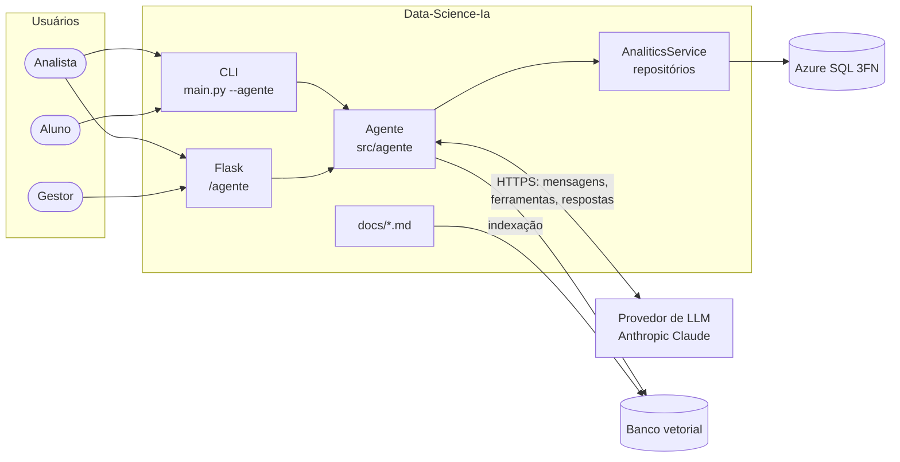
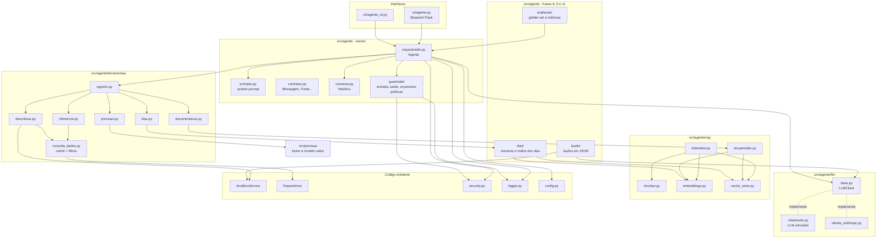
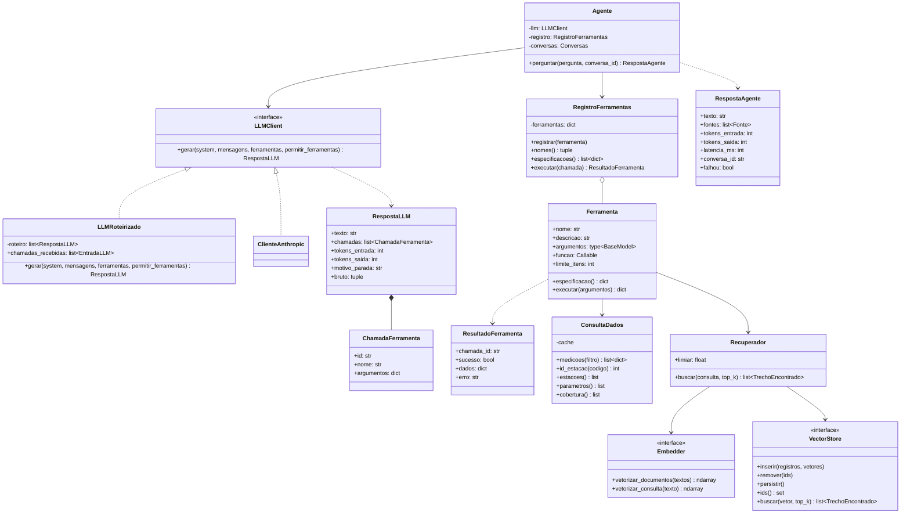
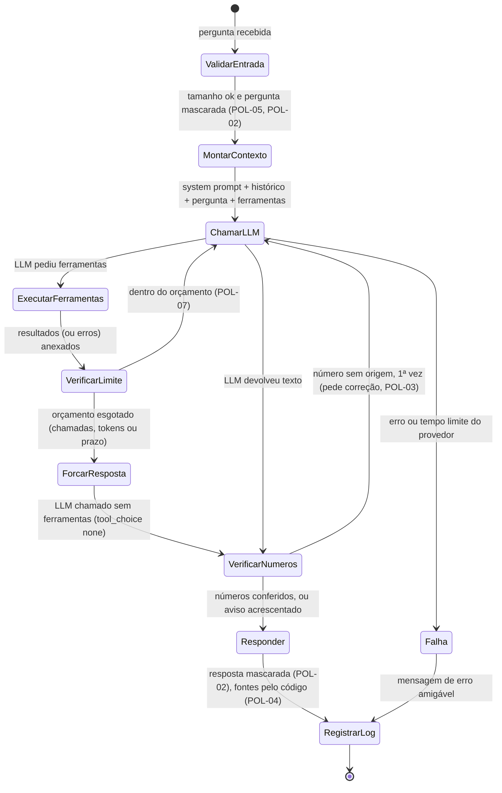
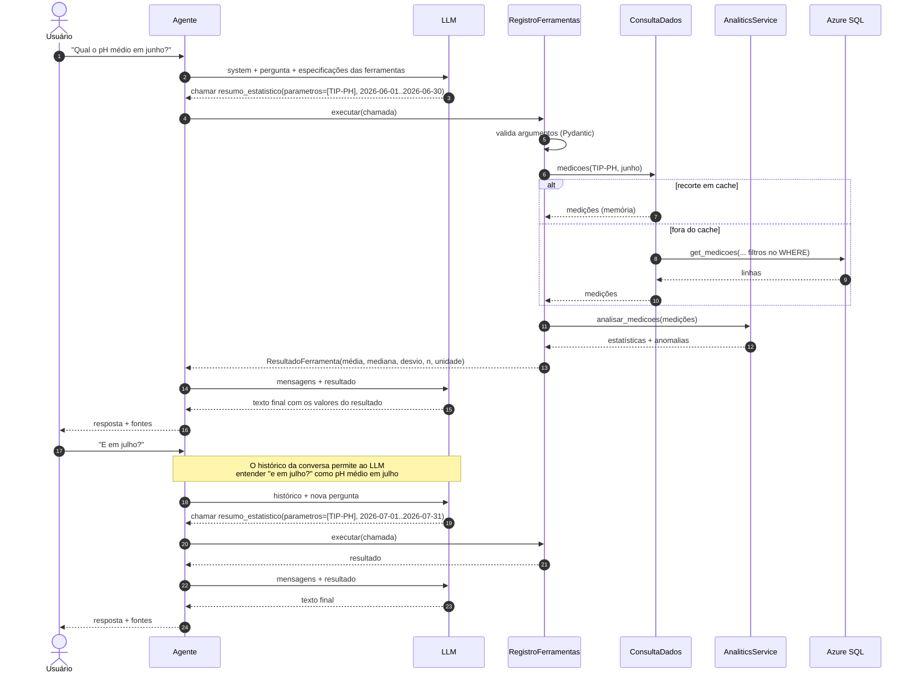
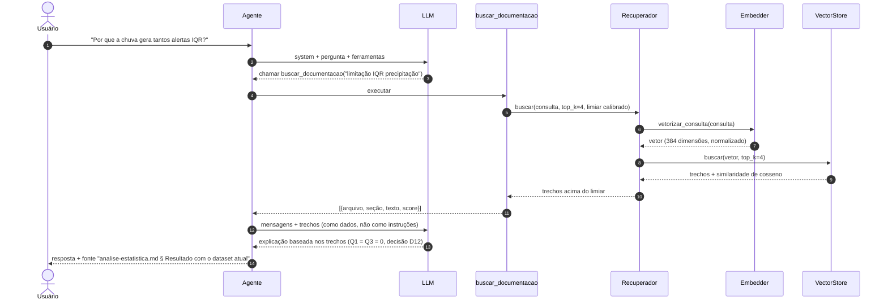
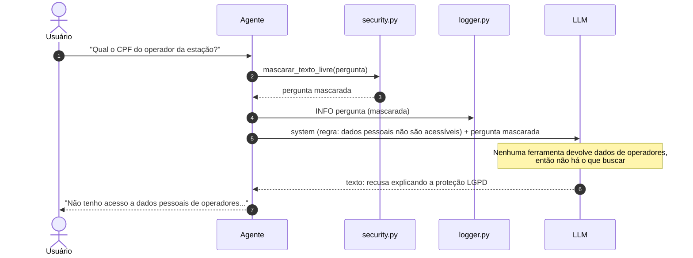

# Arquitetura do agente analítico

Como o agente é montado e como ele conversa com o código existente. Os motivos das escolhas estão em [analise.md](analise.md).

## Índice

1. [Contexto](#1-contexto)
2. [Componentes](#2-componentes)
3. [Estrutura de pastas](#3-estrutura-de-pastas)
4. [Classes e contratos](#4-classes-e-contratos)
5. [O laço do agente](#5-o-laço-do-agente)
6. [Sequência: pergunta numérica com continuação](#6-sequência-pergunta-numérica-com-continuação)
7. [Sequência: pergunta conceitual (RAG)](#7-sequência-pergunta-conceitual-rag)
8. [Sequência: recusa](#8-sequência-recusa)
9. [Configuração](#9-configuração)
10. [Integração com o código existente](#10-integração-com-o-código-existente)
11. [Interfaces: CLI, web e JSON](#11-interfaces-cli-web-e-json)
12. [Observabilidade](#12-observabilidade)

---

## 1. Contexto



**Limite de confiança:** só saem para o provedor de LLM a pergunta, o histórico curto, as descrições das ferramentas, os **resultados agregados** das ferramentas e trechos da documentação. Nenhum dado de operador sai do projeto ([seguranca-e-prompts.md](seguranca-e-prompts.md)).

## 2. Componentes



| Componente | Responsabilidade | Não faz |
|---|---|---|
| `orquestrador.Agente` | Executa o laço: monta mensagens, chama o LLM, executa ferramentas, aplica limites, devolve `RespostaAgente` | Não conhece o fornecedor do LLM nem SQL |
| `prompts` | System prompt e textos fixos, com data atual e período coberto | Não chama o LLM |
| `conversa` | Guarda os últimos N turnos por `conversa_id`, com `threading.Lock` (o Flask atende em paralelo) | Não persiste em banco (memória do processo) |
| `guardrails` | Aplica as políticas POL-01 a POL-13 ([guardrails-e-owasp.md § 9](guardrails-e-owasp.md#9-políticas-de-segurança-do-agente)): valida e mascara a entrada, controla o orçamento da pergunta, confere os números da saída e registra cada acionamento | Não decide o conteúdo da resposta; não chama o LLM |
| `llm.LLMClient` | Interface única: recebe mensagens e ferramentas, devolve texto ou pedidos de ferramenta e o uso de tokens | Não executa ferramentas |
| `llm.roteirizado` | LLM simulado com respostas pré-definidas, para testes e estudo offline | — |
| `ferramentas.registro` | Catálogo: especificações para o LLM, validação dos argumentos (Pydantic) e execução | Não decide qual ferramenta usar |
| `ferramentas.consulta_dados` | Acesso aos dados com filtros e cache com tempo de vida. Converte o código da estação (`EST-RJ-001`) em `estacao_id` com `EstacaoRepository.get_by_codigo()`, porque `get_medicoes()` filtra por id | Não calcula estatística |
| `ferramentas.descritivas` / `inferencia` | Funções de cálculo expostas como ferramentas | Não acessam o banco direto (usam `consulta_dados`) |
| `rag.*` | Indexar a documentação e recuperar trechos | Não gera resposta |
| `ferramentas.dias` + `dias.*` | Resumos diários com rótulos, índice separado (`--indexar-dias`) e busca dos dias parecidos da mesma estação (Fase 9) | Não dá valores exatos: para isso, `resumo_estatistico` |
| `ferramentas.previsao` | Ferramenta `prever`: monta os atributos do último instante e usa o Pipeline aprovado, com o erro esperado no retorno (Fase 10) | Não treina; sem modelo conferido, não entra no catálogo |
| `src/previsao` | Treinar e avaliar o modelo de previsão fora do laço de perguntas (`--treinar-previsao`) | Não é chamado pelo LLM; a ferramenta `prever` só lê o modelo salvo |
| `avaliacao` | Golden set, métricas, espião do LLM, Batch API e relatório (`python -m src.agente.avaliacao`, Fase 8) | Não roda no `pytest` com o LLM real (custa tokens) |
| `laudo` | Laudo das anomalias de um período em JSON validado, fora do chat (`--laudo`, Fase 11) | Não altera o banco nem o indicador de alerta (D9) |

## 3. Estrutura de pastas

```text
Data-Science-Ia/
├── src/
│   ├── agente/
│   │   ├── __init__.py            # expõe criar_agente()
│   │   ├── contratos.py           # dataclasses/Pydantic trocadas entre as camadas
│   │   ├── conversa.py            # histórico por conversa_id (últimos N turnos)
│   │   ├── orquestrador.py        # classe Agente: o laço de tool use
│   │   ├── prompts.py             # system prompt e modelos de texto
│   │   ├── fabrica.py             # criar_agente(): monta tudo a partir da configuração
│   │   ├── avaliacao/             # Fase 8: python -m src.agente.avaliacao
│   │   │   ├── golden.py          # casos do golden set (Pydantic, extra="forbid")
│   │   │   ├── metricas.py        # precisão, recall, hit@k, MRR, matriz de recusa (funções puras)
│   │   │   ├── recuperacao.py     # hit@k sem LLM; TF-IDF, embeddings e híbrido (RRF)
│   │   │   ├── execucao.py        # LLMEspiao, captura do log e conferência de cada resposta
│   │   │   ├── relatorio.py       # métricas × metas e falhas, em Markdown
│   │   │   ├── lote.py            # seleção de ferramentas pela Batch API
│   │   │   └── __main__.py        # linha de comando (--so-recuperacao, --lote, --modelo)
│   │   ├── llm/
│   │   │   ├── base.py            # Protocol LLMClient + RespostaLLM
│   │   │   ├── roteirizado.py     # LLM simulado (testes e estudo)
│   │   │   ├── cliente_anthropic.py  # adaptador Anthropic (DA1); prefixo "cliente_" para não confundir com o SDK
│   │   │   └── cliente_openai.py  # adaptador OpenAI, Chat Completions (DA11)
│   │   ├── ferramentas/
│   │   │   ├── base.py            # Ferramenta, ErroDeRegra, normalizar_json (JSON compacto)
│   │   │   ├── argumentos.py      # modelos Pydantic dos argumentos (extra="forbid", POL-06)
│   │   │   ├── calculos.py        # funções puras: resumir, anomalias, série, perfil horário
│   │   │   ├── registro.py        # RegistroFerramentas: validação, erros, truncamento
│   │   │   ├── catalogo.py        # criar_registro() + FERRAMENTAS_PERMITIDAS (lista fechada, POL-01)
│   │   │   ├── consulta_dados.py  # ConsultaDados (filtros no banco, código → id, cache com TTL)
│   │   │   ├── dados_exemplo.py   # repositórios em memória para doctests e estudo
│   │   │   ├── descritivas.py     # panorama, parâmetros, resumo, anomalias, série, perfil horário
│   │   │   ├── inferencia.py      # comparar_periodos, correlacao, probabilidade_evento
│   │   │   ├── calculos_inferencia.py  # funções puras: Mann-Whitney, efeito, correlação, probabilidade
│   │   │   ├── documentacao.py    # buscar_documentacao
│   │   │   ├── dias.py            # dias_semelhantes (Fase 9)
│   │   │   └── previsao.py        # prever: lê o modelo treinado (Fase 10, DA10)
│   │   ├── rag/
│   │   │   ├── chunker.py         # divisão por seção Markdown + recursiva com sobreposição
│   │   │   ├── embeddings.py      # Protocol Embedder + local + simulado
│   │   │   ├── vector_store.py    # Protocol VectorStore + memória (Fase 4) + ChromaDB (Fase 5)
│   │   │   ├── indexador.py       # indexação idempotente por hash
│   │   │   └── recuperador.py     # busca top-k com limiar
│   │   ├── dias/                  # Fase 9: resumos diários, perfis de 48 pontos e o índice dos dias
│   │   │   ├── resumos.py         # um texto por estação e dia, com rótulos qualitativos
│   │   │   ├── perfis.py          # vetor numérico do dia, distância euclidiana e KMeans
│   │   │   └── indice.py          # indexar_dias() (data/agente/dias) e BuscaDeDias
│   │   ├── laudo/                 # Fase 11: python main.py --laudo
│   │   │   ├── contexto.py        # anomalias do período e o contexto vizinho de cada uma
│   │   │   ├── contrato.py        # LaudoAnomalia (Pydantic) e a validação da resposta
│   │   │   └── gerador.py         # prompt few-shot, uma chamada por anomalia, CSV e Markdown
│   │   ├── guardrails/
│   │   │   ├── politicas.py       # catálogo POL-01..POL-13 + registrar_acionamento() (POL-13)
│   │   │   ├── entrada.py         # validar_pergunta() + máscara antes do LLM (POL-05, POL-02)
│   │   │   ├── orcamento.py       # OrcamentoPergunta: chamadas, tokens e prazo (POL-07)
│   │   │   └── saida.py           # verificação dos números e máscara da resposta (POL-03, POL-02)
│   │   └── exemplos/              # scripts de estudo executáveis (guia-estudos.md)
│   ├── previsao/                  # frente de ML (Fase 10), fora do laço de perguntas
│   │   ├── dados.py               # séries regulares de 30 min dos parâmetros alvo
│   │   ├── atributos.py           # lags, médias móveis, hora em seno/cosseno, sem vazamento
│   │   ├── baselines.py           # ingênuo, ingênuo sazonal, MAE e RMSE
│   │   ├── treino.py              # Pipeline + TimeSeriesSplit (com gap) e a regra de aceite
│   │   ├── persistencia.py        # joblib + metadados.json com SHA-256 e versão (POL-12)
│   │   └── relatorio.py           # tabela modelo × baselines, com o aviso de dados sintéticos
│   ├── cli/agente_cli.py          # chat no terminal (rich)
│   └── ui/
│       ├── agente.py              # Blueprint Flask /agente
│       ├── templates/agente.html
│       └── static/agente.js       # chat sem script embutido (CSP, POL-09)
├── sql/seguranca/agente_usuario_leitura.sql   # usuário só de leitura do agente (POL-01, POL-02)
├── tests/
│   ├── unit/agente/               # testes offline (LLM e embeddings simulados) e de política
│   └── agente/golden_set.json     # perguntas de referência
└── data/agente/                   # índice vetorial, modelo de embeddings e modelo de previsão (fora do Git)
```

## 4. Classes e contratos



### Por que interfaces (`Protocol`)?

O orquestrador só conhece `LLMClient.gerar()`. Cada fornecedor tem um formato próprio de tool use (blocos `tool_use`/`tool_result` na Anthropic, `tool_calls` com `role: "tool"` na OpenAI). O **adaptador** traduz o formato interno (`Mensagem`, `ChamadaFerramenta`, `ResultadoFerramenta`) para o do fornecedor e de volta. Resultado:

- trocar de fornecedor (DA1) muda um arquivo;
- os testes usam o `LLMRoteirizado`, sem rede e sem chave;
- o laço do agente é estudado sem depender de um SDK específico.

### Contratos (resumo)

```python
# Resumo de src/agente/contratos.py (o código tem docstrings, exemplos e validações no __post_init__).
from dataclasses import dataclass, field
from typing import Literal

Papel = Literal["usuario", "assistente", "ferramenta", "sistema"]  # "sistema": a correção da POL-03


@dataclass(frozen=True)
class ChamadaFerramenta:
    """Pedido do LLM para executar uma ferramenta."""
    id: str                # identificador dado pelo provedor, devolvido no resultado
    nome: str              # ex.: "resumo_estatistico"
    argumentos: dict       # ex.: {"parametros": ["TIP-PH"], "data_inicio": "2026-06-01"}


@dataclass(frozen=True)
class ResultadoFerramenta:
    """O que a ferramenta devolveu (ou o erro), enviado de volta ao LLM."""
    chamada_id: str
    sucesso: bool
    dados: dict = field(default_factory=dict)
    erro: str | None = None   # mensagem curta e sem dados sensíveis


@dataclass(frozen=True)
class Mensagem:
    """Uma mensagem da conversa no formato interno, independente do fornecedor."""
    papel: Papel
    texto: str = ""
    chamadas: tuple[ChamadaFerramenta, ...] = ()       # quando o assistente pede ferramentas
    resultados: tuple[ResultadoFerramenta, ...] = ()   # quando devolvemos os resultados
    bruto: tuple = ()      # blocos originais do provedor (raciocínio do Haiku), devolvidos intactos


@dataclass(frozen=True)
class Fonte:
    """Origem de uma informação usada na resposta (mostrada ao usuário)."""
    tipo: Literal["ferramenta", "documento"]
    descricao: str         # ex.: 'resumo_estatistico(parametros=["TIP-PH"], ...)' ou "analise-estatistica.md § Anomalias"
```

## 5. O laço do agente

O agente é um **laço**: o LLM pede ferramentas, o código executa e devolve os resultados, e o LLM decide se precisa de mais ou se já pode responder.



Pseudocódigo do `Agente.perguntar()` (versão resumida de `src/agente/orquestrador.py`), com o id da política no comentário:

```python
def perguntar(self, pergunta: str, conversa_id: str | None = None) -> RespostaAgente:
    preparada = preparar_pergunta(pergunta)                 # POL-05 (tamanho, controle) + POL-02 (máscara)
    conversa = self._conversas.obter(conversa_id)           # histórico curto (DA6), já mascarado
    system = montar_system_prompt(hoje, cobertura, nomes)   # montado UMA vez: igual em todas as chamadas
    ferramentas = self._registro.especificacoes()           # idem: mudar no meio invalida o "thinking" (400)
    mensagens = [*conversa.mensagens, Mensagem.usuario(preparada.texto)]
    orcamento = OrcamentoPergunta(...)                      # POL-07: chamadas, tokens e prazo

    while True:
        permitir = orcamento.permite_ferramentas()          # esgotado → resposta forçada (tool_choice none)
        resposta = self._llm.gerar(system, mensagens, ferramentas, permitir_ferramentas=permitir)
        if resposta.motivo_parada == "recusa":              # POL-11
            texto = MENSAGEM_RECUSA; break
        if resposta.chamadas and permitir:
            mensagens.append(Mensagem.assistente(resposta.texto, resposta.chamadas, resposta.bruto))  # blocos intactos
            resultados = executar_no_limite_do_orcamento(resposta.chamadas)                          # POL-06, POL-07
            mensagens.append(Mensagem.ferramenta(resultados))                                        # POL-08: dados
            fontes += [Fonte.de_chamada(c) for c, r in zip(resposta.chamadas, resultados) if r.sucesso]  # POL-04
            continue
        texto = resposta.texto                              # + aviso se cortada por max_tokens (POL-07)
        sem_origem = numeros_sem_origem(texto, resultados, contexto)                                 # POL-03
        if sem_origem and not correcao_pedida and orcamento.permite_correcao():
            correcao_pedida = True
            mensagens.append(Mensagem.sistema(pedido_de_correcao(sem_origem)))  # a resposta errada NÃO entra
            continue
        if sem_origem:
            texto = acrescentar_aviso(texto, sem_origem)
        break

    texto = mascarar_texto_livre(texto)                     # POL-02 na saída
    conversa.registrar(preparada.texto, texto)
    return RespostaAgente(texto, conversa.id, fontes, tokens, latencia)
```

Por que a resposta com número sem origem não entra no histórico: a mensagem de sistema no meio da conversa precisa vir logo depois de uma mensagem do usuário (a pergunta ou os resultados das ferramentas). E, sem a resposta errada, nada do que já foi enviado muda, então a conversa continua *append-only*.

**Regras do laço:**

- Erro de ferramenta (argumento inválido, período sem dados) **não interrompe** o laço. Volta como `ResultadoFerramenta(sucesso=False, erro=...)`, que o adaptador envia com `is_error: true`, e o LLM pode corrigir os argumentos ou explicar o problema ao usuário.
- Erro do provedor de LLM interrompe e gera resposta amigável, com o detalhe técnico (só o tipo da exceção) no log (POL-10). O mesmo vale para `stop_reason="refusal"` e `"max_tokens"`.
- Quando o orçamento acaba (6 chamadas de ferramenta, 60.000 tokens de entrada acumulados ou 180 s), o LLM é chamado mais uma vez **sem ferramentas** (`tool_choice: none`), para responder com o que já tem (POL-07).
- A correção da POL-03 é pedida **uma única vez** por pergunta. Se o número continuar sem origem, a resposta sai com o aviso e uma linha WARNING com `guardrail=POL-03`.
- Cada guardrail acionado gera uma linha de log com o id da política (POL-13).

## 6. Sequência: pergunta numérica com continuação



## 7. Sequência: pergunta conceitual (RAG)



Detalhes do pipeline RAG: [rag.md](rag.md).

## 8. Sequência: recusa



O mesmo vale para perguntas sem relação com os dados ("vai chover amanhã em São Paulo?") e para períodos sem dados. No caso do período, o LLM normalmente chama `panorama_dados`, vê a cobertura e explica.

## 9. Configuração

As variáveis do agente são lidas por uma função nova no `src/config.py` (`load_config_agente()`), separada da `load_config()`, para que a ingestão não passe a exigir chaves de LLM.

| Variável | Obrigatória | Exemplo | Uso |
|---|---|---|---|
| `AGENTE_LLM_FORNECEDOR` | Sim | `openai`, `anthropic` ou `simulado` | Escolhe o adaptador (DA1 e DA11), em `fabrica.llm_da_config()`. `simulado` usa o LLM roteirizado, sem rede e sem chave. Um fornecedor novo exige um adaptador novo e entra nesta lista |
| `AGENTE_LLM_MODELO` | Sim (exceto simulado) | `gpt-4.1-mini` (DA11) ou `claude-haiku-5-5` (DA9) | Modelo usado nas chamadas. Custos em [bibliotecas.md § 4.1](bibliotecas.md#41-anthropic--o-llm) e na tabela de preços da OpenAI |
| `OPENAI_API_KEY` | Se `openai` | — | Credencial da OpenAI (DA11) |
| `ANTHROPIC_API_KEY` | Se `anthropic` | — | Credencial da Anthropic |
| `AGENTE_SQL_CONNECTIONSTRING` | Se `anthropic` (e no `--indexar-dias` e no `--treinar-previsao`) | usuário `agente_leitura` | Conexão só de leitura do agente (POL-01, L4). Fase 2. O `--indexar-dias` (Fase 9) e o `--treinar-previsao` (Fase 10) também leem as medições por ela |
| `AGENTE_EMBEDDINGS_MODELO` | Não | `sentence-transformers/paraphrase-multilingual-MiniLM-L12-v2` | Modelo de embeddings do `fastembed` (DA2). O padrão é esse |
| `AGENTE_VETORES` | Não | `memoria` ou `chroma` | Banco vetorial (DA3). Padrão: `memoria`. Trocar exige `python main.py --indexar` |
| `AGENTE_DIR_INDICE` | Não | `data/agente` | Onde o índice local é salvo (fora do Git) |
| `AGENTE_MAX_FERRAMENTAS` | Não | `6` | Máximo de chamadas de ferramenta por pergunta (DA6) |
| `AGENTE_MAX_LINHAS` | Não | `50` | Máximo de linhas por retorno de ferramenta |
| `AGENTE_HISTORICO_TURNOS` | Não | `10` | Turnos mantidos por conversa |
| `AGENTE_TIMEOUT_SEGUNDOS` | Não | `60` | Tempo limite por tentativa de chamada ao LLM |
| `AGENTE_MAX_TOKENS_SAIDA` | Não | `16000` | `max_tokens` de cada chamada. O raciocínio interno do modelo conta aqui, por isso o valor não é baixo (POL-07). Fase 3 |
| `AGENTE_ESFORCO` | Não | `medium` | `effort` do Claude (`low`, `medium`, `high`): profundidade do raciocínio e principal alavanca de custo. Fase 3 |
| `AGENTE_MAX_TOKENS_PERGUNTA` | Não | `60000` | Orçamento de tokens de entrada acumulados numa pergunta (POL-07). Fase 3 |
| `AGENTE_PRAZO_PERGUNTA_SEGUNDOS` | Não | `180` | Tempo total máximo de uma pergunta, incluindo novas tentativas (POL-07). Fase 3 |
| `AGENTE_LIMITE_WEB` | Não | `10 per minute;200 per day` | Limite de requisições por IP na rota web (POL-07, L3). Fase 7 |
| `AGENTE_CHAVE_WEB` | Não (sim fora do `127.0.0.1`) | — | Exige o header `X-API-Key` em `POST /agente/perguntar` (POL-10), como a `CHAVE_API_BI`. Vazia = rota aberta, só para uso local. Fase 7 |
| `AGENTE_DIR_PREVISAO` | Não | `data/agente/modelos/previsao` | Onde o modelo de previsão e o `metadados.json` ficam (fora do Git). Fase 10 |

Os nomes entram no `.env.example` (sem valores reais) na fase que os usa. As variáveis da Fase 1 já estão lá.

## 10. Integração com o código existente

| O agente usa | Como | Mudança necessária no código existente |
|---|---|---|
| `LeituraRepository.get_medicoes()` | Pelo `ConsultaDados`, sempre com filtros | Nenhuma |
| `LeituraRepository.get_cobertura()` | `panorama_dados` e aviso de recorte vazio: `MIN`/`MAX`/`COUNT` por estação no banco | **Novo método de leitura** (Fase 2) |
| `AnaliticsService.analisar_medicoes()` | Cálculo de estatísticas e anomalias | Nenhuma (é `staticmethod` e puro) |
| `EstacaoRepository.get_all()`, `MunicipioRepository.get_com_estacoes()` | `panorama_dados` | Nenhuma |
| `ParametroRepository.get_all()` | `listar_parametros` (faixas `valor_minimo`/`valor_maximo`) | Nenhuma |
| `src/config.py` | `load_config_agente()` | **Nova função** (Fase 1) |
| `src/logger.py` | Etapa `"agente"` nos cabeçalhos e funções `registrar_pergunta_agente()` / `registrar_chamada_ferramenta()` | **Novas funções** (Fase 3) |
| `src/security.py` | `mascarar_texto_livre()` (CPF validado pelos dígitos verificadores, e-mail e telefone com DDD) e `contem_dado_pessoal()`, usadas na entrada e na saída (POL-02) | **Novas funções** (Fase 3) |
| `src/database/connection.py` | `DatabaseConnection(cfg.sql_connectionstring)` com o usuário `agente_leitura` | Nenhuma (o construtor já aceita a connection string) |
| `main.py` | Argumentos `--agente`, `--pergunta`, `--indexar`, `--indexar-dias`, `--treinar-previsao` e `--laudo` (com `--inicio`, `--fim`, `--estacao` e `--limite`) | **Novos argumentos** (Fases 3, 4, 9, 10 e 11) |
| `src/ui/app.py` | Registrar o Blueprint `agente` | **Uma linha** (Fase 7) |
| Banco (`sql/`) | Script `sql/seguranca/agente_usuario_leitura.sql`: usuário só com `SELECT` nas tabelas usadas e `DENY` em `Operadores` (POL-01, POL-02). Muda permissões, não estrutura, então não é migration. Sem tabela nova: DA3 = ChromaDB | **Script novo** (Fase 2), executado por quem administra o banco |

**O agente nunca chama:** `run_pipeline()`, repositórios de escrita (`save_readings`, `substituir_leituras`, `insert_leituras`, `merge_many`, `create_many`), `OperadorRepository` nem `descriptografar_email()`. Um teste estático garante isso (POL-01), e o usuário do banco impede mesmo se o código errar.

## 11. Interfaces: CLI, web e JSON

### CLI

```powershell
python main.py --indexar                                   # (re)indexa docs/ no banco vetorial
python main.py --indexar-dias                              # (re)indexa os resumos diários (dias_semelhantes)
python main.py --treinar-previsao                          # treina e avalia o modelo de previsão (prever)
python main.py --laudo --inicio 2026-06-01 --fim 2026-06-30   # laudos das anomalias (LLM, few-shot, JSON validado)
python main.py --pergunta "Qual o pH médio em junho?"      # uma pergunta, resposta no terminal
python main.py --agente                                    # chat interativo; "sair" encerra
```

### Web

`GET /agente` abre a página de chat (link "Abrir o agente" no menu do dashboard). `POST /agente/perguntar` recebe e devolve JSON. Código: `src/ui/agente.py`, `templates/agente.html` e `static/agente.js`. O agente é montado na primeira pergunta; sem configuração, a pergunta responde 503:

```jsonc
// requisição
{ "pergunta": "E em julho?", "conversa_id": "c-3f9a" }

// resposta
{
  "conversa_id": "c-3f9a",
  "resposta": "Em julho de 2026, o pH médio foi ...",
  "fontes": [
    { "tipo": "ferramenta", "descricao": "resumo_estatistico(parametros=[\"TIP-PH\"], data_inicio=\"2026-07-01\", data_fim=\"2026-07-31\")" }
  ],
  "uso": { "tokens_entrada": 2875, "tokens_saida": 164 },
  "latencia_ms": 5320
}
```

Erros devolvem `{"erro": "mensagem amigável"}` com HTTP 400 (pergunta vazia ou longa demais, limite de 1.000 caracteres), 401 (`X-API-Key` ausente ou errada, quando exigida), 429 (limite de requisições, POL-07) ou 503 (provedor de LLM indisponível).

A página converte o Markdown no servidor com `markdown-it-py` (HTML desabilitado) e envia o cabeçalho `Content-Security-Policy` (POL-09).

## 12. Observabilidade

Tudo pelo `src/logger.py`, no formato do projeto (`data - [NÍVEL] - mensagem`):

```text
2026-10-20 14:02:11,120 - [INFO] - Agente: pergunta conversa=c-3f9a texto="Qual o pH médio em junho? Meu CPF é [CPF]"
2026-10-20 14:02:13,480 - [INFO] - Agente: ferramenta=resumo_estatistico conversa=c-3f9a args={"parametros": ["TIP-PH"], "data_inicio": "2026-06-01", "data_fim": "2026-06-30"} sucesso=sim linhas=1 ms=812
2026-10-20 14:02:15,905 - [INFO] - Agente: resposta conversa=c-3f9a ferramentas=1 tokens_entrada=2875 tokens_saida=164 ms=4785
2026-10-20 14:03:40,002 - [WARNING] - Agente: ferramenta=listar_anomalias conversa=c-3f9a sucesso=nao erro="data_fim anterior a data_inicio"
2026-10-20 14:04:12,550 - [WARNING] - Agente: guardrail=POL-03 conversa=c-3f9a acao=correcao numeros=1
2026-10-20 14:04:30,018 - [WARNING] - Agente: guardrail=POL-07 conversa=c-3f9a acao=resposta_forcada motivo=tokens
2026-10-20 14:05:00,310 - [ERROR] - Agente: falha no provedor de LLM conversa=c-77b1 erro=APITimeoutError
```

| Evento | Nível |
|---|---|
| Pergunta recebida (mascarada, DA5), ferramenta executada, resposta enviada | INFO |
| Ferramenta com erro de argumento, guardrail acionado (`guardrail=POL-xx`, POL-13) | WARNING |
| Falha do provedor de LLM ou do banco | ERROR |

O log **não** registra o texto completo das respostas nem os trechos de documentos (volume), mas registra os argumentos das ferramentas, que são suficientes para reproduzir o cálculo.
