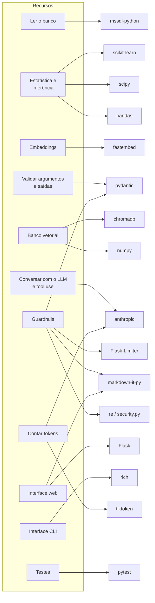

OWASP # Bibliotecas e tecnologias do agente

Quais bibliotecas Python e tecnologias o agente usa, **para qual recurso**, **por que** cada uma foi escolhida, quais alternativas foram descartadas e um exemplo de uso de cada uma.

Instalação conferida em **21/10/2026** no Python 3.14.7 da `.venv` (`pip install --dry-run`). As decisões estão em [analise.md § 8](analise.md#8-decisões-pendentes).

## Índice

1. [Respostas diretas](#1-respostas-diretas)
2. [Mapa: recurso → biblioteca](#2-mapa-recurso--biblioteca)
3. [Tabela completa](#3-tabela-completa)
4. [Detalhamento por biblioteca](#4-detalhamento-por-biblioteca)
5. [Biblioteca padrão do Python](#5-biblioteca-padrão-do-python)
6. [Tecnologias dos guardrails](#6-tecnologias-dos-guardrails)
7. [Alternativas descartadas](#7-alternativas-descartadas)
8. [Como as dependências entram no projeto](#8-como-as-dependências-entram-no-projeto)

---

## 1. Respostas diretas

### Qual biblioteca gera os embeddings?

**`fastembed`** (da Qdrant), com o modelo **`sentence-transformers/paraphrase-multilingual-MiniLM-L12-v2`** (decisão DA2).

- **Embedding** é um vetor de números que representa o significado de um texto. Textos com significado parecido ficam com vetores próximos. Exemplo: "acidez da água" fica perto de "pH" e longe de "velocidade do vento".
- O `fastembed` roda o modelo localmente pelo **ONNX Runtime**, um motor de execução de modelos leve, sem precisar do PyTorch, que tem cerca de 2 GB.
- O modelo é **multilíngue** (inclui português), gera vetores de **384 dimensões** e ocupa cerca de 0,22 GB.
- **Por que não outro:** o `intfloat/multilingual-e5-small`, previsto no planejamento inicial, não existe no catálogo do `fastembed`. Usá-lo exigiria o `sentence-transformers` com PyTorch. Uma API paga (OpenAI, Voyage) enviaria a documentação para fora da máquina e teria custo por chamada.
- Nos testes, o `EmbedderSimulado` (código próprio com `hashlib`) substitui o modelo, sem download.

### Qual biblioteca é o banco vetorial, e por quê?

São duas etapas (decisão DA3):

| Fase | Tecnologia | Por quê |
|---|---|---|
| 4 | **numpy** (código próprio, `VectorStoreMemoria`, salvo em arquivo `.npz`) | Didático: mostra que um banco vetorial é, no fundo, "multiplicar uma matriz por um vetor e ordenar". Com cerca de 400 trechos, a busca exata é instantânea |
| 5 | **ChromaDB** (`chromadb`), local em `data/agente/chroma` | Um banco vetorial de verdade, com índice **HNSW** e persistência em disco, sem servidor, sem migration e sem custo. Instala no Python 3.14 |

- **Banco vetorial** guarda os embeddings dos trechos e responde "quais trechos têm o vetor mais parecido com o desta pergunta?".
- **HNSW** (*Hierarchical Navigable Small World*) é um índice **aproximado**. Em vez de comparar a pergunta com todos os vetores, ele navega por um grafo de vizinhos. Só compensa com centenas de milhares de vetores, mas é o que os bancos vetoriais usam na prática, e a Fase 5 serve para estudá-lo.
- **Por que não o Azure SQL (`VECTOR`):** exigiria a migration `V003`, o recurso disponível no tier e acesso de rede a cada busca. O ganho (índice compartilhado pelo time) não compensa para um corpus pequeno e versionado no Git.
- As duas implementações seguem a mesma interface (`VectorStore`), e o teste de contrato roda contra ambas.

### Qual biblioteca ou tecnologia faz os guardrails?

**Código próprio**, apoiado em bibliotecas que o projeto já usa (decisão DA8). Não há framework de guardrails.

- **Guardrail** é o mecanismo que impõe uma política ao agente. Exemplo: "o agente não grava no banco" é imposto por não existir ferramenta de escrita e pelo usuário do banco só ter permissão de leitura. Conceitos em [guardrails-e-owasp.md](guardrails-e-owasp.md).

| Guardrail | Tecnologia |
|---|---|
| Validar argumentos das ferramentas e saídas estruturadas | **Pydantic** (`extra="forbid"`, tipos, enums, validadores) + `strict: true` no schema enviado ao Claude |
| Mascarar CPF, e-mail e telefone | **`re`** (expressões regulares) + verificação dos dígitos do CPF, em `src/security.py` |
| Limites de chamadas, tokens e tempo | Código do orquestrador (`src/agente/guardrails/orcamento.py`) + parâmetros do SDK `anthropic` (`max_tokens`, `timeout`, `max_retries`) |
| Conferir os números da resposta | Código próprio (`src/agente/guardrails/saida.py`) com `re` e `json` |
| Limitar requisições na web | **Flask-Limiter** |
| Exibir a resposta com segurança no navegador | **markdown-it-py** (HTML desabilitado) + escape automático do **Jinja2** do Flask |
| Impedir escrita e leitura de dados pessoais de `Operadores` no banco | **Permissões do Azure SQL** (usuário só com `SELECT` nas tabelas necessárias e só o código de `Operadores` (nome, CPF, e-mail e município negados por coluna)) |
| Verificar se o código respeita as políticas | **pytest** (teste estático de nomes proibidos e teste de PII nos retornos) |

**Por que não um framework:** o NeMo Guardrails não instala no Python 3.14. O Guardrails AI traz dezenas de dependências e depende de cadastro no Hub. O Presidio exige um modelo de português de cerca de 500 MB. Os guardrails deste agente são regras **determinísticas e baratas** (rodam em microssegundos, sem chamar outro modelo), que um framework não faria melhor ([seção 7](#7-alternativas-descartadas)).

### Qual biblioteca fala com o LLM?

**`anthropic`**, o SDK oficial da Anthropic para Python (decisão DA1), versão 1.x. Modelo: **`claude-haiku-5-5`** (decisão DA9), escolhido pelo custo, cerca de 40 vezes menor que o do Opus ([seção 4.1](#41-anthropic--o-llm)).

### Qual biblioteca conta tokens?

- **Exato, para o Claude:** a própria API, com `client.messages.count_tokens(...)`, e o campo `usage` de cada resposta.
- **Estudo e estimativa offline:** **`tiktoken`**, o tokenizador da OpenAI, usado no `ia_gen_1.py` do módulo e no exemplo `e01_tokens`. Para o Claude, o resultado é só uma aproximação.

## 2. Mapa: recurso → biblioteca



## 3. Tabela completa

"No projeto" = já está no `requirements.txt` hoje.

| Biblioteca | Versão conferida | Recurso no agente | Fase | Onde no código | No projeto |
|---|---|---|---|---|---|
| `anthropic` | 1.17 | Cliente do Claude: mensagens, tool use, tokens, erros | 3 | `llm/cliente_anthropic.py` | Sim (Fase 3) |
| `openai` | 3.36 | Cliente da OpenAI (Chat Completions): mensagens, function tools, tokens, erros | DA11 | `llm/cliente_openai.py` | Sim (DA11) |
| `httpx2` | — | Cliente HTTP usado pelo `anthropic` 1.x (e pelo `TestClient` da API) | 3 | indireto | Sim |
| `pydantic` | 2.13 | Parâmetros das ferramentas, JSON Schema, laudo JSON, guardrails | 2 | `ferramentas/*.py`, `guardrails/` | Sim |
| `tiktoken` | 0.14 | Estimar tokens no estudo (aproximação) | 1 | `exemplos/e01_tokens.py` | Sim |
| `fastembed` | 0.9 | Gerar embeddings localmente (ONNX) | 4 | `rag/embeddings.py` | Sim (Fase 4) |
| `numpy` | 2.5 | Vetores, similaridade de cosseno, índice em memória | 4 | `rag/vector_store.py` | Sim (via pandas) |
| `chromadb` | 1.5.9 | Banco vetorial persistente com HNSW | 5 | `rag/vector_store.py` | Sim (Fase 5) |
| `pandas` | 3.0 | Séries temporais (`resample`), perfil horário (`groupby`), `pivot` para correlação | 2 | `ferramentas/descritivas.py`, `inferencia.py` | Sim |
| `scipy` | 1.18 | Mann-Whitney, Spearman, Pearson | 6 | `ferramentas/calculos_inferencia.py` | Sim (Fase 6) |
| `scikit-learn` | 1.9 | TF-IDF (baseline do RAG), KMeans (dias semelhantes), `Pipeline`, `Ridge`, `HistGradientBoostingRegressor` e `TimeSeriesSplit` (previsão) | 8, 9 e 10 | `avaliacao/recuperacao.py` (TF-IDF), `dias/perfis.py` (KMeans e silhueta), `src/previsao/treino.py` (`Pipeline`, `Ridge`, `HistGradientBoostingRegressor`, `TimeSeriesSplit`) | Sim (Fase 8) |
| `joblib` | 1.6 | Salvar e carregar o modelo de previsão | 10 | `src/previsao/persistencia.py` | Sim (Fase 10, declarado explicitamente) |
| `mssql-python` | 1.15 | Leitura do Azure SQL, pelos repositórios existentes | 2 | `ferramentas/consulta_dados.py` → `src/repository/` | Sim |
| `python-dotenv` | — | Ler o `.env` | 1 | `src/config.py` | Sim |
| `flask` (+ Jinja2) | 3.1 | Página `/agente` e rota JSON | 7 | `src/ui/agente.py` | Sim |
| `Flask-Limiter` | 4.1.1 | Limite de requisições por IP | 7 | `src/ui/agente.py` | Sim (Fase 7) |
| `markdown-it-py` | 4.2 | Converter o Markdown da resposta em HTML seguro | 7 | `src/ui/agente.py` | Sim (Fase 7; também vem com o `rich`) |
| `rich` | 15.0 | Chat bonito no terminal | 3 | `src/cli/agente_cli.py` | Sim |
| `pytest` | 9.1 | Testes, doctests e testes de política | todas | `tests/unit/agente/` | Sim |

## 4. Detalhamento por biblioteca

Cada item responde: o que é, para que serve no agente, por que foi escolhida, um exemplo e os cuidados.

### 4.1 `anthropic` — o LLM

**O que é:** o SDK (*Software Development Kit*) oficial da Anthropic. Ele encapsula as chamadas HTTP à API do Claude e trata autenticação, novas tentativas e erros.

**Para que serve no agente:** só dentro do adaptador `llm/cliente_anthropic.py`, que traduz o formato interno (`Mensagem`, `ChamadaFerramenta`, `ResultadoFerramenta`) para o da API e de volta. Nenhum outro arquivo importa `anthropic`.

**Por que:** decisão DA1. O SDK oficial tem tipos, erros específicos e novas tentativas automáticas. O *tool use* do Claude é o mecanismo central do agente.

**Exemplo** (o que o adaptador faz numa rodada):

```python
import json
import anthropic

cliente = anthropic.Anthropic(
    api_key=cfg.anthropic_api_key,   # vem de load_config_agente(), nunca escrita no código
    timeout=60.0,                    # segundos por tentativa (AGENTE_TIMEOUT_SEGUNDOS)
    max_retries=2,                   # novas tentativas em 429, 5xx e falha de rede
)

resposta = cliente.messages.create(
    model="claude-haiku-5-5",
    max_tokens=16000,                     # teto da resposta (o raciocínio interno conta aqui)
    output_config={"effort": "medium"},   # profundidade do raciocínio: alavanca de custo
    system=system_prompt,
    tools=[{
        "name": "resumo_estatistico",
        "description": "Calcula estatísticas descritivas... Use para perguntas numéricas.",
        "input_schema": ParametrosResumo.model_json_schema(),
        "strict": True,                   # o Claude só gera argumentos válidos para o schema
    }],
    messages=[{"role": "user", "content": "Qual o pH médio em junho?"}],
)

for bloco in resposta.content:
    if bloco.type == "tool_use":          # o LLM pediu uma ferramenta
        print(bloco.id, bloco.name, bloco.input)

print(resposta.stop_reason)               # "tool_use", "end_turn", "max_tokens" ou "refusal"
print(resposta.usage.input_tokens, resposta.usage.output_tokens)
```

Resultado de ferramenta devolvido ao Claude. Todos os resultados de uma rodada vão numa **única** mensagem, e um erro vai marcado com `is_error`:

```python
{"role": "user", "content": [
    {"type": "tool_result", "tool_use_id": "toolu_01...", "content": json.dumps(dados)},
    {"type": "tool_result", "tool_use_id": "toolu_02...", "content": "data_fim anterior a data_inicio", "is_error": True},
]}
```

**Cuidados:**

- **Resposta forçada sem ferramentas:** usar `tool_choice={"type": "none"}`. É a forma que funciona em todos os modelos atuais: o Opus 5.5 e o Sonnet 5.5 recusam as formas que obrigam a chamar uma ferramenta (`any` e `tool`). Usá-la desde já permite trocar de modelo sem mudar o adaptador.
- **`stop_reason`:** `"max_tokens"` significa resposta cortada, e `"refusal"` significa recusa do modelo por segurança. As duas viram mensagem amigável e log. O Haiku 5.5 **não** tem o fallback do servidor (reprocessar a pergunta recusada em outro modelo), então uma recusa vira só a mensagem amigável.
- **Erros tipados**, tratados do mais específico para o mais geral: `AuthenticationError` (chave inválida), `RateLimitError` (limite de uso), `APITimeoutError`, `APIConnectionError` (rede) e `APIStatusError` (outros). No log, só o **tipo** da exceção, nunca a chave.
- **Tempo total:** o `timeout` vale por tentativa. Com `max_retries=2`, uma chamada pode levar até 3 × 60 s. O orçamento da pergunta limita o tempo total ([seção 6](#6-tecnologias-dos-guardrails)).
- **Cache de prompt:** o system prompt e as especificações das ferramentas são iguais em toda pergunta. Marcar `cache_control` reduz o custo, mas qualquer byte diferente invalida o cache. Por isso, no system prompt entra a **data** (muda uma vez por dia), nunca a hora.
- **Raciocínio interno:** no Haiku 5.5 ele está ligado por padrão e conta no `max_tokens`. A resposta pode começar com blocos `thinking`, então o adaptador lê os blocos pelo `type`, nunca pela posição (`content[0]`), e devolve os blocos `thinking` intactos junto com os resultados das ferramentas.
- **Parâmetros de amostragem:** o Haiku 5.5 recusa `temperature`, `top_p` e `top_k` diferentes do padrão (erro 400). O adaptador não os envia. No adaptador da OpenAI, os modelos que não são de raciocínio (como o `gpt-4.1-mini`) recebem `temperature=0` desde 23/10/2026: com o padrão (1,0), a mesma pergunta às vezes recusava e às vezes respondia. Os modelos de raciocínio (`o*`, `gpt-5*`) não aceitam o parâmetro e recebem só o `reasoning_effort`.
- **Modelo e custo (DA9):** `claude-haiku-5-5`. Preços conferidos em 21/10/2026, por milhão de tokens de entrada/saída: Haiku 5.5 US$ 0,10 / US$ 0,50 (pedidos de até 100 mil tokens), Sonnet 5.5 US$ 2 / US$ 10, Opus 5.5 US$ 4 / US$ 20. Estimativa por pergunta típica (~4.400 tokens de entrada e ~1.500 de saída): Haiku ~US$ 0,001, Sonnet ~US$ 0,02, Opus ~US$ 0,05. O Sonnet pode ser usado numa comparação pontual na Fase 8, só trocando `AGENTE_LLM_MODELO`. Os preços mudam e ficam fora do código.
- **Batch API:** processamento assíncrono (até 24 h) com 50% de desconto. Serve para rodar o golden set inteiro na Fase 8 (`client.messages.batches.create(...)`).
- **Limite de gasto:** configurar um teto mensal no Console da Anthropic antes de usar a chave. É um guardrail de custo fora do código (POL-07).

### 4.2 `pydantic` — validação e JSON Schema

**O que é:** biblioteca de validação de dados por tipos. Você descreve os campos numa classe, e ela confere e converte o que chega.

**Para que serve no agente:**
1. Parâmetros de cada ferramenta (`ParametrosResumo`...). O mesmo modelo gera o **JSON Schema** enviado ao LLM e valida os argumentos que voltam.
2. Saída estruturada do laudo (`LaudoAnomalia`, Fase 11).
3. Guardrails de entrada (`PerguntaValidada`).

**Por que:** já está no projeto, e o modelo é escrito uma vez só e serve de documentação, schema e validação. Ele também evita o erro do `ia_gen_2.py` do módulo (campo `nivel_insatisfeito` × `nivel_insatisfacao`).

**Exemplo:**

```python
from datetime import date
from pydantic import BaseModel, ConfigDict, Field, ValidationError

class ParametrosResumo(BaseModel):
    """Argumentos de resumo_estatistico."""
    model_config = ConfigDict(extra="forbid")   # argumento desconhecido = erro (guardrail POL-06)

    parametros: list[str] | None = Field(None, description='Códigos, ex.: ["TIP-PH"].')
    data_inicio: date | None = Field(None, description="AAAA-MM-DD.")

ParametrosResumo.model_json_schema()   # vira o input_schema da ferramenta
try:
    ParametrosResumo.model_validate({"parametros": ["TIP-PH"], "apagar_tudo": True})
except ValidationError as erro:
    print(erro.errors()[0]["type"])     # 'extra_forbidden'
```

**Cuidado:** o `strict: true` do Claude exige `additionalProperties: false` no schema, que o `extra="forbid"` gera. Ele também tem tetos por pedido (24 parâmetros opcionais, 16 com `anyOf`, 20 ferramentas): o adaptador aplica o `strict` em ordem enquanto cabe, e as ferramentas que passam do teto vão sem ele, com aviso no log (desde a Fase 6, `correlacao`, `probabilidade_evento` e `buscar_documentacao`). Conferir na Fase 3 as demais regras do modo strict para os campos opcionais. A validação Pydantic continua obrigatória mesmo com `strict`: o schema garante a forma, e o Pydantic garante as regras (ex.: `data_fim >= data_inicio`).

### 4.3 `tiktoken` — tokens no estudo

**O que é:** o tokenizador da OpenAI. Ele divide o texto em **tokens**, as unidades que o LLM processa e pelas quais cobra.

**Para que serve no agente:** só no exemplo `e01_tokens` (ver por que as especificações das ferramentas pesam mais que o system prompt) e no estudo do `ia_gen_1.py`.

**Exemplo:**

```python
import tiktoken
codificacao = tiktoken.get_encoding("o200k_base")
len(codificacao.encode("Qual foi o pH médio em junho?"))   # alguns poucos tokens
```

**Cuidados:** cada modelo tem o próprio tokenizador, então para o Claude o número é aproximado. A contagem exata vem de `client.messages.count_tokens(...)` ou do `usage` da resposta. Na primeira execução, o `tiktoken` baixa a codificação da internet, por isso nenhum teste depende dele (ponto P1).

### 4.4 `fastembed` — embeddings

**O que é:** biblioteca da Qdrant que gera embeddings com modelos em formato **ONNX** (*Open Neural Network Exchange*, um formato portátil de modelos) executados pelo `onnxruntime`.

**Para que serve no agente:** `EmbedderFastembed` em `rag/embeddings.py`. Vetoriza os trechos da documentação na indexação e a consulta a cada `buscar_documentacao`.

**Por que:** decisão DA2 ([seção 1](#qual-biblioteca-gera-os-embeddings)).

**Exemplo:**

```python
import numpy as np
from fastembed import TextEmbedding

modelo = TextEmbedding("sentence-transformers/paraphrase-multilingual-MiniLM-L12-v2")
textos = ["O pH mede a acidez da água.", "Velocidade do vento em m/s."]
vetores = np.array(list(modelo.embed(textos)))           # matriz (2, 384)
vetores /= np.linalg.norm(vetores, axis=1, keepdims=True) # norma 1: cosseno = produto escalar
consulta = np.array(list(modelo.embed(["acidez da água"])))[0]
consulta /= np.linalg.norm(consulta)
print(vetores @ consulta)   # o primeiro texto tem similaridade maior
```

**Cuidados:**
- O primeiro uso baixa o modelo (cerca de 0,22 GB) do Hugging Face para o cache local. Os testes usam o `EmbedderSimulado`.
- O `modelo` entra no hash de cada trecho: trocar o modelo reindexa tudo.
- O `onnxruntime` também é usado pelo `chromadb`, então as duas bibliotecas compartilham essa dependência.

### 4.5 `numpy` — vetores e índice em memória

**O que é:** a biblioteca de arrays numéricos do Python. O `pandas`, o `scipy` e o `fastembed` são construídos sobre ela.

**Para que serve no agente:** `VectorStoreMemoria` (Fase 4). Busca por similaridade de cosseno com uma multiplicação de matriz.

**Exemplo:**

```python
import numpy as np
matriz = np.load("data/agente/indice_docs.npz")["vetores"]   # (n_trechos, 384), normalizada
similaridades = matriz @ consulta                         # cosseno de cada trecho com a consulta
melhores = np.argsort(similaridades)[::-1][:4]            # índices dos 4 mais parecidos
```

**Por que:** é o mesmo conceito do `mat_IA.py` do módulo (rei, rainha, carro), sem laço `for`. Também é a referência para conferir o ChromaDB: os mesmos ids no top-4.

### 4.6 `chromadb` — banco vetorial persistente

**O que é:** banco vetorial *open source* que roda embutido no processo Python (sem servidor) e salva em disco.

**Para que serve no agente:** `VectorStoreChroma` (Fase 5), selecionado com `AGENTE_VETORES=chroma`.

**Por que:** decisão DA3 ([seção 1](#qual-biblioteca-é-o-banco-vetorial-e-por-quê)).

**Exemplo:**

```python
import chromadb

cliente = chromadb.PersistentClient(
    path="data/agente/chroma",
    settings=chromadb.Settings(anonymized_telemetry=False),  # telemetria vem LIGADA por padrão
)
colecao = cliente.get_or_create_collection(
    name="docs",
    embedding_function=None,                      # os vetores vêm do nosso Embedder
    configuration={"hnsw": {"space": "cosine"}},  # distância de cosseno no índice HNSW
)
colecao.add(ids=ids, embeddings=vetores.tolist(), documents=textos, metadatas=metadados)
achados = colecao.query(query_embeddings=[consulta.tolist()], n_results=4)
# achados["distances"] = 1 - similaridade de cosseno
```

**Cuidados:**
- Passar `embedding_function=None`. Sem isso, o Chroma usa o modelo padrão dele, que baixa outro modelo e gera vetores incompatíveis com os nossos.
- O Chroma devolve **distância** (0 = idêntico), e não similaridade. O `VectorStoreChroma` converte para similaridade, para o limiar valer igual nas duas implementações.
- A pasta `data/agente/` fica fora do Git (`.gitignore`).
- **Telemetria:** o Chroma envia dados anônimos de uso por padrão. O `VectorStoreChroma` desliga isso com `anonymized_telemetry=False`, porque um índice local não precisa mandar nada para fora.
- Inserção em lotes de até `cliente.get_max_batch_size()` itens (5.461 na versão conferida).
- No Python 3.14, o Chroma 1.5.9 emite um `DeprecationWarning` interno (`asyncio.iscoroutinefunction`). Não afeta o uso.

### 4.7 `pandas` — séries e agrupamentos

**O que é:** a biblioteca de tabelas (*DataFrames*) do Python. O `AnaliticsService` já a usa.

**Para que serve no agente:** `serie_temporal` (`resample` por hora, dia, semana e mês), `perfil_horario` (`groupby` pela hora), `correlacao` e `probabilidade_evento` (`pivot` das medições pela mesma leitura).

**Exemplo:**

```python
import pandas as pd
df = pd.DataFrame(medicoes).set_index("data_hora")
semanal = df["valor"].resample("W-MON").agg(["mean", "count"])   # média e n por semana
por_hora = df.groupby(df.index.hour)["valor"].mean()             # ciclo diário
```

### 4.8 `scipy` — inferência estatística

**O que é:** biblioteca científica. O módulo `scipy.stats` tem os testes de hipótese.

**Para que serve no agente:** `comparar_periodos` (`mannwhitneyu`) e `correlacao` (`spearmanr`, `pearsonr`), na Fase 6.

**Exemplo:**

```python
from scipy.stats import mannwhitneyu, spearmanr
teste = mannwhitneyu(junho, julho)       # teste.pvalue < 0,05 → distribuições diferentes
r, p = spearmanr(temperatura, umidade)   # r ≈ -0,45 → correlação moderada negativa
```

**Por que:** é a referência em Python para esses testes. O Mann-Whitney foi escolhido em vez do t-test porque os dados não são normais ([ferramentas.md § 4.8](ferramentas.md#48-comparar_periodos-fase-6)). Entra no `requirements.txt` na Fase 6.

### 4.9 `scikit-learn` — baseline e agrupamento

**O que é:** a biblioteca de *machine learning* clássico do Python.

**Para que serve no agente:**
- `TfidfVectorizer` como **baseline** da busca na avaliação (Fase 8), como no `workload.py`. Baseline é a referência simples que a solução precisa superar.
- `KMeans` e `silhouette_score` dos perfis diários (Fase 9, `src/agente/dias/perfis.py`).
- Previsão (Fase 10, DA10): `Pipeline` (padronização + regressor), `Ridge` e `HistGradientBoostingRegressor`, validados com `TimeSeriesSplit`.

**Exemplo:**

```python
from sklearn.feature_extraction.text import TfidfVectorizer
tfidf = TfidfVectorizer().fit(textos_dos_trechos)
pontuacoes = (tfidf.transform([pergunta]) @ tfidf.transform(textos_dos_trechos).T).toarray()[0]
```

Validação temporal da previsão (Fase 10):

```python
from sklearn.model_selection import TimeSeriesSplit
for treino, teste in TimeSeriesSplit(n_splits=5).split(X):   # o treino vem sempre ANTES do teste
    modelo.fit(X.iloc[treino], y.iloc[treino])
```

**Cuidados:**
- `train_test_split` aleatório (como no `modelo_1_ml.py`) mistura passado e futuro numa série temporal, e o erro medido sai otimista demais.
- O modelo salvo com `joblib` é um pickle, e **carregá-lo executa código**. Só se carrega o modelo treinado localmente, com o sha256 conferido (POL-12).

Entra no `requirements.txt` na Fase 8 ou na Fase 10, a que vier antes.

### 4.10 `mssql-python` — leitura do banco

**O que é:** o driver oficial da Microsoft para SQL Server e Azure SQL, já usado por `src/database/connection.py`.

**Para que serve no agente:** só indiretamente, pelos repositórios existentes (`LeituraRepository.get_medicoes()` etc.), com a **connection string só de leitura** do agente (`AGENTE_SQL_CONNECTIONSTRING`, política POL-01).

**Exemplo:**

```python
from src.database.connection import DatabaseConnection
from src.repository.leitura_repository import LeituraRepository

banco = DatabaseConnection(cfg.sql_connectionstring)   # usuário agente_leitura: só SELECT
medicoes = LeituraRepository(banco).get_medicoes(estacao_id=1, codigos_parametro=["TIP-PH"])
```

### 4.11 `flask`, `Flask-Limiter` e `markdown-it-py` — interface web

**O que são:**
- **Flask** é o framework web do dashboard, que já existe. O **Jinja2** é o motor de templates dele e escapa HTML automaticamente.
- **Flask-Limiter** limita quantas requisições cada cliente faz por período.
- **markdown-it-py** converte Markdown em HTML.

**Para que servem no agente:** página `/agente` e rota `POST /agente/perguntar` (Fase 7), com as políticas POL-07 (consumo) e POL-09 (saída segura).

**Exemplo:**

```python
from flask_limiter import Limiter
from flask_limiter.util import get_remote_address
from markdown_it import MarkdownIt

limiter = Limiter(get_remote_address, app=app)          # identifica o cliente pelo IP
conversor = MarkdownIt("commonmark", {"html": False}).enable("table")

@app.post("/agente/perguntar")
@limiter.limit("10 per minute;200 per day")             # AGENTE_LIMITE_WEB
def perguntar():
    resposta = agente.perguntar(...)
    html = conversor.render(resposta.texto)   # <script> vira texto; links javascript: são recusados
    ...
```

**Por que:** o Flask-Limiter é leve (5 dependências) e resolve o limite por IP com um decorador. O `markdown-it-py` já está instalado (o `rich` depende dele) e, com `html: False`, não deixa passar HTML escrito pelo LLM (risco LLM05).

### 4.12 `rich` — chat no terminal

**O que é:** biblioteca de saída formatada no terminal (cores, tabelas, Markdown), já usada pela CLI do projeto.

**Para que serve no agente:** `src/cli/agente_cli.py` (Fase 3). Mostra a resposta em Markdown, as fontes e um indicador de "pensando".

```python
from rich.console import Console
from rich.markdown import Markdown
Console().print(Markdown(resposta.texto))
```

### 4.13 `pytest` — testes e políticas

**O que é:** o framework de testes do projeto.

**Para que serve no agente:**
- testes unitários com o LLM roteirizado;
- doctests (os exemplos dos docstrings), pelo `test_agente_doctests.py`;
- **testes de política**: ninguém em `src/agente` chama métodos de escrita, nenhum retorno de ferramenta contém PII e toda classe, função e método tem docstring.

```python
def test_agente_nao_usa_metodos_de_escrita():
    proibidos = {"save_readings", "substituir_leituras", "insert_leituras", "OperadorRepository"}
    for arquivo in Path("src/agente").rglob("*.py"):
        assert not proibidos & set(re.findall(r"\w+", arquivo.read_text(encoding="utf-8")))
```

## 5. Biblioteca padrão do Python

Módulos que já vêm com o Python e que o agente usa (nenhuma instalação):

| Módulo | Para que serve no agente | Exemplo |
|---|---|---|
| `dataclasses` | Contratos imutáveis (`frozen=True`) | `ChamadaFerramenta`, `Mensagem` |
| `typing` (`Protocol`, `Literal`) | Interfaces (`LLMClient`, `Embedder`, `VectorStore`) e valores fechados | `Papel = Literal["usuario", ...]` |
| `threading` | Lock do histórico, já que o Flask atende em paralelo | `Conversas` |
| `collections` (`deque`, `OrderedDict`) | Janela de turnos e descarte LRU de conversas | `deque(maxlen=10)` |
| `hashlib` | Id dos trechos (`sha256`) e embedder simulado determinístico | `hashlib.sha256(texto.encode()).hexdigest()` |
| `re` | Máscara de PII e extração de números da resposta | `re.compile(r"\d{3}\.\d{3}\.\d{3}-\d{2}")` |
| `json` | Resultados das ferramentas e fontes | `json.dumps(dados, ensure_ascii=False)` |
| `uuid` | Id de conversa nova | `uuid.uuid4().hex[:12]` |
| `time` | Latência e prazo da pergunta (`monotonic`) | `time.monotonic()` |
| `doctest`, `pkgutil`, `importlib` | Executar os exemplos dos docstrings | `test_agente_doctests.py` |
| `logging` | Só por meio de `src/logger.py` | `registrar_chamada_ferramenta(...)` |

## 6. Tecnologias dos guardrails

Resumo da implementação de cada política de [guardrails-e-owasp.md § 9](guardrails-e-owasp.md#9-políticas-de-segurança-do-agente):

| Política | Guardrails | Tecnologia | Custo de execução |
|---|---|---|---|
| POL-01 Somente leitura | Catálogo sem escrita, usuário SQL só de leitura, teste estático | Código + permissões do Azure SQL + pytest | Zero em execução |
| POL-02 Dados pessoais | De `Operadores`, só o código (consulta + `DENY` de coluna), máscara da pergunta antes do LLM, máscara da resposta, teste de PII | `re` + `security.py` + Azure SQL + pytest | Microssegundos |
| POL-03 Números só de ferramentas | System prompt + verificação dos números com 1 pedido de correção | Código próprio (`re`, `json`) | 1 chamada extra ao LLM, **só quando** falha |
| POL-04 Fontes verdadeiras | Fontes montadas pelo código | Código (`Fonte.de_chamada`) | Zero |
| POL-05 Entrada controlada | Tamanho, caracteres de controle, `conversa_id` | Pydantic + `re` | Microssegundos |
| POL-06 Argumentos validados | Schema estrito e validação | Pydantic (`extra="forbid"`) + `strict: true` | Microssegundos |
| POL-07 Consumo limitado | Chamadas, linhas, tokens, esforço, prazo, histórico, requisições web | Orquestrador + parâmetros do `anthropic` + Flask-Limiter | Zero |
| POL-08 Dados externos não são ordens | Trechos e resultados como `tool_result` em JSON | Código do adaptador | Zero |
| POL-09 Saída segura na web | HTML desabilitado, só links http(s), CSP | markdown-it-py + Jinja2 + cabeçalho HTTP | Microssegundos |
| POL-10 Segredos | `.env`, `repr=False`, log só do tipo do erro | `python-dotenv` + `dataclasses` + `logger.py` | Zero |
| POL-11 Escopo | System prompt + tratamento de `stop_reason="refusal"` | Prompt + `anthropic` | Zero |
| POL-12 Dependências confiáveis | Nomes e versões conferidos neste documento | Processo (`pip install --dry-run`) | Zero |
| POL-13 Rastreabilidade | Cada guardrail acionado vira log com o id da política | `src/logger.py` | Zero |

**Por que é eficiente:** todos os guardrails rodam localmente, em tempo proporcional ao tamanho do texto, sem chamar outro modelo. A única exceção é a correção da POL-03, que só acontece quando a verificação falha. Comparação: um guardrail que usasse um segundo LLM para julgar cada resposta dobraria o custo e a latência de **toda** pergunta.

## 7. Alternativas descartadas

| Alternativa | O que é | Por que não |
|---|---|---|
| **LangChain / LlamaIndex** | Frameworks que encapsulam LLM, RAG e agentes | Escondem justamente o que o agente quer ensinar (o laço de tool use, o chunking, a busca). Trazem muitas dependências e mudam de API com frequência. O agente tem cerca de 10 componentes pequenos, mais simples de escrever e testar |
| **NeMo Guardrails** (NVIDIA) | Framework de guardrails com linguagem própria (Colang) | Não instala no Python 3.14 (conflito de dependências, conferido em 21/10/2026) |
| **Guardrails AI** | Framework de validadores de entrada e saída | Dezenas de dependências (boto3, grpc...), validadores no Hub com cadastro externo. Pydantic cobre a validação |
| **Presidio** (Microsoft) | Detector de PII com NLP | Exige o modelo spaCy de português (~500 MB) e rebaixa o numpy. O texto livre do agente é curto, e o risco principal (operadores) é coberto pela arquitetura |
| **LLM Guard** | Scanners de prompt e resposta | No Python 3.14 só resolve uma versão antiga (0.0.2) e traz o Presidio junto |
| **`sentence-transformers`** | Embeddings com PyTorch | PyTorch (~2 GB) para o mesmo resultado do `fastembed` |
| **APIs de embeddings** (OpenAI, Voyage) | Embeddings na nuvem | Custo por chamada e a documentação saindo da máquina |
| **Azure SQL `VECTOR`** | Banco vetorial no banco do projeto | Migration, dependência do tier e rede a cada busca (DA3) |
| **FAISS, Pinecone, Qdrant servidor** | Outros bancos vetoriais | FAISS não persiste metadados sozinho. Pinecone é serviço pago. Qdrant exige servidor |
| **SDK `openai` / Azure OpenAI** | Outro fornecedor de LLM | DA1 = Anthropic. A interface `LLMClient` permite trocar depois |
| **Ollama** (modelos locais) | LLM rodando na máquina | Tool use pouco confiável em modelos pequenos ([analise.md § 8](analise.md#8-decisões-pendentes)) |

## 8. Como as dependências entram no projeto

Regra: **cada dependência entra no `requirements.txt` na fase que a usa**, e não antes (regra do [todo.md](todo.md)). O teste `test_pol12_agente_so_importa_bibliotecas_aprovadas` (`tests/unit/agente/test_agente_politicas.py`) falha se o código de `src/agente` importar uma biblioteca de terceiros fora da lista aprovada até a fase atual. Hoje (Fase 6) a lista tem `anthropic`, `chromadb`, `fastembed`, `numpy`, `pandas`, `pydantic`, `scipy` e `tiktoken`.

| Fase | Entra no `requirements.txt` |
|---|---|
| 1 | `tiktoken` (feito) |
| 3 | `anthropic` (feito) |
| 4 | `fastembed` (feito) |
| 5 | `chromadb` (feito) |
| 6 | `scipy` (feito) |
| 7 | `Flask-Limiter`, `markdown-it-py` (explícita, embora já venha com o `rich`) (feito) |
| 8 | `scikit-learn` (feito) |
| 10 | `joblib` (o `scikit-learn` já entrou na Fase 8) (feito) |

**Cuidados de cadeia de suprimentos** (risco LLM03 do OWASP, ver [guardrails-e-owasp.md § 6](guardrails-e-owasp.md#6-owasp-top-10-para-aplicações-com-llm-2025)):

- Conferir o nome exato no PyPI antes de instalar. Pacotes falsos usam nomes parecidos (*typosquatting*, ex.: `reqeusts`).
- Nomes parecidos nem sempre são falsos. O **`httpx2`** é legítimo: é o cliente HTTP em que o `anthropic` 1.x é construído, sucessor do `httpx`.
- Atualizar a coluna "versão conferida" da [seção 3](#3-tabela-completa) quando uma dependência mudar.
- Modelos (embeddings) só dos repositórios oficiais no Hugging Face, pelos nomes do catálogo do `fastembed`.
