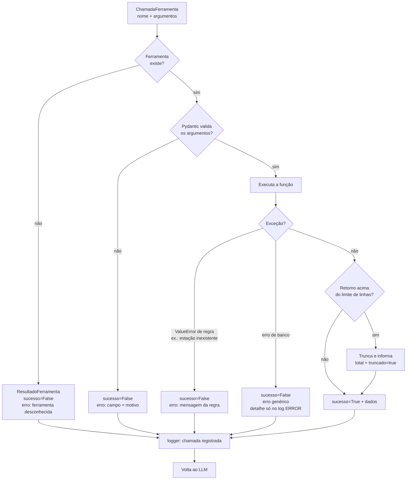

# Ferramentas do agente

As ferramentas são o **único** caminho pelo qual o agente obtém números. Cada uma é uma função Python com nome, descrição e parâmetros tipados, que o LLM pode pedir para executar. Quem executa é o nosso código, não o LLM.

## Índice

1. [Anatomia de uma ferramenta](#1-anatomia-de-uma-ferramenta)
2. [Regras para todas as ferramentas](#2-regras-para-todas-as-ferramentas)
3. [Catálogo](#3-catálogo)
4. [Detalhamento](#4-detalhamento)
5. [Fluxo de execução e validação](#5-fluxo-de-execução-e-validação)
6. [Como criar uma ferramenta nova](#6-como-criar-uma-ferramenta-nova)

---

## 1. Anatomia de uma ferramenta

| Parte | Para quem | Exemplo |
|---|---|---|
| `nome` | LLM e log | `resumo_estatistico` |
| `descricao` | LLM: é o que ele lê para decidir **quando** usar | "Calcula média, mediana, desvio... Use para perguntas numéricas sobre um período." |
| `argumentos` | LLM (como JSON Schema) e validação (Pydantic) | `ArgumentosResumo`: `parametros: list[str]`, `data_inicio: date` |
| `funcao` | Código | Chama `ConsultaDados` e `AnaliticsService` |

O LLM recebe a **especificação** (nome + descrição + JSON Schema gerado pelo Pydantic com `model_json_schema()`), por exemplo:

```json
{
  "name": "resumo_estatistico",
  "description": "Calcula estatísticas descritivas (quantidade, média, mediana, desvio padrão, variância, quartis, IQR, mínimo, máximo e número de anomalias) por estação e parâmetro, num período. Use para qualquer pergunta numérica sobre valores medidos. Não use para explicar regras (use buscar_documentacao).",
  "input_schema": {
    "type": "object",
    "properties": {
      "estacao": {"type": "string", "description": "Código da estação, ex.: EST-RJ-001. Omitir = todas."},
      "parametros": {"type": "array", "items": {"type": "string"}, "description": "Códigos dos parâmetros, ex.: [\"TIP-PH\"]. Omitir = todos."},
      "data_inicio": {"type": "string", "format": "date", "description": "AAAA-MM-DD. Sozinha = só esse dia."},
      "data_fim": {"type": "string", "format": "date", "description": "AAAA-MM-DD, inclusiva. Exige data_inicio."}
    }
  }
}
```

> A chave do schema muda conforme o fornecedor (`input_schema` na Anthropic, `parameters` na OpenAI). O adaptador de `src/agente/llm/` faz essa tradução, e a ferramenta não precisa saber.

## 2. Regras para todas as ferramentas

1. **Somente leitura.** Nenhuma escrita no banco ou em arquivos.
2. **Argumentos validados por Pydantic** antes da execução, com `ConfigDict(extra="forbid")` (argumento desconhecido é erro). O schema vai ao Claude com `strict: true` (POL-06). Argumento inválido vira `ResultadoFerramenta(sucesso=False, erro="...")` e o LLM pode corrigir.
3. **Retorno compacto e em JSON:** no máximo `AGENTE_MAX_LINHAS` linhas (padrão 50), números arredondados (3 casas), datas em ISO, e sempre a **unidade** e a **quantidade** de valores.
4. **Retorno autoexplicativo:** inclui os filtros efetivamente aplicados (`filtros`), para o LLM e o usuário saberem o que foi calculado.
5. **Recorte vazio não é erro:** devolve `sucesso=True` com `aviso: "sem medições no recorte"` e o período coberto pelos dados.
6. **Sem dados pessoais:** nenhuma ferramenta lê `Operadores`. Um teste automático percorre os retornos procurando `cpf`, `email`, `nome_hash` e padrões de CPF/e-mail. O usuário do banco do agente também não tem permissão de leitura em `Operadores` (POL-02).
7. **Reaproveitar o código existente:** estatística e anomalias vêm do `AnaliticsService.analisar_medicoes()`. Regras não são reescritas.
8. **Documentação de estudo:** docstring com o conceito, `Args`, `Returns`, `Raises` e um exemplo executável ([guia-estudos.md](guia-estudos.md)).

## 3. Catálogo

| Ferramenta | Pergunta típica | Reaproveita | Fase |
|---|---|---|---|
| `panorama_dados` | "Que dados você tem?" | `EstacaoRepository`, `MunicipioRepository`, novo `LeituraRepository.get_cobertura()` | 2 |
| `listar_parametros` | "Qual a faixa válida do oxigênio?" | `ParametroRepository.get_all()` | 2 |
| `resumo_estatistico` | "pH médio em junho?" | `AnaliticsService.analisar_medicoes()` | 2 |
| `listar_anomalias` | "Anomalias de turbidez na última semana?" | `AnaliticsService.analisar_medicoes()` | 2 |
| `serie_temporal` | "Temperatura média por semana em agosto" | pandas `resample` | 2 |
| `perfil_horario` | "Em que hora a radiação é maior?" | pandas `groupby(hora)` | 2 |
| `buscar_documentacao` | "Por que a chuva gera alertas?" | `rag.Recuperador` | 4 |
| `comparar_periodos` | "Turbidez de julho × junho" | `scipy.stats.mannwhitneyu` | 6 |
| `correlacao` | "Temperatura e umidade estão relacionadas?" | `scipy.stats.spearmanr` / `pearsonr` | 6 |
| `probabilidade_evento` | "Chance de chover com umidade > 90%?" | contagem (Bernoulli, probabilidade condicional) | 6 |
| `dias_semelhantes` | "Dias parecidos com 15/06?" | embeddings de resumos diários | 9 |
| `prever` | "Temperatura nas próximas 6 h?" | modelo treinado no projeto (`src/previsao/`, DA10) | 10 |

As 9 primeiras estão sempre no catálogo. As três últimas só entram quando existe o que elas leem: o índice da documentação (`--indexar`), o índice dos dias (`--indexar-dias`) e o modelo de previsão com o hash conferido (`--treinar-previsao`). A lista fechada está em `FERRAMENTAS_PERMITIDAS` (`ferramentas/catalogo.py`, POL-01).

## 4. Detalhamento

Os exemplos de retorno mostram o **formato**. Os valores são ilustrativos.

### 4.1 `panorama_dados` (Fase 2)

**Objetivo:** dar ao LLM a "visão de cima": estações, período coberto, volume e os códigos dos operadores de cada estação. Costuma ser a primeira ferramenta em perguntas vagas, sobre datas ou sobre "quem opera a estação".

**Parâmetros:** nenhum.

**Retorno (exemplo resumido com uma das estações):**

```json
{
  "estacoes": [{"codigo": "EST-RJ-001", "nome": "Estação Integrada Guanabara Norte", "municipio": "Rio de Janeiro", "uf": "RJ",
                "primeira_leitura": "2026-04-01T00:00:00", "ultima_leitura": "2026-10-23T23:30:00", "leituras": 9856,
                "intervalo_medio_minutos": 30,
                "operadores": [{"codigo": "OP-RJ-001", "primeira_leitura": "2026-04-01T00:00:00", "ultima_leitura": "2026-10-23T23:30:00", "leituras": 4928},
                               {"codigo": "OP-RJ-002", "primeira_leitura": "2026-04-01T00:30:00", "ultima_leitura": "2026-10-23T23:00:00", "leituras": 4928}]}],
  "parametros_cadastrados": 11
}
```

**Implementação:** um método novo de leitura em `LeituraRepository`, `get_cobertura()`, com `MIN(data_hora)`, `MAX(data_hora)` e `COUNT(*)` agrupados por estação. Isso evita carregar mais de 630 mil medições só para saber o período. O intervalo médio sai da própria cobertura: (última − primeira) / (leituras − 1). Os nomes vêm de `EstacaoRepository.get_all()` e `MunicipioRepository.get_com_estacoes()`.

**Operadores (decisão de 23/10/2026):** `LeituraRepository.get_operadores()` agrupa as leituras por estação e `codigo_operador`, com `MIN`, `MAX` e `COUNT(L.id_leitura)`. Lê só o código, que identifica o posto de trabalho e não é dado pessoal. Nome e CPF (hash), e-mail (criptografado) e município do operador nunca entram na consulta, e o usuário `agente_leitura` tem `DENY` de coluna neles (POL-02). A contagem é por `L.id_leitura`, e não `COUNT(*)`, porque o SQL Server recusa `COUNT(*)` numa tabela com coluna negada. O system prompt (regra 7) manda responder "quem opera a estação?" com o código e recusar nome, CPF e e-mail.

### 4.2 `listar_parametros` (Fase 2)

**Parâmetros:** nenhum.

**Retorno:** `[{"codigo": "TIP-OXI", "nome": "Oxigênio dissolvido", "unidade": "mg/L", "faixa_minima": 0, "faixa_maxima": 20}, ...]`. Uma faixa `null` significa "sem limite" (ex.: turbidez sem máximo).

**Uso pelo LLM:** traduzir "oxigênio" → `TIP-OXI` antes de chamar as outras ferramentas, e responder perguntas sobre faixas e unidades.

### 4.3 `resumo_estatistico` (Fase 2)

**Parâmetros:**

| Nome | Tipo | Obrigatório | Regra |
|---|---|---|---|
| `estacao` | string | não | Código existente. Omitir = todas |
| `parametros` | lista de string | não | Códigos existentes. Omitir = todos |
| `data_inicio` | data | não | Sozinha = só esse dia (mesma regra do `get_medicoes`) |
| `data_fim` | data | não | Exige `data_inicio`; `data_fim >= data_inicio` |

**Retorno:**

```json
{
  "filtros": {"estacao": null, "parametros": ["TIP-PH"], "data_inicio": "2026-06-01", "data_fim": "2026-06-30"},
  "linhas": [{
    "estacao": "Estação Integrada Guanabara Norte", "codigo": "TIP-PH", "parametro": "pH", "unidade": "pH",
    "quantidade": 1402, "media": 7.381, "mediana": 7.37, "desvio_padrao": 0.214, "variancia": 0.046,
    "q1": 7.29, "q3": 7.46, "iqr": 0.17, "minimo": 6.71, "maximo": 9.3, "anomalias": 11
  }]
}
```

**Implementação:** `ConsultaDados.medicoes(...)` → `AnaliticsService.analisar_medicoes()` → renomear as chaves do relatório (`"Média"` → `media` etc.) e arredondar.

### 4.4 `listar_anomalias` (Fase 2)

**Parâmetros:** os mesmos filtros de `resumo_estatistico`, com `parametro` único e opcional (omitir = todos), mais:

| Nome | Tipo | Padrão | Regra |
|---|---|---|---|
| `alerta` | enum `IQR`, `ZSCORE`, `IQR+ZSCORE` | todos | Filtra pelo indicador (D10) |
| `ordenar_por` | enum `data`, `extremidade` | `extremidade` | `extremidade` = maior \|Z-Score\| primeiro |
| `limite` | inteiro 1–50 | 10 | Itens devolvidos. O total sempre vem completo |

**Retorno:**

```json
{
  "filtros": {...},
  "base_calculo": "limites IQR e Z-Score calculados sobre o recorte pedido",
  "total": 11, "por_alerta": {"IQR": 9, "IQR+ZSCORE": 2},
  "itens": [{"data_hora": "2026-06-03T06:00:00", "estacao": "Estação Integrada Guanabara Norte", "codigo": "TIP-PH", "parametro": "pH", "unidade": "pH", "valor": 9.3,
             "limite_inferior": 6.98, "limite_superior": 7.94, "zscore": 4.1, "alerta": "IQR+ZSCORE", "registro": "REG-RJ-001-03106"}]
}
```

> **Ponto de atenção:** os limites IQR e o Z-Score dependem do recorte analisado (decisão D9). Anomalias "de junho" calculadas só com junho podem diferir das calculadas com o período inteiro. Por isso o retorno tem `base_calculo`, e o system prompt pede ao LLM que mencione isso quando o usuário comparar resultados.

### 4.5 `serie_temporal` (Fase 2)

**Parâmetros:**

| Nome | Tipo | Obrigatório | Regra |
|---|---|---|---|
| `parametro` | string | sim | Código |
| `estacao` | string | não | Se houver mais de uma estação e for omitida, devolve erro pedindo a estação |
| `data_inicio`, `data_fim` | data | sim | Intervalo fechado |
| `granularidade` | enum `hora`, `dia`, `semana`, `mes` | sim | Regra do pandas: `h`, `D`, `W-MON`, `MS` |
| `estatistica` | enum `media`, `mediana`, `minimo`, `maximo`, `soma` | não (`media`) | `soma` é a mais útil para a chuva (mm acumulados) |

**Limite:** no máximo 200 pontos. Acima disso, **erro** sugerindo uma granularidade maior. O código não troca a granularidade sozinho, para o LLM não apresentar uma série diferente da pedida.

**Retorno:** `{"filtros": {...}, "unidade": "°C", "pontos": [{"inicio": "2026-08-03", "valor": 21.4, "n": 336}, ...]}`.

### 4.6 `perfil_horario` (Fase 2)

**Objetivo:** responder perguntas sobre o ciclo diário, que é forte em temperatura, umidade e radiação ([analise.md § 3](analise.md#3-perfil-dos-dados-que-o-agente-consulta)).

**Parâmetros:** `parametro` (obrigatório), `estacao`, `data_inicio`, `data_fim`.

**Retorno:** `{"unidade": "W/m²", "horas": [{"hora": 0, "media": 0.4, "mediana": 0, "n": 284}, ...], "hora_maior_media": 12, "hora_menor_media": 3}`.

### 4.7 `buscar_documentacao` (Fase 4)

**Parâmetros:** `consulta` (texto de 3 a 300 caracteres, que o LLM pode reformular a partir da pergunta) e `top_k` (1–8, padrão 6).

**Retorno:**

```json
{
  "trechos": [{"arquivo": "docs/analise-estatistica.md", "secao": "Resultado com o dataset atual",
               "texto": "Limitação da regra IQR na precipitação: a maior parte das leituras é 0 mm...", "similaridade": 0.71}],
  "aviso": null
}
```

O retorno também traz a `consulta` usada. Sem trecho acima do limiar de similaridade (0,35, calibrado na Fase 8), devolve `trechos: []` e `aviso: "nenhum trecho relevante na documentação"`. A ferramenta só entra no catálogo quando existe o índice (`python main.py --indexar`). O LLM então responde que a documentação não cobre o assunto. Detalhes em [rag.md](rag.md).

### 4.8 `comparar_periodos` (Fase 6)

**Parâmetros** (planos, sem objetos aninhados, para o schema caber no modo estrito do Claude):

| Nome | Tipo | Obrigatório | Regra |
|---|---|---|---|
| `parametro` | string | sim | Código |
| `estacao` | string | não | Com mais de uma estação cadastrada, é obrigatória |
| `inicio_a`, `fim_a` | data | sim | Período A, intervalo fechado |
| `turno_a` | enum `todas`, `dia`, `noite` | não (`todas`) | `dia` = 6h às 17h59; `noite` = 18h às 5h59 |
| `inicio_b`, `fim_b`, `turno_b` | idem | idem | Período B. A e B não podem ser iguais |

"Dia × noite" = o mesmo intervalo de datas com `turno_a="dia"` e `turno_b="noite"`.

**Cálculo** (`ferramentas/calculos_inferencia.py`):

- Descritiva de cada recorte (n, média, mediana, desvio).
- **Teste de Mann-Whitney U** bilateral (`scipy.stats.mannwhitneyu`), com H0: as distribuições são iguais e α = 0,05. Usa-se Mann-Whitney, e não o t-test do `aplicacao_estatistica.py`, porque as distribuições não são normais ([analise.md § 3](analise.md#3-perfil-dos-dados-que-o-agente-consulta)).
- **Tamanho de efeito**: correlação rank-bisserial r = 2·U/(n1·n2) − 1. Faixas de |r|: < 0,1 desprezível; < 0,3 pequeno; < 0,5 médio; a partir de 0,5 grande. Com cerca de 1.400 medições por mês, diferenças mínimas viram "significativas". O tamanho do efeito diz se a diferença **importa**.
- Mínimo de 5 valores em cada recorte.

**Retorno:**

```json
{"filtros": {...}, "unidade": "°C",
 "a": {"n": 72, "media": 28.5, "mediana": 28.5, "desvio_padrao": 2.0},
 "b": {"n": 72, "media": 22.5, "mediana": 22.5, "desvio_padrao": 2.0},
 "teste": "Mann-Whitney U (bilateral)", "p_valor": "<0.001", "significativo": true, "alfa": 0.05,
 "efeito": 0.97, "efeito_interpretacao": "grande", "sentido": "A maior que B"}
```

**p-valor:** número com 3 casas, ou o texto `"<0.001"` quando é menor. O arredondamento padrão de 3 casas transformaria 0,0003 em 0, e o LLM poderia dizer "p = 0", o que é falso.

### 4.9 `correlacao` (Fase 6)

**Parâmetros:** `parametros` (2 a 6 códigos, sem repetição), `estacao`, `data_inicio`, `data_fim`, `metodo` (`spearman`, o padrão, ou `pearson`).

**Cálculo:** as medições são pareadas pela **mesma leitura** (`codigo_registro`) com `pivot_table`, e o r e o p-valor são calculados por par, só com as leituras que têm os dois valores. Faixas de interpretação de |r|: < 0,1 desprezível; 0,1–0,3 fraca; 0,3–0,5 moderada; > 0,5 forte. Valores constantes (ex.: chuva sempre 0) dão "indefinida (valores constantes)", e menos de 3 pares dão "poucas leituras".

**Retorno:** `{"filtros": {...}, "metodo": "spearman", "pares": [{"a": "TIP-TMP", "b": "TIP-UMI", "r": -0.45, "p_valor": "<0.001", "n": 9420, "interpretacao": "moderada negativa"}]}`.

### 4.10 `probabilidade_evento` (Fase 6)

**Parâmetros** (planos): `evento_parametro`, `evento_operador` (`>`, `>=`, `<`, `<=`), `evento_valor` e, opcionais e sempre juntos, `condicao_parametro`, `condicao_operador`, `condicao_valor`, mais `estacao`, `data_inicio` e `data_fim`.

**Cálculo:** P(evento) = casos / leituras com o parâmetro medido (Bernoulli). Com condição: P(evento | condição) = casos em que os dois ocorrem / casos da condição, com as leituras pareadas por `codigo_registro`.

**Retorno:** `{"filtros": {...}, "unidades": {"TIP-CHU": "mm", "TIP-UMI": "%"}, "p_evento": 0.123, "n_evento": 9645, "casos_evento": 1186, "p_evento_dado_condicao": 0.131, "n_condicao": 1810, "casos_evento_e_condicao": 237}`.

### 4.11 `dias_semelhantes` (Fase 9)

**Parâmetros** (`ArgumentosDiasSemelhantes`, `extra="forbid"`): `data` (AAAA-MM-DD), `estacao` (obrigatória com mais de uma estação) e `top_k` (1 a 10, padrão 5).

**Cálculo** (`src/agente/ferramentas/dias.py`): cada dia tem um **resumo textual** gerado das estatísticas diárias, com rótulos qualitativos (faixa de chuva, tercis "baixa/típica/alta para o período" e anomalias do dia). Os resumos ficam num índice separado, criado por `python main.py --indexar-dias`. A ferramenta recalcula o resumo do dia pedido, usa esse resumo como consulta e devolve os vizinhos da **mesma estação**, sem o próprio dia. Ver [rag.md § 8](rag.md#8-resumos-diários-embeddings-sobre-a-análise-temporal).

**Retorno:** `estacao`, `data_referencia`, `resumo_referencia`, `dias` (`data`, `similaridade` de 0 a 1 e `resumo`) e um `aviso` de que a similaridade é entre resumos, e não uma medida física. Para o valor exato de um dia, a descrição e o system prompt mandam chamar `resumo_estatistico` com `data_inicio = data_fim`.

**Erros de regra:** mais de uma estação sem `estacao`, estação inexistente, ou dia sem medições (a mensagem traz o período com dados).

**Só é registrada** quando o índice dos dias existe e foi criado com o mesmo modelo de embeddings. Sem ele, o agente registra um aviso no log e segue sem a ferramenta.

### 4.12 `prever` (Fase 10)

**Objetivo:** estimar um parâmetro de 1 a 24 horas à frente, sempre com a margem de erro. Decisão DA10 ([analise.md § 8](analise.md#8-decisões-pendentes)).

**Parâmetros:**

| Nome | Tipo | Obrigatório | Regra |
|---|---|---|---|
| `parametro` | enum (`TIP-TMP`, `TIP-UMI`, `TIP-TAG`, `TIP-RAD`) | sim | Só os que têm estrutura temporal: temperatura do ar, umidade, temperatura da água e radiação solar. pH, oxigênio, condutividade e turbidez não têm (correlação ≈ 0, [analise.md § 3](analise.md#3-perfil-dos-dados-que-o-agente-consulta)), e nenhum modelo vence a média |
| `estacao` | string | não | Obrigatória com mais de uma estação |
| `horizonte_horas` | inteiro 1–24 | sim | Só os horizontes treinados (1, 3, 6, 12 e 24 h) e aprovados. Os outros voltam com erro de regra listando os disponíveis |

**Retorno:**

```json
{"parametro": "TIP-TMP", "unidade": "°C", "estacao": "EST-RJ-001", "referencia": "2026-10-23T23:30:00",
 "horizonte_horas": 6, "instante_previsto": "2026-10-24T05:30:00", "previsao": 21.4,
 "erro_validacao": {"modelo": {"mae": 1.57, "rmse": 1.97}, "ingenuo": {"mae": 3.53, "rmse": 4.4}, "ingenuo_sazonal": {"mae": 2.17, "rmse": 2.73}},
 "erro_teste": {"modelo": {"mae": 1.61, "rmse": 2.02}, "ingenuo": {"...": "..."}, "ingenuo_sazonal": {"...": "..."}},
 "modelo": "Ridge", "treinado_em": "2026-10-21", "periodo_treino": ["2026-04-01T00:00:00", "2026-10-09T23:30:00"],
 "aviso": "Estimativa do modelo, não uma medição. Os dados do projeto são sintéticos: ..."}
```

Código: `src/agente/ferramentas/previsao.py` (ferramenta) e `src/previsao/` (dados, atributos, baselines, treino, persistência e relatório). O MAE de validação é a média das dobras do `TimeSeriesSplit`; o de teste vem das últimas 2 semanas, fora de todas as escolhas.

**Regras:**

- A previsão parte da **última leitura disponível** (`referencia`), e não da hora atual: os dados podem terminar antes ou depois de hoje (ponto P3).
- Horizonte em que o modelo não vence os dois baselines (ingênuo e ingênuo sazonal) é **recusado** com erro de regra, e o LLM explica que não há previsão melhor que "igual a ontem nesta hora".
- O modelo é treinado fora do laço de perguntas (`python main.py --treinar-previsao`). A ferramenta só carrega o arquivo se o sha256 e a versão do scikit-learn baterem com o `metadados.json` (POL-12: carregar `joblib`/pickle executa código).
- Sem modelo válido, a ferramenta não entra no catálogo, e o log registra o motivo (`guardrail=POL-12 acao=modelo_recusado motivo=sha256_diferente` ou `versao_sklearn`).
- Lacuna nas 24 h antes da última leitura (os atributos precisam delas) vira erro de regra, e não uma previsão com dados inventados.

**Por que dois baselines:** com ciclo diário forte, "igual à última medição" é difícil de bater em 1 hora e fácil de bater em 6 horas. "A mesma hora de ontem" é a referência justa para horizontes maiores. Um modelo que não vence o melhor dos dois não acrescenta nada.

## 5. Fluxo de execução e validação



## 6. Como criar uma ferramenta nova

Checklist:

1. A pergunta que ela responde está na tabela de casos de uso de [analise.md § 4](analise.md#4-casos-de-uso-e-perguntas-alvo)? Se não, acrescente.
2. Escreva o modelo Pydantic dos parâmetros, com `description` em todo campo e `Literal`/enum sempre que os valores forem fechados.
3. Escreva a função pura de cálculo (recebe medições e devolve dict), testável sem banco.
4. Escreva a descrição para o LLM: **o que faz, quando usar e quando não usar**.
5. Registre a ferramenta no `RegistroFerramentas` (em `fabrica.py`).
6. Testes: função pura, validação de argumentos, retorno sem dados pessoais e um caso no golden set ([avaliacao.md](avaliacao.md)).
7. Atualize o catálogo deste documento.

Padrão de código esperado (esboço):

```python
"""
Ferramentas descritivas do agente.

Conceito (módulo 3 — Fundamentos de IA, Estatística): tendência central e
dispersão. A ferramenta não recalcula nada: delega ao AnaliticsService, que já
é testado contra as consultas SQL do projeto.
"""
from datetime import date

from pydantic import BaseModel, ConfigDict, Field, model_validator

from src.services.analytics_service import AnaliticsService


class ArgumentosResumo(BaseModel):
    """Argumentos aceitos por `resumo_estatistico` (viram o JSON Schema enviado ao LLM)."""

    model_config = ConfigDict(extra="forbid")   # POL-06: argumento desconhecido é erro

    estacao: str | None = Field(None, description="Código da estação, ex.: EST-RJ-001. Omitir = todas.")
    parametros: list[str] | None = Field(None, description='Códigos dos parâmetros, ex.: ["TIP-PH"].')
    data_inicio: date | None = Field(None, description="AAAA-MM-DD. Sozinha = só esse dia.")
    data_fim: date | None = Field(None, description="AAAA-MM-DD, inclusiva. Exige data_inicio.")

    @model_validator(mode="after")
    def _periodo_coerente(self) -> "ArgumentosResumo":
        if self.data_fim and not self.data_inicio:
            raise ValueError("data_fim exige data_inicio")
        if self.data_inicio and self.data_fim and self.data_fim < self.data_inicio:
            raise ValueError("data_fim anterior a data_inicio")
        return self


def resumir(medicoes: list[dict]) -> list[dict]:
    """
    Estatísticas por estação e parâmetro, com chaves curtas e valores arredondados.

    Args:
        medicoes: linhas no formato de `LeituraRepository.get_medicoes()`.

    Returns:
        Uma linha por estação + parâmetro (ver ferramentas.md § 4.3).

    Example:
        >>> from datetime import datetime
        >>> linhas = [
        ...     {"estacao_codigo": "EST-1", "estacao": "Estação 1", "codigo_registro": f"R{i}",
        ...      "data_hora": datetime(2026, 6, 1, i), "codigo_parametro": "TIP-PH",
        ...      "parametro": "pH", "unidade_medida": "pH", "valor": v}
        ...     for i, v in enumerate([7.0, 7.2, 7.4, 7.6])
        ... ]
        >>> resumo = resumir(linhas)[0]
        >>> resumo["media"], resumo["mediana"], resumo["quantidade"]
        (7.3, 7.3, 4)
    """
    analise = AnaliticsService.analisar_medicoes(medicoes)
    return [
        {
            "estacao": linha["Estação"],
            "codigo": linha["Código"],
            "unidade": linha["Unidade"],
            "quantidade": linha["Quantidade"],
            "media": _arredondar(linha["Média"]),
            "mediana": _arredondar(linha["Mediana"]),
            # ... demais métricas
        }
        for linha in analise["estatisticas"]
    ]


def _arredondar(valor: float | None, casas: int = 3) -> float | None:
    """Arredonda mantendo None (métrica indefinida, ex.: desvio de um único valor)."""
    return None if valor is None else round(float(valor), casas)
```

O exemplo do docstring roda com `pytest --doctest-modules src/agente`. Se o código mudar e o exemplo deixar de valer, o teste falha.
