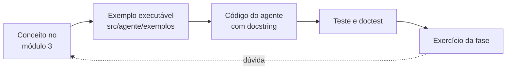

# Guia de estudos do agente

O agente também é material de estudo. Este guia liga cada conceito do módulo 3 (`avanade-ds-ia/modulo-3`) ao ponto do código onde ele aparece, define o padrão de documentação do código e propõe exemplos executáveis e exercícios por fase.

## Índice

1. [Como usar este guia](#1-como-usar-este-guia)
2. [Mapa de conceitos: módulo 3 → agente](#2-mapa-de-conceitos-módulo-3--agente)
3. [Padrão de documentação do código](#3-padrão-de-documentação-do-código)
4. [O que aprender com o código do módulo 3](#4-o-que-aprender-com-o-código-do-módulo-3)
5. [Exemplos executáveis](#5-exemplos-executáveis)
6. [Trilha de estudo e exercícios por fase](#6-trilha-de-estudo-e-exercícios-por-fase)
7. [Referências](#7-referências)

---

## 1. Como usar este guia



Para cada fase do [todo.md](todo.md):

1. Releia o conceito no arquivo do módulo indicado na tabela abaixo.
2. Rode o exemplo executável da fase.
3. Leia o código implementado: cada módulo começa com um docstring que explica o conceito.
4. Rode os testes e doctests.
5. Faça os exercícios da fase.

**Tour guiado no VSCode.** Para uma primeira visão da arquitetura, a pasta `.tours/` tem dois tours da extensão [CodeTour](https://marketplace.visualstudio.com/items?itemName=vsls-contrib.codetour). Eles abrem cada arquivo na linha certa, com a explicação num balão:

- `1-caminho-da-pergunta.tour`: CLI, fábrica, laço do orquestrador, adaptador do LLM, ferramentas e acesso aos dados;
- `2-rag-guardrails-avaliacao.tour`: chunking, embeddings, banco vetorial, políticas POL-01 a POL-13, rota web e golden set.

Para usar, abra a pasta `Data-Science-Ia` no VSCode, vá ao painel **CodeTour** do Explorer e clique em ▶. Os passos de demonstração rodam os exemplos `e04`, `e06` e `e11` no terminal, sem chave e sem banco. Se um arquivo citado mudar, confira se a seleção do passo ainda aponta para o trecho certo.

## 2. Mapa de conceitos: módulo 3 → agente

| Conceito | No módulo 3 | No agente | Fase |
|---|---|---|---|
| Workload: treino × inferência | `Resumo-Fundamentos-IA.pdf`, Módulo 1 | O agente é **só inferência**. A latência e o custo por pergunta viram métricas | 3, 8 |
| NLP clássico (TF-IDF) | `Fundamentos-IA/workload.py` | Baseline de recuperação contra os embeddings | 8 |
| Vetores e similaridade de cosseno | `Fundamentos-IA/matematica_IA/mat_IA.py` | `VectorStore` em memória: `matriz @ vetor` com vetores normalizados | 4 |
| Distância euclidiana | `Resumo-Fundamentos-IA.pdf`, Módulo 2 | Dias semelhantes por vetor numérico (comparação com embeddings) | 9 |
| Gradient descent | `mat_IA.py` | Conceitual: é como os modelos de embeddings e de linguagem foram treinados. O agente não treina nada | — |
| Média, mediana, variância | `Fundamentos-IA/estatistica_IA/aplicacao_estatistica.py` | `resumo_estatistico` (via `AnaliticsService`) | 2 |
| Teste de hipótese e p-valor | `aplicacao_estatistica.py` (t-test) | `comparar_periodos` (Mann-Whitney, porque os dados não são normais) | 6 |
| Correlação (Pearson) | `Resumo-Fundamentos-IA.pdf`, Módulo 3 | `correlacao` (Spearman e Pearson) | 6 |
| Probabilidade condicional, Bernoulli | `Resumo-Fundamentos-IA.pdf`, Módulo 3 | `probabilidade_evento` | 6 |
| Pipeline e ColumnTransformer | `Fundamentos-ML/modelo_1_ml.py` | Pipeline de treino da previsão (`src/previsao/treino.py`) | 10 |
| Validação temporal (`TimeSeriesSplit`) × `train_test_split` | `modelo_1_ml.py` usa o aleatório, que só serve para dados sem ordem no tempo | `src/previsao/treino.py` | 10 |
| Engenharia de atributos (lags, seno/cosseno da hora) | — | `src/previsao/atributos.py` | 10 |
| Baseline (ingênuo e ingênuo sazonal) | `workload.py` (baseline TF-IDF) | `src/previsao/baselines.py` | 8, 10 |
| KMeans, cotovelo, silhueta | `modelo_1_ml.py` | Perfis diários (vetor numérico) para comparar com `dias_semelhantes` | 9 |
| Precisão, recall, F1, matriz de confusão | `Fundamentos-ML/modelo_2_ml.py` | Seleção de ferramentas e recusa correta na avaliação | 8 |
| MAE, RMSE | `modelo_2_ml.py` | Fidelidade numérica e erro da previsão | 8, 10 |
| Tokenização, janela de contexto | `Fundamentos-IA-Gen/ia_gen_1.py` | Orçamento de tokens, corte do histórico, custo por pergunta | 3 |
| Grounding e alucinação | `ia_gen_1.py` | Regras 1 a 6 do system prompt; fontes montadas pelo código | 3, 4 |
| System × user prompt, zero-shot | `Fundamentos-IA-Gen/ia_gen_2.py` | `prompts.py`; seleção de ferramentas por descrição | 3 |
| Few-shot e Chain-of-Thought | `ia_gen_2.py` | Laudo de anomalias | 11 |
| Saída estruturada (JSON) | `ia_gen_2.py` | Laudo validado com Pydantic; argumentos das ferramentas em JSON Schema | 2, 11 |
| Decomposição de tarefas | `Resumo-Fundamentos-ML.pdf`, Módulo 7 | O laço do agente (várias ferramentas por pergunta) | 3 |
| Agentes de IA (ferramentas externas) | `Resumo-Fundamentos-IA.pdf`, Módulo 1 | O projeto inteiro | 3 |
| Guardrails, menor privilégio, defesa em profundidade | [guardrails-e-owasp.md](guardrails-e-owasp.md) | `src/agente/guardrails/` e o usuário do banco só de leitura | 2 e 3 |
| OWASP Top 10 para LLM | [guardrails-e-owasp.md § 6](guardrails-e-owasp.md#6-owasp-top-10-para-aplicações-com-llm-2025) | Checklist de cada fase | todas |
| Chunking recursivo | `Fundamentos-Rags-Embenddings/rag_pipeline.py` | `rag/chunker.py` (com sobreposição real e títulos Markdown) | 4 |
| Embeddings (simulados) | `rag_pipeline.py` | `rag/embeddings.py`: modelo real + simulado determinístico | 4 |
| Vector store e retrieval | `rag_pipeline.py` | `rag/vector_store.py` e `rag/recuperador.py` | 4, 5 |

## 3. Padrão de documentação do código

Todo arquivo de `src/agente/` e de `src/previsao/` (Fase 10) segue este padrão, verificado na revisão de cada fase e pelo `test_agente_doctests.py`.

### 3.1 Docstring do módulo: o conceito

```python
"""
Busca vetorial em memória (banco vetorial mínimo).

Conceito
--------
Um banco vetorial guarda, para cada trecho de texto, um vetor (embedding) e
responde "quais trechos têm vetor mais parecido com este?". Com vetores
normalizados (norma 1), a similaridade de cosseno vira um produto escalar:

    cos(u, v) = u·v / (|u|·|v|) = u·v      quando |u| = |v| = 1

Então buscar em N trechos é uma multiplicação de matriz (N × d) por vetor (d),
seguida de uma ordenação. É exatamente a VectorStore do módulo 3
(rag_pipeline.py), trocando o laço `for` por numpy e acrescentando persistência.

Onde estudar: avanade-ds-ia/modulo-3/Fundamentos-IA/matematica_IA/mat_IA.py
Documentação: docs/agente/rag.md § 5
"""
```

### 3.2 Docstring de função e classe: contrato + exemplo

Estilo Google (`Args`, `Returns`, `Raises`, `Example`). O `Example` é um **doctest**: roda no `pytest --doctest-modules src/agente src/previsao` (e no `pytest` comum, pelo `test_agente_doctests.py`) e falha se o código mudar.

```python
def similaridade_cosseno(u: np.ndarray, v: np.ndarray) -> float:
    """
    Similaridade de cosseno entre dois vetores.

    Mede o ângulo entre os vetores, ignorando o tamanho: 1 = mesma direção,
    0 = ortogonais (sem relação), -1 = opostos.

    Args:
        u: vetor de dimensão d.
        v: vetor de dimensão d.

    Returns:
        Valor entre -1 e 1.

    Raises:
        ValueError: se algum vetor tiver norma zero (cosseno indefinido).

    Example:
        >>> import numpy as np
        >>> rei, rainha, carro = np.array([0.50, 0.80, 0.12]), np.array([0.48, 0.82, 0.15]), np.array([0.01, 0.05, 0.99])
        >>> round(similaridade_cosseno(rei, rainha), 4) > round(similaridade_cosseno(rei, carro), 4)
        True
    """
```

### 3.3 Comentários no corpo

| Marcador | Quando usar | Exemplo |
|---|---|---|
| `# Conceito:` | O trecho aplica uma ideia do curso | `# Conceito: grounding — o LLM só pode usar o que está em `resultados`.` |
| `# Por quê:` | A decisão não é óbvia | `# Por quê: hashlib e não hash(); hash() de str muda a cada processo.` |
| `# Cuidado:` | Armadilha conhecida | `# Cuidado: hash() de str muda a cada processo; use hashlib.` |

Comentários explicam o **porquê**, não repetem o código (`# soma 1 em i` não ajuda).

### 3.4 Docstring em todo código

Toda **classe, função e método** de `src/agente` e `src/previsao` tem docstring, inclusive os privados (`_arredondar`), os especiais (`__len__`, `__post_init__`) e as funções internas. O teste `test_agente_doctests.py` confere isso com o módulo `ast`, que lê o código sem executá-lo, a partir da Fase 2.

| Tipo | Mínimo exigido | Exemplo |
|---|---|---|
| Classe pública | O que representa, `Args` dos campos, `Example` | `ChamadaFerramenta` |
| Função ou método público | O que faz, `Args`, `Returns`, `Raises` (se lança), `Example` executável | `formatar_chamada()` |
| Privado, especial ou interno | Uma linha dizendo o que faz e, se não for óbvio, por quê | `def __len__(self): """Quantidade de conversas ativas."""` |
| Módulo | O conceito (seção `Conceito`), onde estudar e o documento relacionado | `contratos.py` |
| Exemplo (`exemplos/`) | O que demonstra, `Como rodar` e o que observar | `e01_tokens.py` |

### 3.5 Organização do código

- **Um módulo, uma responsabilidade:** `contratos` só define tipos, `orquestrador` só conduz o laço, `guardrails/` só aplica políticas, `ferramentas/` só calcula. Se um arquivo passar de cerca de 300 linhas ou tiver duas responsabilidades, ele é dividido.
- **Guardrails isolados e nomeados:** cada guardrail é uma função ou classe pequena em `src/agente/guardrails/`, com o id da política na docstring (ex.: `POL-03`), testável sem LLM. O orquestrador só os chama na ordem de [arquitetura.md § 5](arquitetura.md#5-o-laço-do-agente).
- **Dependências injetadas:** o `Agente` recebe o LLM, o registro e as conversas no construtor (ver `fabrica.py`). Assim, o teste troca o LLM real pelo roteirizado sem `monkeypatch`.
- **Sem valor mágico no código:** limites e nomes vêm de `load_config_agente()` ou de constantes nomeadas no topo do módulo.

### 3.6 Outras convenções

- Nomes em português, como no restante do projeto (`buscar`, `vetorizar_consulta`, `ResultadoFerramenta`).
- Type hints em todas as assinaturas.
- Log só pelo `src/logger.py`. `print` só é permitido em `src/agente/exemplos/`, que são scripts de estudo, não pipeline.
- Funções de cálculo **puras** (recebem dados e devolvem dados) separadas do acesso ao banco. São mais fáceis de testar e de estudar.

## 4. O que aprender com o código do módulo 3

O código do módulo foi feito para ensinar o conceito. Ao levá-lo para produção, estes pontos mudam. Cada um é uma boa lição.

| Onde | O que acontece | Por que importa | No agente |
|---|---|---|---|
| `rag_pipeline.py`, `generate_mock_embedding` | Usa `hash(text)` como semente | Em Python, `hash()` de string é aleatorizado por processo (`PYTHONHASHSEED`). O mesmo texto gera vetores diferentes em execuções diferentes | `hashlib.sha256` no embedder simulado |
| `rag_pipeline.py`, `RecursiveChuncker` | Recebe `overlap`, mas não o usa | Ideias cortadas na fronteira entre chunks se perdem | Sobreposição implementada e testada |
| `rag_pipeline.py`, `generate_response_from_context` | A "resposta do LLM" é busca por palavra-chave | Mostra o fluxo, mas não generaliza (sinônimos, paráfrases) | LLM real com grounding |
| `rag_pipeline.py`, embeddings aleatórios | O mock não tem significado: a busca retorna trechos ao acaso | Explica por que o RAG do módulo "às vezes acerta" | Embedder real. O simulado só testa o encanamento |
| `ia_gen_2.py` | O schema pede `nivel_insatisfeito` e a resposta usa `nivel_insatisfacao` | Sem validação, um JSON "válido" com campo errado passa | Pydantic valida toda saída estruturada |
| `ia_gen_1.py`, `responder_com_grounding` | Anotada `-> str`, mas devolve uma tupla | Type hints errados enganam quem lê e as ferramentas | Type hints conferidos |
| `aplicacao_estatistica.py` | `ttest_ind` padrão assume variâncias iguais e normalidade | Com dados assimétricos (pH, turbidez), o t-test pode enganar | Mann-Whitney + tamanho de efeito |
| `workload.py` | Acurácia medida em 2 frases de teste | Com 2 amostras, cada erro vale 50 pontos percentuais: a métrica não diz nada | Golden set de cerca de 40 perguntas |
| `rag_pipeline.py`, `ia_gen_2.py` | f-strings com aspas iguais dentro das chaves (`f'{d['x']}'`) | Só funciona no Python 3.12+ | O projeto usa Python 3.14. Vale saber ao rodar em versões antigas |

## 5. Exemplos executáveis

Scripts em `src/agente/exemplos/`, rodados com `python -m src.agente.exemplos.<nome>`. Cada um tem no topo **o que demonstra, como rodar e o que observar**.

| Script | Demonstra | Precisa de | Fase |
|---|---|---|---|
| `e01_tokens` | Quantos tokens têm o system prompt, as especificações das ferramentas e uma resposta típica (`tiktoken`) | nada | 1 |
| `e02_similaridade` | Cosseno com embeddings reais: "acidez da água" × "pH" × "velocidade do vento" | modelo de embeddings | 4 |
| `e03_chunking` | Divide o `analise-estatistica.md` e mostra os chunks com seção e tamanho | nada | 4 |
| `e04_busca_vetorial` | Indexa os docs em memória e busca uma pergunta, mostrando os scores | modelo de embeddings | 4 |
| `e05_tool_use_passo_a_passo` | Um ciclo de tool use mensagem por mensagem com o LLM roteirizado | nada | 3 |
| `e06_agente_offline` | O agente completo com LLM roteirizado e dados de exemplo | nada | 3 |
| `e07_agente_real` | A mesma pergunta com o LLM real, mostrando as chamadas e os tokens | chave do LLM + banco | 3 |
| `e08_tfidf_x_embeddings` | TF-IDF × embeddings × híbrido (RRF), tamanho do chunk, cabeçalho contextual e curva do limiar, medidos com hit@4 e MRR no golden set | modelo de embeddings (ou `--simulado`) | 8 |
| `e09_teste_hipotese` | Turbidez sintética (assimétrica): p-valor pequeno com efeito desprezível; picos que puxam a média e não a mediana | nada | 6 |
| `e10_laudo_json` | Laudo few-shot de três anomalias sintéticas (pico isolado, subida após chuva, sem vizinhos), validado com Pydantic, com os descartes de campo errado (POL-06) e número inventado (POL-03) | nada (LLM roteirizado) ou a chave com `--real` | 11 |
| `e12_previsao` | `train_test_split` aleatório × divisão temporal (o aleatório dá MAE otimista) e modelo × baselines ingênuo e sazonal por horizonte | nada (60 dias sintéticos) ou o banco com `--banco` | 10 |
| `e13_dias_semelhantes` | Vizinhos de um dia pelo embedding do resumo × pelo perfil numérico de 48 pontos, e KMeans dos perfis com silhueta e inércia, em 30 dias sintéticos montados para os dois métodos discordarem | modelo de embeddings (ou `--simulado`) | 9 |
| `e11_guardrails` | Cada guardrail da Fase 3 acionado (POL-02, 03, 05, 07, 10, 11), com a linha de log `guardrail=POL-xx` | nada | 3 |

Esboço do `e05_tool_use_passo_a_passo`, que é o mais importante para entender o agente:

```python
"""
Exemplo 05 — Um ciclo de tool use, mensagem por mensagem.

Demonstra: o LLM não executa nada. Ele PEDE uma ferramenta; o nosso código
executa e devolve o resultado; o LLM então redige a resposta.

Como rodar:  python -m src.agente.exemplos.e05_tool_use_passo_a_passo
Observe:     as 4 mensagens impressas e quem produz cada uma.
"""
# 1. usuário  → "Qual o pH médio em junho?"
# 2. LLM      → pede resumo_estatistico(parametros=["TIP-PH"], ...)   (roteirizado)
# 3. código   → executa a ferramenta com dados de exemplo e devolve o JSON
# 4. LLM      → "O pH médio em junho foi 7,30 (n = 4)."                (roteirizado)
```

## 6. Trilha de estudo e exercícios por fase

| Fase | Estude antes | Exercícios |
|---|---|---|
| 1 — Fundação | `ia_gen_1.py` (tokens); dataclasses e `typing.Protocol` | (a) Rodar o `e01_tokens` e estimar o custo de 100 perguntas. (b) Escrever um `LLMClient` que sempre responde "olá" e passar no teste da interface |
| 2 — Ferramentas de dados | `aplicacao_estatistica.py`; `AnaliticsService`; Pydantic `model_json_schema()` | (a) Imprimir o JSON Schema de `ParametrosResumo` e explicar cada campo. (b) Criar a ferramenta `extremos(parametro, periodo)` seguindo o checklist de [ferramentas.md § 6](ferramentas.md#6-como-criar-uma-ferramenta-nova) |
| 3 — Laço do agente | `ia_gen_2.py` (system prompt); [arquitetura.md § 5](arquitetura.md#5-o-laço-do-agente) | (a) Rodar o `e05` e desenhar à mão a lista de mensagens. (b) Fazer uma pergunta que esgote o limite de 6 chamadas e observar a resposta forçada |
| 4 — RAG | `mat_IA.py`; `rag_pipeline.py`; [rag.md](rag.md) | (a) No `e04`, comparar a busca do modelo da DA2 com o `EmbedderSimulado` e explicar por que o simulado acerta por acaso. (b) Mudar o tamanho do chunk para 300 e para 2.000 e comparar os trechos devolvidos |
| 5 — Banco vetorial persistente | [rag.md § 5](rag.md#5-banco-vetorial) | Indexar duas vezes e provar a idempotência pelo log |
| 6 — Inferência | `aplicacao_estatistica.py` | (a) No `e09`, explicar por que o p-valor é minúsculo e o efeito, desprezível. (b) Calcular P(chuva \| umidade > 90%) à mão, com pandas, e comparar com a ferramenta |
| 7 — Interface web | Flask Blueprint; `src/ui/app.py` | Mostrar as fontes recolhidas sob cada resposta |
| 8 — Avaliação | `modelo_2_ml.py` | (a) Montar a matriz de confusão de "recusou × deveria recusar". (b) Rodar o `e08` e decidir, com números, se vale a busca híbrida |
| 9 — Dias semelhantes | `modelo_1_ml.py` (KMeans) | (a) Rodar o `e13` e explicar por que o dia 12 só aparece pelo perfil, e o 21, só pelo texto. (b) Trocar a centralização por z-score em `perfis.py` e mostrar que o KMeans deixa de separar os dias nublados |
| 10 — Previsão | `modelo_1_ml.py`, `modelo_2_ml.py` | (a) Mostrar que um `train_test_split` aleatório dá um MAE otimista demais em relação ao `TimeSeriesSplit`. (b) Encontrar o horizonte a partir do qual o modelo deixa de vencer o ingênuo sazonal. (c) Treinar para a turbidez e explicar por que o modelo não vence a média |
| 11 — Laudo JSON | `ia_gen_2.py` | Remover os exemplos few-shot e medir quantos laudos deixam de validar |

## 7. Referências

- Material do curso: `avanade-ds-ia/modulo-3/Resumo-Fundamentos-IA.pdf` e `Resumo-Fundamentos-ML.pdf`.
- Documentação do fornecedor escolhido na DA1: guias de *tool use* / *function calling* (Anthropic, DA1): https://docs.claude.com/en/docs/agents-and-tools/tool-use/overview
- Sentence Transformers: https://www.sbert.net
- `fastembed` (DA2) e o catálogo de modelos: https://qdrant.github.io/fastembed/
- Modelo usado: https://huggingface.co/sentence-transformers/paraphrase-multilingual-MiniLM-L12-v2
- Azure SQL: documentação do tipo `VECTOR` e da função `VECTOR_DISTANCE` (Microsoft Learn).
- SciPy: `scipy.stats.mannwhitneyu`, `spearmanr`, `pearsonr`.
- Segurança de agentes: [guardrails-e-owasp.md](guardrails-e-owasp.md) e o OWASP Top 10 para LLM (https://genai.owasp.org/llm-top-10/).
