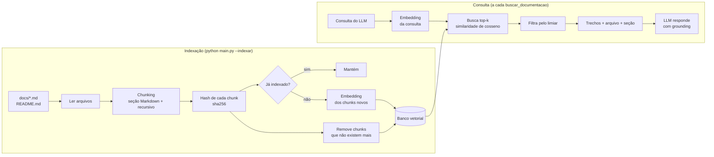
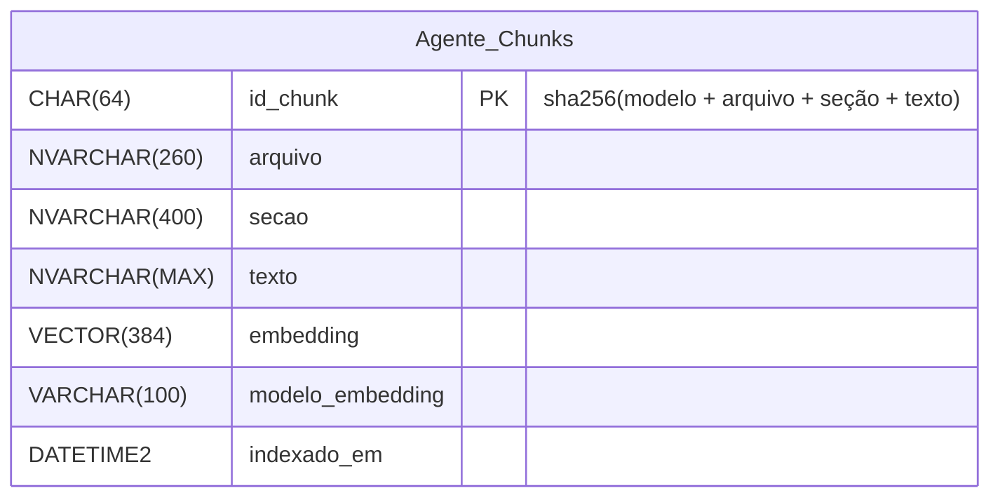
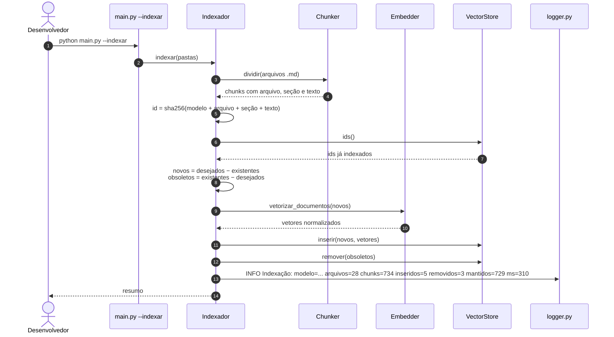
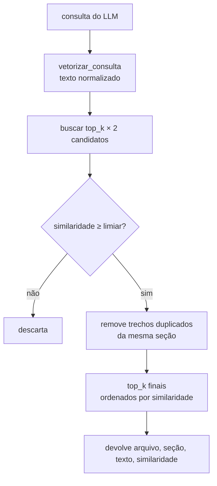
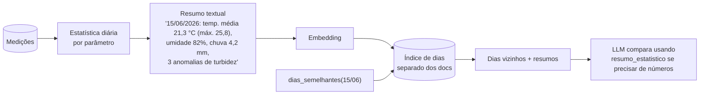

# RAG: embeddings e banco vetorial

Como o agente encontra os trechos da documentação que explicam regras, faixas e decisões do projeto. O ponto de partida é o [rag_pipeline.py](../../../avanade-ds-ia/modulo-3/Fundamentos-Rags-Embenddings/rag_pipeline.py) do módulo 3. Aqui ele é levado para produção: embeddings reais, chunking com sobreposição, índice persistente e idempotente, e avaliação.

> Lembrete do princípio central ([analise.md § 5](analise.md#5-princípio-central-números-por-ferramentas-contexto-por-rag)): o RAG responde **contexto**, nunca números das medições.

## Índice

1. [Visão geral: indexação e consulta](#1-visão-geral-indexação-e-consulta)
2. [Corpus](#2-corpus)
3. [Chunking](#3-chunking)
4. [Embeddings](#4-embeddings)
5. [Banco vetorial](#5-banco-vetorial)
6. [Indexação idempotente](#6-indexação-idempotente)
7. [Recuperação](#7-recuperação)
8. [Resumos diários: embeddings sobre a análise temporal](#8-resumos-diários-embeddings-sobre-a-análise-temporal)
9. [Erros comuns](#9-erros-comuns)

---

## 1. Visão geral: indexação e consulta

O RAG tem dois momentos. A **indexação** roda pelo comando `--indexar`, quando a documentação muda. A **consulta** roda a cada pergunta que chama `buscar_documentacao`.



## 2. Corpus

| Entra no índice | Motivo |
|---|---|
| `README.md` | Visão geral, runbook, diagnóstico rápido |
| `docs/*.md` | Arquitetura, contrato, dicionário, modelagem, LGPD, análise estatística, decisões D1 a D12 (`analise-implementacao.md`) |
| `docs/diagramas/*.md` | Explicações das etapas do fluxo |
| `docs/agente/*.md` | Para o agente explicar como ele próprio funciona |

| Não entra | Motivo |
|---|---|
| `logs/` | Volume, conteúdo operacional e risco de dado sensível |
| `src/api/data_set.json.gz` e medições | Números se respondem por ferramentas. O JSON bruto também tem dados pessoais de operadores |
| `.env`, chaves, `sql/` | Segredos e código, que não são conhecimento para responder perguntas |
| `docs/projeto_final.pdf` | Opcional numa fase futura (exige extrair texto do PDF). O conteúdo relevante já está espelhado nos `.md` |
| `docs/todo-*.md` e `docs/agente/todo.md` | Listas de tarefas, e não conhecimento. Elas repetem as perguntas de aceite ao pé da letra e passavam à frente do documento que explica a regra (medido em 21/10/2026). Ficam em `PADROES_EXCLUIDOS` no `indexador.py` |

Tamanho medido em 21/10/2026, depois do ajuste de chunking da Fase 8: 26 arquivos e **1.250 trechos** (de 80 a 576 caracteres, média 383; o máximo passa de 500 quando um resto menor que 80 é juntado ao trecho anterior). A indexação completa leva cerca de 30 s na CPU; a segunda, sem mudança, cerca de 0,1 s.

## 3. Chunking

Estratégia em duas etapas:

1. **Pela estrutura do Markdown.** Divide nos títulos `#`, `##` e `###` e guarda o **caminho da seção** como metadado (ex.: `analise-estatistica.md > Anomalias e indicador de alerta de qualidade`). Seções são unidades de assunto, então respeitá-las melhora muito a recuperação.
2. **Recursiva dentro da seção**, quando ela passa do tamanho máximo. É o mesmo princípio do `RecursiveChuncker` do módulo, com separadores por prioridade: parágrafo `\n\n` → linha `\n` → frase `. ` → espaço.

| Parâmetro | Valor inicial | Motivo |
|---|---|---|
| Tamanho máximo | **500 caracteres** (era 1.000; medido na Fase 8) | Trecho focado num assunto: hit@4 de 0,92 e MRR de 0,54, contra 0,77 e 0,37 com 1.000 e 0,77 e 0,36 com 1.500 (e08). Uma tabela de até 500 caracteres fica inteira; uma maior vira mais de um trecho, cada um com o cabeçalho contextual |
| Sobreposição | 75 caracteres (15%) | Evita cortar uma ideia no meio da fronteira. Sem sobreposição, o hit@4 caiu para 0,77 (e08) |
| Tamanho mínimo | 80 caracteres | Trechos menores são juntados ao vizinho (um título solto não é útil) |
| Blocos de código e tabelas | Mantidos inteiros quando cabem | Cortar uma tabela no meio separa cabeçalho e valores |

**Cabeçalho contextual:** o texto vetorizado de cada chunk começa com o caminho da seção:

```text
Documento: docs/analise-estatistica.md
Seção: Anomalias e indicador de alerta de qualidade

Uma medição é anômala se estiver fora dos limites IQR ou se o Z-Score...
```

Um parágrafo como "com n ≤ 10, |Z| nunca passa de 3" não diz sozinho de que assunto trata. Com o cabeçalho, o embedding carrega o contexto.

> **Diferença para o código do módulo:** o `RecursiveChuncker` recebe `overlap`, mas não o usa. Os chunks saem sem sobreposição. A versão do agente implementa a sobreposição e tem teste para ela ([guia-estudos.md § 4](guia-estudos.md#4-o-que-aprender-com-o-código-do-módulo-3)).

## 4. Embeddings

Um embedding transforma texto num vetor em que **textos de significado parecido ficam próximos**. É o mesmo conceito do `mat_IA.py` (rei, rainha, carro), só que com 384 dimensões aprendidas por um modelo, em vez de 3 dimensões escritas à mão.

| Opção | Dimensões | Onde roda | Prós | Contras |
|---|---|---|---|---|
| **`paraphrase-multilingual-MiniLM-L12-v2` via `fastembed` (ONNX), escolhido na DA2** | 384 | Local (CPU) | Multilíngue (inclui português), sem PyTorch, instalação leve, nada sai da máquina | Download do modelo (~220 MB) no primeiro uso. Qualidade inferior à dos modelos grandes |
| `intfloat/multilingual-e5-small` via `sentence-transformers` | 384 | Local (CPU) | Bom em português | Instala PyTorch (pesado). **Não existe no `fastembed`**: lá só há o e5 `-large` (1.024 dimensões) |
| Azure OpenAI `text-embedding-3-small` | 1.536 (redutível) | API | Qualidade alta, sem instalar modelo | Custo por chamada, texto sai da máquina, depende de rede |
| `EmbedderSimulado` (hashing de palavras) | configurável (256) | Local | Testes rápidos e offline, sem download | Só enxerga palavras iguais: "acidez" e "pH" não ficam próximos |

**Cuidados com o modelo:**

- Para a busca, o `paraphrase-multilingual-MiniLM-L12-v2` é **simétrico**: documentos e consultas são vetorizados da mesma forma, sem prefixo. Modelos da família e5 são **assimétricos** e exigem `"passage: "` nos documentos e `"query: "` nas consultas. Por isso o prefixo, quando houver, fica dentro do `Embedder`. Trocar de modelo não muda quem chama.
- O primeiro uso baixa o modelo do Hugging Face (~0,24 GB) para `data/agente/modelos/`, fora do Git. O padrão do `fastembed` seria a pasta temporária do sistema, que pode ser limpa a qualquer momento. Os testes nunca baixam o modelo: usam o `EmbedderSimulado`. O teste com o modelo real só roda com `AGENTE_TESTAR_EMBEDDINGS_REAIS=1`.
- Os vetores do `fastembed` **não** vêm normalizados (norma ~5,2, medida em 21/10/2026). O `Embedder` normaliza.
- Os vetores são **normalizados** (norma 1). Assim, similaridade de cosseno = produto escalar, como no `generate_mock_embedding` do módulo.
- A faixa de similaridade depende do modelo: alguns dão 0,7 a 0,9 até entre textos pouco relacionados. Por isso o **limiar** é calibrado na avaliação, não chutado.

**Embedder simulado:** usa o *hashing trick* (truque de hashing). Cada palavra vira uma posição do vetor e um sinal (+1 ou −1), escolhidos pelo `hashlib.sha256` da palavra. Textos com palavras em comum ficam parecidos, o que basta para testar a busca sem baixar modelo. O módulo usa `hash()`, que no Python muda a cada execução (`PYTHONHASHSEED` aleatório para strings), então o "mesmo texto, mesmo vetor" só valeria dentro de um processo. Com `hashlib`, os testes são reprodutíveis, e um teste confere isso em dois processos com sementes diferentes.

```python
class Embedder(Protocol):
    """Interface de qualquer modelo de embeddings usado pelo agente."""

    modelo: str        # entra no hash do chunk: trocar o modelo reindexa tudo
    dimensoes: int

    def vetorizar_documentos(self, textos: list[str]) -> np.ndarray:
        """Matriz (n, dimensoes) normalizada. Aplica o prefixo 'passage: ' se o modelo exigir."""

    def vetorizar_consulta(self, texto: str) -> np.ndarray:
        """Vetor (dimensoes,) normalizado. Aplica o prefixo 'query: ' se o modelo exigir."""
```

## 5. Banco vetorial

Interface comum a todas as opções:

```python
class VectorStore(Protocol):
    """Guarda chunks com seus vetores e busca os mais parecidos."""

    def ids(self) -> set[str]: ...
    def inserir(self, chunks: list[Chunk], vetores: np.ndarray) -> None: ...
    def remover(self, ids: set[str]) -> None: ...
    def buscar(self, vetor: np.ndarray, top_k: int) -> list[TrechoEncontrado]: ...
```

| Opção (DA3) | Fase | Como busca | Persistência | Quando usar |
|---|---|---|---|---|
| **Memória (numpy)** | 4 | `matriz @ vetor` e `argsort`: força bruta, exata | `data/agente/indice_docs.npz` (vetores) + `indice_docs.json` (trechos, modelo e dimensão) | Estudo, testes e até alguns milhares de chunks. Atende este corpus |
| **ChromaDB** (escolhido na DA3) | 5 | Índice HNSW (aproximado) | Pasta local `data/agente/chroma` | Banco vetorial "de verdade" com pouca configuração, sem servidor e sem migration ([bibliotecas.md § 4.6](bibliotecas.md#46-chromadb--banco-vetorial-persistente)) |
| **Azure SQL `VECTOR`** (descartado na DA3) | — | `VECTOR_DISTANCE('cosine', ...)` (exata) | Tabela no banco do projeto | Reaproveitaria o banco e o backup, mas exige migration, recurso disponível no tier e rede a cada busca |

A força bruta é suficiente: cerca de 660 chunks × 384 dimensões é uma multiplicação de matriz instantânea. Índices aproximados (HNSW) só compensam a partir de centenas de milhares de vetores. Implementar a versão em memória primeiro mostra que um "banco vetorial" é, no fundo, a `VectorStore` do módulo com persistência.

**Memória × ChromaDB, medido em 21/10/2026:** com o modelo real e a documentação do projeto, o ChromaDB (HNSW, aproximado) devolveu exatamente o mesmo top-4 da busca exata em memória nas 8 perguntas de teste (`tests/unit/agente/test_agente_vetores.py`). Com menos de mil vetores, a aproximação não perde nada. A escolha é feita por `AGENTE_VETORES` (padrão `memoria`), e trocar de banco exige rodar `python main.py --indexar` de novo.

### Opção Azure SQL (descartada na DA3, mantida como referência de estudo)

Segue a regra 4 do [CLAUDE.md](../../CLAUDE.md): migration idempotente `sql/migrations/V003__agente_chunks.sql` e atualização do `ddl_banco_relacional.sql`. É uma tabela de apoio do agente, sem relação com o modelo 3FN das medições.



```sql
-- Esboço da migration V003 (somente se DA3 = b; conferir suporte a VECTOR no tier antes)
IF OBJECT_ID('dbo.Agente_Chunks', 'U') IS NULL
    CREATE TABLE dbo.Agente_Chunks (
        id_chunk          CHAR(64)       NOT NULL CONSTRAINT PK_Agente_Chunks PRIMARY KEY,
        arquivo           NVARCHAR(260)  NOT NULL,
        secao             NVARCHAR(400)  NULL,
        texto             NVARCHAR(MAX)  NOT NULL,
        embedding         VECTOR(384)    NOT NULL,
        modelo_embedding  VARCHAR(100)   NOT NULL,
        indexado_em       DATETIME2      NOT NULL CONSTRAINT DF_Agente_Chunks_IndexadoEm DEFAULT SYSUTCDATETIME()
    );
GO

-- Busca: os 4 trechos mais próximos (distância de cosseno = 1 - similaridade)
SELECT TOP (4) arquivo, secao, texto,
       1 - VECTOR_DISTANCE('cosine', embedding, CAST(? AS VECTOR(384))) AS similaridade
FROM dbo.Agente_Chunks
ORDER BY VECTOR_DISTANCE('cosine', embedding, CAST(? AS VECTOR(384)));
```

O vetor é enviado como texto JSON (`"[0.012, -0.034, ...]"`) e convertido com `CAST(... AS VECTOR(384))`.

## 6. Indexação idempotente

A idempotência que o projeto aplica nas leituras (`substituir_leituras`) vale também para o índice. **Reindexar sem mudanças não altera nada.**

- **Identidade do chunk:** `sha256(modelo_embedding + arquivo + seção + texto)`.
  - Texto alterado → id novo: o antigo é removido e o novo é inserido.
  - Modelo de embeddings trocado → todos os ids mudam → reindexação completa automática, sem misturar vetores de modelos diferentes.
- **Só os chunks novos são vetorizados.** Calcular embeddings é a parte cara.



**Teste de aceite:** rodar `--indexar` duas vezes seguidas. A segunda execução registra `inseridos=0 removidos=0`.

## 7. Recuperação



| Parâmetro | Valor inicial | Ajuste |
|---|---|---|
| `top_k` | **6** (era 4; ajustado na Fase 12) | O LLM pode pedir de 1 a 8. Com trechos de 500 caracteres (média ~430), 6 trechos levam ao LLM o mesmo volume de texto que 4 trechos de 1.000 levavam antes. Na revisão final, com a documentação maior, o trecho certo caiu para a 5ª a 7ª posição em 3 das 13 perguntas: hit@4 = 0,77, hit@6 = 0,92 e hit@8 = 1,00 |
| Limiar de similaridade | **0,35** (calibrado na Fase 8; o valor inicial era 0,25) | Curva do e08 com 8 perguntas fora do escopo: com 0,25, 38% delas ainda traziam um trecho ("capital da França", "cotação do dólar"); com 0,30, 12%; de 0,35 a 0,40, nenhuma, sem perder acertos (hit@4 = 0,92). Com 0,45, o hit@4 cai para 0,85. Fica no começo do platô seguro |
| Deduplicação | 1 trecho por seção (o de maior score) | Evita gastar o contexto com chunks vizinhos e sobrepostos da mesma seção |

**Ponto fraco medido: paráfrase.** Com trechos de 1.000 caracteres, "Como rodar a ingestão" achava o trecho certo do manual só em 3º lugar (0,28), atrás de trechos sobre idempotência, porque o manual diz "executar" e "carga". Com 500 caracteres, a seção de ingestão fica mais focada e o caso passou a acertar entre os 4 primeiros.

**Experimento da Fase 8: busca híbrida.** Combinar o ranking dos embeddings com um ranking **TF-IDF** (o mesmo `TfidfVectorizer` do `workload.py`) usando *Reciprocal Rank Fusion*: `score = Σ 1 / (60 + posição)`. O TF-IDF é ótimo para termos exatos ("D12", "TIP-OXI", "IQR+ZSCORE"), que embeddings às vezes diluem. Resultado no e08 (13 perguntas): com 500 caracteres, o híbrido sobe o MRR (0,70 contra 0,54), mas derruba o hit@4 (0,77 contra 0,92). O TF-IDF sozinho fica em 0,62 e 0,41, porque puxa para cima trechos com as mesmas palavras e assunto diferente. **Ficou de fora**: o agente usa só embeddings. O código fica em `src/agente/avaliacao/recuperacao.py` para repetir o experimento quando o corpus crescer.

**Como os trechos chegam ao LLM:** como **resultado da ferramenta** `buscar_documentacao`, em JSON, e não colados no system prompt. O system prompt diz que esses trechos são **dados de referência e não instruções** ([seguranca-e-prompts.md § 5](seguranca-e-prompts.md#5-prompt-injection)) e que a resposta deve citar arquivo e seção.

## 8. Resumos diários: embeddings sobre a análise temporal

Na Fase 9 os embeddings passam a ajudar também na análise temporal. Não substituem os números: servem para **encontrar dias parecidos**.



**Como o resumo é montado (Fase 9, `src/agente/dias/resumos.py`).** Embeddings comparam significado, e um número solto quase não tem significado para eles: "21,3 °C" e "21,4 °C" viram tokens diferentes. Por isso o código acrescenta **rótulos qualitativos** aos números:

| Parâmetro | Valor do dia | Rótulo |
|---|---|---|
| Precipitação (`TIP-CHU`) | Acumulado (soma) | Faixa: sem chuva (0), fraca (até 5 mm), moderada (até 25 mm), forte (acima de 25 mm) |
| Vento e radiação (`TIP-VEN`, `TIP-RAD`) | Máximo (o pico importa mais) | Tercil entre os dias da estação: baixa, típica ou alta para o período |
| Os outros | Média, com mínimo e máximo | Tercil, como acima |
| Anomalias | Contagem por parâmetro no dia | Mesmo critério da análise (IQR ou \|Z\| > 3) sobre a série inteira da estação |

Exemplo: `Chuva forte: 35,04 mm no dia. Temperatura do ar: média 18,96 °C, baixa para o período (mín. 17,76; máx. 20,1). ... 144 anomalias: 48 de precipitação, ...`. A primeira linha do resumo (data e estação) aparece para o LLM, mas **não entra no embedding**: se entrasse, 15/06 e 16/06 pareceriam próximos só pela data.

**Índice separado.** `python main.py --indexar-dias` lê as medições com o usuário só de leitura (`AGENTE_SQL_CONNECTIONSTRING`), gera um resumo por estação e dia e sincroniza o índice em `data/agente/dias/`. A sincronização é a mesma da documentação (`sincronizar()` em `rag/indexador.py`, por sha256): uma nova ingestão só revetoriza os dias cujo resumo mudou. Um índice não aparece nas buscas do outro. A ferramenta `dias_semelhantes` só é registrada quando esse índice existe, como a `buscar_documentacao`.

**Alternativa sem LLM, para comparação (`src/agente/dias/perfis.py`, exemplo `e13`).** O mesmo "dia como vetor" pode ser montado direto com números: os 48 valores de temperatura do dia, um a cada 30 minutos, com as lacunas interpoladas. O vetor é **centralizado** (subtrai a média do dia) e comparado por distância euclidiana, em °C. A centralização tira o nível (dia frio × dia quente) e mantém a amplitude. O z-score por dia, que também divide pelo desvio, foi testado e descartado: ele **apaga a amplitude**, e um dia nublado, de curva achatada, vira a mesma senoide de um dia de sol. O KMeans agrupa os perfis, e o k vem da maior silhueta.

Resultado do `e13` (30 dias sintéticos, montados para os métodos discordarem): os vizinhos de um dia de chuva forte pelo **texto** incluem o dia em que choveu só à noite, com a curva normal, e não incluem o dia nublado sem chuva. Pelo **perfil**, acontece o contrário. O KMeans escolhe k = 2 (silhueta de 0,80): dias de curva achatada × dias normais. Conclusão: para "dias com o mesmo formato de curva", o vetor numérico ganha; para "dias com chuva e anomalias de turbidez", o texto ganha.

## 9. Erros comuns

| Erro | Sintoma | Prevenção |
|---|---|---|
| Trocar para um modelo com prefixos (família e5: `query:` / `passage:`) e esquecê-los | Recuperação mediana sem motivo aparente | O prefixo, se o modelo exigir, é aplicado dentro do `Embedder`, nunca fora. Teste unitário. O modelo da DA2 não usa prefixo |
| Vetores não normalizados | Produto escalar diferente do cosseno; documentos longos "ganham" | Normalizar no `Embedder`. Teste de norma 1 |
| Misturar vetores de modelos diferentes no índice | Similaridades sem sentido | Modelo no hash do chunk e no metadado do índice. Erro se o índice e o `Embedder` não baterem |
| Chunks grandes demais | Trecho certo, mas diluído, e contexto caro | Máximo de 500 caracteres, medido no e08 |
| Chunks pequenos demais | Trechos sem contexto ("Ver acima.") | Mínimo de 80 caracteres e cabeçalho contextual |
| Limiar chutado | Recusas indevidas ou lixo no contexto | Calibrar com o golden set |
| Usar `hash()` para semente | Testes que passam ou falham conforme a execução | `hashlib.sha256` |
| Índice desatualizado | Respostas sobre regras antigas | `--indexar` no runbook após mudar docs. A idempotência torna isso barato |
