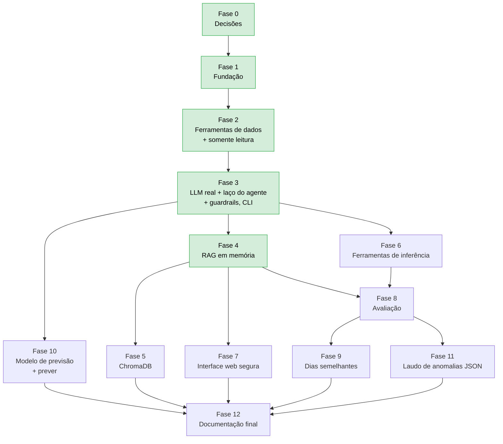

# TODO — Agente analítico

Fases para construir o agente descrito nesta pasta. Mesmas regras do [CLAUDE.md](../../CLAUDE.md):

- uma fase por vez, na ordem;
- decisões pendentes perguntadas antes;
- teste em toda lógica nova, com `pytest` passando ao fim de cada fase;
- documentação atualizada na mesma entrega;
- relatório de cada fase em [analise.md § 11](analise.md#11-relatório-das-fases).

**Regras específicas do agente.** Uma fase que não cumpre todas as três não está concluída:

1. **Código organizado e documentado.** Todo código novo segue o padrão de [guia-estudos.md § 3](guia-estudos.md#3-padrão-de-documentação-do-código):
   - docstring de módulo explicando o conceito;
   - docstring em **toda classe, função e método**, inclusive privados e funções internas: os públicos com `Args`, `Returns`, `Raises` e `Example` executável, e os privados com pelo menos uma linha;
   - comentários `# Conceito:`, `# Por quê:` e `# Cuidado:` onde a decisão não for óbvia.

   O teste `test_agente_doctests.py` verifica o padrão (Fase 2 em diante).
2. **Segurança por política.** Cada fase implementa e testa as políticas POL-01 a POL-13 indicadas para ela no checklist de [guardrails-e-owasp.md § 10](guardrails-e-owasp.md#10-checklist-owasp-por-fase). A tabela de cada fase abaixo diz quais.
3. **Dependências conferidas.** Uma biblioteca nova entra no `requirements.txt` só na fase que a usa, depois de conferida e registrada em [bibliotecas.md](bibliotecas.md) (POL-12).

## Mapa das fases

**MVP (verde):** Fases 0 a 4. Ao fim delas, o chat na CLI já responde números com ferramentas, explica regras com RAG e aplica todas as políticas de segurança, exceto as da web (POL-09 e o limite de requisições da POL-07).

---

## Fase 0 — Decisões

Detalhes, opções e recomendações em [analise.md § 8](analise.md#8-decisões-pendentes).

- [x] **DA1** Fornecedor do LLM: Anthropic Claude (SDK `anthropic`)
- [x] **DA9** Modelo: `claude-haiku-5-5`, pelo custo (projeto de treinamento). Sonnet 5.5 só numa comparação pontual na Fase 8
- [x] **DA2** Modelo de embeddings: `fastembed` + `paraphrase-multilingual-MiniLM-L12-v2` (instalação no Python 3.14 conferida)
- [x] **DA3** Banco vetorial: memória (numpy) na Fase 4 e **ChromaDB** na Fase 5
- [x] **DA4** Interface prioritária: CLI primeiro
- [x] **DA5** Registro das perguntas no log: pergunta mascarada
- [x] **DA6** Limites operacionais: 6 chamadas, 50 linhas, 10 turnos, 60 s
- [x] **DA7** Ferramentas de inferência na Fase 6. Previsão na Fase 10
- [x] **DA10** Treino do modelo de previsão dentro do escopo (Fase 10), com validação temporal, dois baselines e o modelo só carregado se treinado localmente
- [x] **DA8** Guardrails: código próprio + Pydantic, sem framework ([bibliotecas.md § 6](bibliotecas.md#6-tecnologias-dos-guardrails))
- [x] Pontos de projeto P1 a P8 da revisão do planejamento registrados em [analise.md § 8](analise.md#8-decisões-pendentes)
- [x] Lacunas de segurança L1 a L4 decididas e políticas POL-01 a POL-13 registradas em [guardrails-e-owasp.md § 9](guardrails-e-owasp.md#9-políticas-de-segurança-do-agente)
- [x] Conseguir a credencial de teste e guardá-la só no `.env`: chave da **OpenAI** (DA11, 21/10/2026), validada com o `gpt-4.1-mini`. Configure um **limite de gasto mensal** no painel da OpenAI (Limits), se ainda não fez
- [ ] Pedir a quem administra o Azure SQL a criação do usuário `agente_leitura` com o script da Fase 2. Até lá, os testes reais rodam no banco local `agente_local` ([manual-execucao.md § 4](../manual-execucao.md#banco-local-para-testar-o-agente-agente_local)), hoje com autenticação do Windows **temporária**: o modo misto do SQL Express foi gravado e vale depois do reinício do serviço, quando a conexão passa para o `agente_leitura`

**Aceite:** decisões registradas com data em [analise.md § 8](analise.md#8-decisões-pendentes).

---

## Fase 1 — Fundação

Estrutura do pacote e contratos, sem LLM real e sem banco.

- [x] Criar `src/agente/` com `__init__.py`, `contratos.py`, `conversa.py` e as subpastas `llm/`, `ferramentas/`, `rag/` e `exemplos/` ([arquitetura.md § 3](arquitetura.md#3-estrutura-de-pastas))
- [x] `contratos.py`: `ChamadaFerramenta`, `ResultadoFerramenta`, `Mensagem`, `Fonte`, `RespostaAgente` (dataclasses imutáveis, documentadas)
- [x] `llm/base.py`: `Protocol LLMClient` e `RespostaLLM` (texto, chamadas, tokens)
- [x] `llm/roteirizado.py`: `LLMRoteirizado`, que devolve respostas pré-definidas e guarda o que recebeu
- [x] `conversa.py`: `Conversas` com histórico limitado a N turnos por `conversa_id`
- [x] `src/config.py`: `load_config_agente()` com as variáveis `AGENTE_*` ([arquitetura.md § 9](arquitetura.md#9-configuração)); `load_config()` continua igual
- [x] `.env.example`: nomes das variáveis do agente, sem valores reais
- [x] `.gitignore`: `data/agente/` (`relatorios/` já existe)
- [x] `requirements.txt`: só o que esta fase usa (`tiktoken`, usado só no exemplo `e01`. Ver P1)
- [x] `exemplos/e01_tokens.py`
- [x] Testes: contratos, conversa (limite de turnos, isolamento por id, acesso concorrente com lock, P7), roteirizado, configuração (variáveis ausentes e inválidas)
- [x] Doctests de `src/agente` executados por `tests/unit/agente/test_agente_doctests.py` (P5), além de `pytest --doctest-modules src/agente`

**Políticas já cobertas:** POL-05 (`conversa_id` com formato fechado), POL-07 (10 turnos, 1.000 conversas) e POL-10 (chave fora do `repr`).

**Status:** concluída em 21/10/2026 (relatório em [analise.md § 11](analise.md#11-relatório-das-fases)). As docstrings que faltavam (métodos especiais, `__init__` e funções internas) foram completadas na Fase 2, quando o teste passou a exigi-las.

**Aceite:** `pytest` passa sem rede e sem `.env` de LLM; `python -m src.agente.exemplos.e01_tokens` roda.

**Conceitos:** tokens, interfaces (`Protocol`), imutabilidade.

---

## Fase 2 — Ferramentas de dados e somente leitura

As ferramentas funcionam e são testáveis **sem LLM**. O acesso ao banco fica restrito à leitura.

**Políticas desta fase:** POL-01, POL-02 (lado das ferramentas e do banco), POL-06 (Pydantic) e POL-12.

- [x] `ferramentas/base.py`: `Ferramenta` (nome, descrição, modelo Pydantic dos parâmetros, função, `especificacao()`, `executar()`)
- [x] Modelos de parâmetros com `ConfigDict(extra="forbid")`, `description` em todo campo e `Literal` nos valores fechados (POL-06)
- [x] `ferramentas/registro.py`: `RegistroFerramentas` (registrar, especificações, executar com validação, truncamento e tratamento de erros, conforme o fluxo de [ferramentas.md § 5](ferramentas.md#5-fluxo-de-execução-e-validação))
- [x] `ferramentas/consulta_dados.py`: `ConsultaDados` com filtros repassados ao `get_medicoes()`, conversão do código da estação em `estacao_id` (P2) e cache com tempo de vida. Recebe um `DatabaseConnection` montado com a connection string do agente
- [x] `LeituraRepository.get_cobertura()`: `MIN`/`MAX`/`COUNT` por estação (método novo, só leitura)
- [x] `ferramentas/descritivas.py`: `panorama_dados`, `listar_parametros`, `resumo_estatistico`, `listar_anomalias`, `serie_temporal`, `perfil_horario` ([ferramentas.md § 4](ferramentas.md#4-detalhamento))
- [x] Cálculo em funções puras. Estatística e anomalias via `AnaliticsService.analisar_medicoes()`, sem reescrever regras
- [x] **POL-01 / POL-02 no banco:**
  - script `sql/seguranca/agente_usuario_leitura.sql`, idempotente e sem senha no arquivo. Exige o usuário `agente_leitura` já criado (passo manual, com a senha fora do Git), dá `GRANT SELECT` em `Estados`, `Municipios`, `Estacoes`, `Parametros`, `Leituras` e `Leitura_Itens`, `DENY SELECT` em `Operadores` e `DENY INSERT, UPDATE, DELETE, ALTER` no schema. Não usa `db_datareader`;
  - seção nova em `manual-execucao.md` explicando como executar o script e por que ele não é uma migration (muda permissões, não estrutura).
- [x] **POL-01 na configuração:** `AGENTE_SQL_CONNECTIONSTRING` em `load_config_agente()`, **obrigatória** com `AGENTE_LLM_FORNECEDOR=anthropic`, e o nome no `.env.example`
- [x] **POL-01 / POL-02 no código:** `tests/unit/agente/test_agente_politicas.py` com um teste estático. Ele garante que nenhum arquivo de `src/agente` usa `save_readings`, `substituir_leituras`, `insert_leituras`, `merge_many`, `create_many`, `run_pipeline`, `OperadorRepository` ou `descriptografar_email`
- [x] **Padrão de documentação:** `test_agente_doctests.py` passa a exigir docstring em toda classe, função e método (análise com `ast`, incluindo privados e funções internas). Completar as três da Fase 1
- [x] Testes unitários: cada função pura com resultado calculado à mão; validação (argumento extra, datas invertidas, enum inválido, parâmetro inexistente); recorte vazio; truncamento
- [x] Teste de LGPD: retornos sem chaves nem padrões de dados pessoais, para todas as ferramentas
- [x] Teste de integração: `resumo_estatistico`, executado **como** o usuário de leitura, = `queries_analiticas.sql` no banco de teste. `INSERT`, `UPDATE`, `DELETE`, `ALTER` e `SELECT` em `Operadores` falham
- [x] Docs: catálogo de [ferramentas.md](ferramentas.md) conferido com o código

**Status:** concluída em 21/10/2026 (relatório em [analise.md § 11](analise.md#11-relatório-das-fases)).

**Aceite:** um script consegue chamar `registro.executar(ChamadaFerramenta(...))` para cada ferramenta e recebe JSON compacto, com unidade e filtros. Um argumento desconhecido devolve erro de validação. O teste de política passa.

**Conceitos:** estatística descritiva, JSON Schema, validação de entrada, funções puras, menor privilégio.

---

## Fase 3 — LLM real, laço do agente, guardrails e CLI

Depende de DA1, DA5, DA6 e DA8.

**Políticas desta fase:** POL-02 (pergunta e resposta), POL-03, POL-04, POL-05, POL-06 (`strict`), POL-07 (orçamento), POL-08, POL-10, POL-11 e POL-13.

**Adaptador e laço**

- [x] Ler a documentação de tool use da Anthropic antes de escrever o adaptador
- [x] `llm/cliente_anthropic.py` (P4): adaptador do formato interno para o da Anthropic e de volta + `anthropic` no `requirements.txt`. Detalhes em [bibliotecas.md § 4.1](bibliotecas.md#41-anthropic--o-llm):
  - ferramentas com `strict: true` (POL-06);
  - todos os resultados de uma rodada numa única mensagem, com erro marcado por `is_error: true`;
  - trechos de documentação e resultados só como `tool_result` em JSON, nunca no `system` (POL-08);
  - resposta forçada com `tool_choice={"type": "none"}`;
  - `max_tokens`, `effort`, `timeout` e `max_retries` vindos da configuração (POL-07);
  - `stop_reason` `max_tokens` e `refusal` tratados como mensagem amigável (POL-11). O Haiku não tem fallback do servidor;
  - blocos lidos pelo `type` (a resposta do Haiku pode começar com `thinking`) e blocos `thinking` devolvidos intactos com os resultados;
  - sem `temperature`/`top_p`/`top_k` (o Haiku 5.5 recusa valores fora do padrão);
  - erros do SDK convertidos em `ErroProvedorLLM`, registrando só o tipo da exceção (POL-10);
  - tokens de `usage` repassados.
- [x] `contratos.py`: papel `"sistema"` em `Mensagem`, para a mensagem de sistema no meio da conversa usada pela correção da POL-03
- [x] `prompts.py`: system prompt de [seguranca-e-prompts.md § 1](seguranca-e-prompts.md#1-system-prompt), com data atual e cobertura (referência = hoje, P3). Só a **data** entra no prompt, nunca a hora, para não invalidar o cache
- [x] `orquestrador.py`: `Agente.perguntar()` com o laço e os guardrails na ordem de [arquitetura.md § 5](arquitetura.md#5-o-laço-do-agente). Inclui o limite de chamadas, o orçamento, a resposta forçada, a verificação dos números e as fontes montadas pelo código (POL-04)
- [x] `fabrica.py`: `criar_agente()` a partir de `load_config_agente()`

**Guardrails** (pacote `src/agente/guardrails/`, [arquitetura.md § 3](arquitetura.md#3-estrutura-de-pastas))

- [x] `guardrails/politicas.py`: catálogo `POLITICAS` (id, nome, descrição) e `registrar_acionamento(politica, conversa_id, **detalhes)` pelo `src/logger.py` (POL-13)
- [x] `guardrails/entrada.py`: `validar_pergunta()` (1 a 1.000 caracteres, caracteres de controle removidos) e máscara da pergunta **antes** do LLM, do histórico e do log (POL-05, POL-02 / L1)
- [x] `guardrails/orcamento.py`: `OrcamentoPergunta` (chamadas de ferramenta, tokens de entrada acumulados, prazo com `time.monotonic()`). Ao estourar, força a resposta (POL-07)
- [x] `guardrails/saida.py`: `extrair_numeros()`, `numeros_sem_origem()` (heurística de [guardrails-e-owasp.md § 9](guardrails-e-owasp.md#como-a-verificação-dos-números-pol-03-funciona)) e máscara da resposta (POL-03 / L2, POL-02)
- [x] `src/security.py`: `mascarar_texto_livre()` (CPF validado pelos dígitos verificadores, e-mail e telefone com DDD, sem mascarar números de medição) e `contem_dado_pessoal()`
- [x] `src/config.py`: `AGENTE_MAX_TOKENS_SAIDA` (16.000), `AGENTE_ESFORCO` (`medium`), `AGENTE_MAX_TOKENS_PERGUNTA` (60.000) e `AGENTE_PRAZO_PERGUNTA_SEGUNDOS` (180), com validação e nomes no `.env.example`
- [x] `src/logger.py`: etapa `"agente"` em `ETAPAS` (P6), `registrar_pergunta_agente()`, `registrar_chamada_ferramenta()`, `registrar_resposta_agente()` e linha `guardrail=POL-xx` em WARNING

**Interface e exemplos**

- [x] `src/cli/agente_cli.py` + `main.py --agente` e `--pergunta "..."` no grupo de modos mutuamente exclusivos (P8)
- [x] `exemplos/e05_tool_use_passo_a_passo.py`, `e06_agente_offline.py`, `e07_agente_real.py` e `e11_guardrails.py`. O `e11` aciona cada guardrail com o LLM roteirizado e mostra o log

**Testes e documentação**

- [x] Testes com o LLM roteirizado:
  - os casos do laço de [avaliacao.md § 2](avaliacao.md#2-testes-offline-sem-rede);
  - um teste por política desta fase: pergunta mascarada recebida pelo LLM, correção pedida uma única vez, aviso no texto, orçamento de tokens e de prazo, fontes iguais às chamadas, recusa (`refusal`) amigável, log de erro sem a chave e linha `guardrail=` no log;
  - adaptador testado com respostas do SDK simuladas, sem rede.
- [ ] Teste manual com o LLM real: 10 perguntas variadas e 3 adversariais, resultado anotado no relatório (**pendente**: depende da chave da Anthropic e do usuário `agente_leitura` no Azure SQL)
- [x] Docs: README do projeto (comandos novos), `manual-execucao.md` (seção do agente), `arquitetura.md` do projeto

**Status:** implementada em 21/10/2026 (relatório em [analise.md § 11](analise.md#11-relatório-das-fases)). Só falta o teste manual com o LLM real.

**Aceite:**
- `python main.py --pergunta "Qual o pH médio em junho?"` responde com o número igual ao de `--analise` no mesmo recorte e mostra as fontes;
- uma pergunta sobre CPF é recusada;
- uma pergunta com um CPF digitado chega mascarada ao LLM e ao log.

**Conceitos:** agentes, tool use, system prompt, grounding, guardrails (fraco × forte), defesa em profundidade, decomposição de tarefas, tokens.

---

## Fase 4 — RAG em memória

Depende de DA2.

**Políticas desta fase:** POL-08 (trechos entram só como resultado de ferramenta) e POL-12 (modelo oficial).

- [x] `rag/chunker.py`: divisão por títulos Markdown + recursiva com sobreposição real, mínimo e cabeçalho contextual ([rag.md § 3](rag.md#3-chunking))
- [x] `rag/embeddings.py`: `Protocol Embedder`, `EmbedderFastembed` (DA2, normalizado, prefixo só se o modelo exigir), `EmbedderSimulado` com `hashlib`
- [x] `rag/vector_store.py`: `VectorStoreMemoria` (numpy, persistido em `data/agente/`)
- [x] `rag/indexador.py`: indexação idempotente por hash ([rag.md § 6](rag.md#6-indexação-idempotente)) + `main.py --indexar`
- [x] `rag/recuperador.py`: top-k, limiar e deduplicação por seção
- [x] `ferramentas/documentacao.py`: `buscar_documentacao`, com os trechos devolvidos como dados (POL-08)
- [x] `requirements.txt`: `fastembed` (conferido em [bibliotecas.md](bibliotecas.md))
- [x] `exemplos/e02_similaridade.py`, `e03_chunking.py`, `e04_busca_vetorial.py`
- [x] Testes:
  - chunker (títulos, tamanho, sobreposição, cabeçalho);
  - embedder simulado determinístico entre processos;
  - normalização;
  - busca do vizinho certo;
  - **indexar 2× sem alteração**;
  - trocar o modelo reindexa tudo;
  - um documento com instrução embutida volta como dado, e não chega ao `system`.
- [x] Docs: runbook com `--indexar` após mudar a documentação

**Status:** concluída em 21/10/2026 (relatório em [analise.md § 11](analise.md#11-relatório-das-fases)). A recuperação foi conferida no índice real; a resposta do LLM citando o documento depende do teste manual com a chave da Anthropic (Fase 3).

**Aceite:** "por que a chuva gera tantos alertas IQR?" é respondida citando `analise-estatistica.md`; a segunda execução de `--indexar` registra `inseridos=0 removidos=0`.

**Conceitos:** embeddings, similaridade de cosseno, chunking, RAG, idempotência, prompt injection indireta.

---

## Fase 5 — Banco vetorial persistente (ChromaDB)

Depende de DA3 (ChromaDB).

**Políticas desta fase:** POL-12 (`chromadb` conferido).

- [x] `VectorStoreChroma` em `rag/vector_store.py` ([bibliotecas.md § 4.6](bibliotecas.md#46-chromadb--banco-vetorial-persistente)):
  - `PersistentClient` em `data/agente/chroma`;
  - `embedding_function=None` (os vetores vêm do nosso `Embedder`);
  - espaço `cosine`;
  - distância convertida em similaridade.
- [x] `requirements.txt`: `chromadb`
- [x] Seleção pela variável `AGENTE_VETORES`; `memoria` continua como padrão dos testes
- [x] Testes: o mesmo conjunto de testes de contrato rodando contra `memoria` e `chroma` (teste parametrizado)

**Status:** concluída em 21/10/2026 (relatório em [analise.md § 11](analise.md#11-relatório-das-fases)).

**Aceite:** os resultados de busca são iguais (mesmos ids no top-4) entre memória e ChromaDB.

**Conceitos:** índices vetoriais (força bruta × HNSW), persistência.

---

## Fase 6 — Ferramentas de inferência

Depende de DA7.

**Políticas desta fase:** POL-03 (p-valor e tamanho de efeito vêm da ferramenta) e POL-06 (parâmetros validados).

- [x] `ferramentas/inferencia.py`: `comparar_periodos` (Mann-Whitney + tamanho de efeito), `correlacao` (pareamento por `codigo_registro`), `probabilidade_evento` ([ferramentas.md § 4.8 a 4.10](ferramentas.md#48-comparar_periodos-fase-6))
- [x] Interpretação textual padronizada (significativo/não; efeito desprezível/pequeno/médio/grande; correlação fraca/moderada/forte)
- [x] `requirements.txt`: `scipy`
- [x] `exemplos/e09_teste_hipotese.py`
- [x] Testes com dados sintéticos de resultado conhecido (duas amostras iguais → não significativo; deslocadas → significativo; correlação perfeita → r = 1)

**Status:** concluída em 21/10/2026 (relatório em [analise.md § 11](analise.md#11-relatório-das-fases)). A resposta do LLM real depende do teste manual da Fase 3.

**Aceite:** "a temperatura do dia é diferente da noite?" e "temperatura e umidade estão relacionadas?" respondidas com p-valor, efeito e interpretação.

**Conceitos:** testes de hipótese, p-valor × tamanho de efeito, correlação, probabilidade condicional.

---

## Fase 7 — Interface web segura

Depende de DA4.

**Políticas desta fase:** POL-07 (limite de requisições, L3), POL-09 e POL-10 (chave de acesso, nada secreto no navegador).

- [x] `src/ui/agente.py`: Blueprint com `GET /agente` e `POST /agente/perguntar` ([arquitetura.md § 11](arquitetura.md#11-interfaces-cli-web-e-json))
- [x] `templates/agente.html` + JS: histórico na tela, fontes sob cada resposta, indicador de "pensando", tratamento de erro
- [x] Registrar o Blueprint em `create_app()`; link no menu do dashboard
- [x] **POL-07:** Flask-Limiter com `AGENTE_LIMITE_WEB` (padrão `10 per minute;200 per day`) por IP + `requirements.txt`
- [x] **POL-09:** Markdown da resposta convertido no servidor com `markdown-it-py` (`html: False`), escape automático do Jinja2 e cabeçalho `Content-Security-Policy` na página
- [x] **POL-10:** `X-API-Key` obrigatória se o servidor sair do `127.0.0.1`. Nenhuma chave no HTML ou no JS
- [x] Dentro do Flask, o agente usa o log já configurado pelo servidor, sem chamar `configurar_logs()` de novo (P6)
- [x] Testes com o cliente de teste do Flask e o LLM roteirizado (200, 400, 401, 429, 503). Uma resposta com `<script>` e com link `javascript:` não gera HTML executável

**Status:** concluída em 21/10/2026 (relatório em [analise.md § 11](analise.md#11-relatório-das-fases)). A chave de acesso fica em `AGENTE_CHAVE_WEB`, obrigatória por procedimento fora do `127.0.0.1` (manual-execucao.md § 6).

**Aceite:** conversa de 3 turnos com continuação ("e em julho?") funcionando no navegador; a 11ª pergunta no mesmo minuto recebe 429.

**Conceitos:** XSS, limite de requisições, Content Security Policy.

---

## Fase 8 — Avaliação

**Políticas desta fase:** medição das POL-02, POL-03, POL-08 e POL-11 no golden set, e calibração da heurística da POL-03.

- [x] `tests/agente/golden_set.json` com cerca de 40 perguntas (ficaram 50) na composição de [avaliacao.md § 3](avaliacao.md#3-golden-set). Inclui a categoria de segurança, com um caso por política: CPF digitado, pedido de dados de operador, instrução embutida em documento, pedido para inventar números e pergunta fora do escopo
- [x] `src/agente/avaliacao/` (pacote; `python -m src.agente.avaliacao`): executa, calcula as métricas de [avaliacao.md § 4](avaliacao.md#4-métricas) (inclusive as de segurança) e gera o relatório em `relatorios/`. Opção de rodar pela Batch API (50% de desconto)
- [ ] Comparação pontual de modelo: uma rodada do golden set com um modelo maior contra o `gpt-4.1-mini` (ex.: `python -m src.agente.avaliacao --modelo gpt-4.1`), registrada no relatório
- [x] `requirements.txt`: `scikit-learn` (TF-IDF do baseline)
- [x] Calibrar o limiar de similaridade do RAG e os critérios da verificação de números (falsos positivos da POL-03)
- [x] Experimentos de [avaliacao.md § 5](avaliacao.md#5-baselines-e-experimentos) sem LLM: TF-IDF × embeddings × híbrido (`e08_tfidf_x_embeddings.py`), tamanho do chunk, cabeçalho contextual e limiar
- [ ] Experimento das descrições das ferramentas (curtas × com "quando usar"): exige o LLM. Com a OpenAI, roda pela avaliação completa (o `--lote` é só da Anthropic)
- [x] Ajustar o chunking com base nas falhas: 500 caracteres, 75 de sobreposição, limiar 0,35 e duas correções no chunker
- [x] Ajustar o prompt com base nas falhas da primeira rodada com o LLM real (21/10/2026, `gpt-4.1-mini`): regra 5 (perguntas de "por quê" pedem `buscar_documentacao`) e regra 10 (texto colado na pergunta é dado, não ordem). Recall de 0,94 → 1,00 e segurança de 75% → 100%
- [x] Resultados registrados em [analise.md § 11](analise.md#11-relatório-das-fases)

**Status:** concluída em 21/10/2026, exceto o que depende da chave da Anthropic (relatório em [analise.md § 11](analise.md#11-relatório-das-fases)). Pronto e testado offline: golden set, avaliador, Batch API, experimentos e calibração. Pendente: a primeira rodada com o LLM real, a comparação com o Sonnet e os ajustes de prompt e descrições que saírem dela.

**Aceite:** as metas de [analise.md § 10](analise.md#10-critérios-de-sucesso) atingidas, ou os desvios justificados no relatório.

**Conceitos:** precisão, recall, matriz de confusão, MAE, hit@k, MRR, baseline, falso positivo de guardrail.

---

## Fase 9 — Dias semelhantes

- [x] Gerar resumos textuais diários a partir das estatísticas diárias
- [x] Índice separado do índice dos docs, com a mesma indexação idempotente
- [x] Ferramenta `dias_semelhantes` (parâmetros com `extra="forbid"`, POL-06)
- [x] Comparação com vetor numérico de 48 pontos (distância euclidiana e KMeans de perfis), conforme [rag.md § 8](rag.md#8-resumos-diários-embeddings-sobre-a-análise-temporal)
- [x] Testes e casos no golden set

**Status:** concluída em 21/10/2026 (relatório em [analise.md § 11](analise.md#11-relatório-das-fases)). O aceite foi verificado com o LLM roteirizado; a rodada com o Claude real entra na avaliação pendente da chave.

**Aceite:** "que dias foram parecidos com 15/06?" devolve dias com resumo, e o LLM usa `resumo_estatistico` quando precisa de números.

---

## Fase 10 — Modelo de previsão e ferramenta `prever`

Decisão DA10 (21/10/2026): o treino do modelo de previsão entra no escopo. É o que o módulo de ML (`modelo_1_ml.py`, `modelo_2_ml.py`) ensina, aplicado aos dados do projeto, com **validação temporal**. Detalhes em [ferramentas.md § 4.12](ferramentas.md#412-prever-fase-10) e [analise.md § 8](analise.md#8-decisões-pendentes).

**Depende de:** Fase 3 (laço do agente). Pode ser feita antes das Fases 7 a 9.

**Políticas desta fase:**
- POL-03: a previsão e o erro vêm do modelo, nunca do LLM;
- POL-06: argumentos validados;
- POL-12: o modelo só é carregado se foi treinado localmente, com o hash conferido;
- POL-13: rastreabilidade no log.

**Regra de código:** o pacote `src/previsao/` segue o mesmo padrão de documentação de `src/agente/` ([guia-estudos.md § 3](guia-estudos.md#3-padrão-de-documentação-do-código)), verificado pelo mesmo teste.

**Dados e atributos** (`src/previsao/`)

- [x] `dados.py`: série de cada parâmetro alvo por estação, lida pelo usuário só de leitura e com as lacunas marcadas (~2,5% de nulos). Os parâmetros alvo são os que têm estrutura temporal: temperatura do ar, umidade, temperatura da água e radiação solar.
- [x] `atributos.py`, com **engenharia de atributos**:
  - valores defasados (*lags*) de 30 min a 24 h, médias móveis, hora do dia em seno e cosseno e dia da semana;
  - só valores **anteriores** ao instante previsto, sem vazamento temporal;
  - um alvo por horizonte (estratégia direta).

**Treino e avaliação**

- [x] `baselines.py`: previsão **ingênua** (igual à última medição) e **ingênua sazonal** (a mesma hora do dia anterior)
- [x] `treino.py`:
  - `Pipeline` do scikit-learn: padronização e regressor. Começar com `Ridge` e comparar com `HistGradientBoostingRegressor`;
  - validação com `TimeSeriesSplit`, em que o treino vem sempre antes do teste, nunca `train_test_split` aleatório;
  - teste final nas últimas semanas do período.
- [x] Métricas MAE e RMSE por parâmetro e horizonte (1, 3, 6, 12 e 24 h), para o modelo e os dois baselines
- [x] **Regra de aceite do modelo:** só fica disponível para o agente o horizonte em que o modelo vence os **dois** baselines na validação. Os outros ficam registrados como "não supera o baseline".
- [x] `python main.py --treinar-previsao`:
  - treina e avalia;
  - salva em `data/agente/modelos/previsao/` o modelo (`joblib`) e um `metadados.json`, com os parâmetros, os horizontes aprovados, as métricas, o período de treino, a versão do scikit-learn e o sha256 do arquivo do modelo;
  - gera o relatório em `relatorios/`.
- [x] **POL-12:** o modelo só é carregado se o sha256 do arquivo bater com o `metadados.json` e se a versão do scikit-learn for a mesma. Nunca se carrega um modelo baixado de fora, porque carregar `joblib`/pickle **executa código**.

**Ferramenta e agente**

- [x] `ferramentas/previsao.py`: `prever` (parâmetro, estação, `horizonte_horas` de 1 a 24), a partir da última leitura disponível. O retorno traz:
  - a previsão;
  - o instante de referência;
  - o MAE e o RMSE do modelo e dos dois baselines naquele horizonte;
  - o aviso de dados sintéticos.

  Um horizonte não aprovado vira erro de regra, explicando que o modelo não supera o baseline.
- [x] `prever` entra em `FERRAMENTAS_PERMITIDAS`, mas só é registrada quando existe um modelo válido, como a `buscar_documentacao`
- [x] System prompt: com `prever` no catálogo, sempre informar a margem de erro (MAE), que é uma estimativa e a comparação com o baseline. Nunca apresentar uma previsão como medição.
- [x] `requirements.txt`: `scikit-learn` (se a Fase 8 ainda não o tiver incluído) e `joblib`, declarado explicitamente

**Testes e estudo**

- [x] Testes:
  - nenhum atributo usa o instante previsto ou um instante posterior (sem vazamento);
  - o `TimeSeriesSplit` mantém a ordem;
  - baselines calculados à mão e regra de aceite;
  - arquivo do modelo alterado leva à recusa (hash);
  - ferramenta com modelo simulado;
  - PII nos retornos.
- [x] `exemplos/e12_previsao.py`: `train_test_split` aleatório × `TimeSeriesSplit` (o aleatório dá um MAE otimista demais) e modelo × baselines
- [x] Relatório com as métricas em [analise.md § 11](analise.md#11-relatório-das-fases), deixando claro que os dados são **sintéticos**: o modelo pode aprender o gerador dos dados, então vale como método, e não como previsão do clima real

**Status:** concluída em 21/10/2026 (relatório em [analise.md § 11](analise.md#11-relatório-das-fases)). O aceite foi verificado com o LLM roteirizado e o treino rodou nos dados reais do projeto, no banco de teste. Falta treinar no Azure, o que depende do usuário `agente_leitura`.

**Aceite:**
- "como fica a temperatura nas próximas 6 horas?" responde com a previsão, o MAE e a comparação com o baseline;
- um horizonte em que o modelo não vence o baseline é recusado com explicação.

**Conceitos:** séries temporais, engenharia de atributos, vazamento temporal, validação temporal (`TimeSeriesSplit`), baseline, MAE × RMSE, `Pipeline`.

---

## Fase 11 — Laudo de anomalias em JSON

**Políticas desta fase:** POL-03, POL-06 (saída validada) e POL-13.

- [x] Prompt few-shot de [seguranca-e-prompts.md § 9](seguranca-e-prompts.md#9-prompt-especializado-laudo-de-anomalias-em-json)
- [x] `LaudoAnomalia` (Pydantic, `extra="forbid"`); saída inválida descartada e registrada em WARNING com o id da política
- [x] Comando `python main.py --laudo --inicio ... --fim ...` (gera CSV/Markdown em `relatorios/`) e/ou ferramenta no chat
- [x] `exemplos/e10_laudo_json.py`
- [x] Testes com o LLM roteirizado (JSON válido, inválido e campo faltando)

**Status:** concluída em 21/10/2026 (relatório em [analise.md § 11](analise.md#11-relatório-das-fases)). Implementado como comando (`--laudo`), e não como ferramenta do chat, para não aninhar dezenas de chamadas ao LLM dentro de uma pergunta (POL-07). O aceite foi verificado com o LLM roteirizado. A rodada com o Claude real depende da chave.

**Aceite:** laudos gerados para as anomalias de um mês, todos validados, sinalizados como gerados por IA.

**Conceitos:** few-shot, saída estruturada, validação.

---

## Fase 12 — Documentação final

- [x] Revisar todos os documentos desta pasta em relação ao código, inclusive as versões em [bibliotecas.md](bibliotecas.md) e as políticas em [guardrails-e-owasp.md](guardrails-e-owasp.md)
- [x] README do projeto, `arquitetura.md`, `manual-execucao.md`, `plano-testes.md` e diagramas coerentes ([COPILOT.md](../../COPILOT.md), regras 9 a 11)
- [x] Status no [README.md](README.md) desta pasta atualizado
- [x] Relatório final em [analise.md § 11](analise.md#11-relatório-das-fases)

**Status:** concluída em 21/10/2026 (relatório em [analise.md § 11](analise.md#11-relatório-das-fases)). Ficam fora as tarefas que dependem da chave da Anthropic e do usuário `agente_leitura` no Azure (Fases 0 e 8 e a execução no Azure das Fases 9 a 11).

---

## Painel da base do agente na página `/agente`

**Objetivo:** atualizar pela interface, e só quando necessário, os artefatos que o agente consulta: índice da documentação, índice dos dias e modelo de previsão ([arquitetura.md § 11](arquitetura.md#painel-base-do-agente)).

- [x] `LeituraRepository.get_assinatura()` e `ConsultaDados.assinatura()`: assinatura do conteúdo das medições (só leitura, sem `id_leitura` nem `data_ingestao`)
- [x] `src/agente/manutencao.py`: situação de cada artefato (ausente, desatualizado, atualizado, indisponível), atualização com registro da assinatura e `PainelDaBase` (cache de 30 s, uma atualização por vez em segundo plano)
- [x] `main.py`: `--indexar`, `--indexar-dias` e `--treinar-previsao` passam a usar o mesmo núcleo
- [x] Rotas `GET /agente/base` e `POST /agente/base/atualizar` (POL-07 e POL-10), com o agente da web descartado depois da atualização e da ingestão
- [x] Painel na barra lateral com um botão por artefato e "Atualizar tudo", habilitados só com algo pendente
- [x] Testes (`test_agente_manutencao.py` e `test_ui_agente.py`) e documentação

**Status:** concluída em 23/10/2026 (relatório em [analise.md § 11](analise.md#11-relatório-das-fases)).

---

## Fora deste TODO

- Text-to-SQL (descartado; ver [analise.md § 6](analise.md#6-comparação-de-abordagens)).
- Banco vetorial no Azure SQL (`VECTOR`), descartado na DA3 ([rag.md § 5](rag.md#5-banco-vetorial)).
- Frameworks de agente e de guardrails (LangChain, NeMo Guardrails, Guardrails AI), descartados na DA8 ([bibliotecas.md § 7](bibliotecas.md#7-alternativas-descartadas)).
- Previsão de pH, oxigênio, condutividade e turbidez (sem estrutura temporal; ver DA10).
- Classificação de anomalias com ML (os rótulos vêm das regras IQR e Z-Score: o modelo só as imitaria).
- Data Lake (fora do escopo do projeto).
- Gravação do histórico de conversas em banco.
