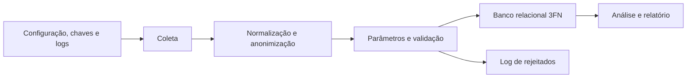

# Arquitetura em camadas do projeto

## Objetivo

Documentar a organização da solução de monitoramento ambiental: separação de responsabilidades, módulos e fluxo de processamento dos dados.

A arquitetura é em camadas, adequada a um pipeline de ingestão, qualidade, persistência e análise. Cada módulo tem um papel definido, o que reduz o acoplamento e facilita testar e evoluir o código.

## Visão geral

1. Configuração, segurança e observabilidade
2. Modelo de domínio
3. Serviços e regras de negócio
4. Persistência e Data Lake
5. Orquestração e execução

## 1. Configuração, segurança e observabilidade

Prepara o ambiente e concentra o que é transversal a todas as etapas.

| Módulo | Responsabilidade |
|---|---|
| `src/config.py` | Lê o `.env`: `AZURE_SQL_CONNECTIONSTRING`, `FONTE_DADOS` (URL da API, também gravada em `Leituras.fonte`), `CHAVE_CRIPTOGRAFIA` e `CHAVE_HASH`. Falha com mensagem clara, sem expor valores. |
| `src/security.py` | **Único** ponto de anonimização (SHA-256/HMAC de CPF e nome) e criptografia (Fernet do e-mail). |
| `src/logger.py` | **Único** ponto de configuração de log: execução (console + arquivo) e rejeitados (só arquivo), no formato `data - [NÍVEL] - mensagem`. |

Nenhum segredo fica no código; o `.env.example` traz só os nomes. Regras em [seguranca-lgpd.md](seguranca-lgpd.md).

## 2. Camada de domínio

Modelos Pydantic em `src/models/`, um por tabela do modelo 3FN ([modelagem-banco.md](modelagem-banco.md)):

`EstadoModel`, `MunicipioModel`, `EstacaoModel`, `OperadorModel` (só dados anonimizados), `ParametroModel`, `LeituraModel` (cabeçalho) e `LeituraItemModel` (medição).

Os tamanhos e as faixas dos campos seguem o DDL, então um valor que o banco recusaria é barrado antes da gravação.

## 3. Camada de serviços

| Serviço | Responsabilidade |
|---|---|
| `src/ingestion/data_client.py` | Coleta o lote em `GET {FONTE_DADOS}/api/v1/data-set`. Nova tentativa com espera crescente (1 s, 2 s, 4 s; 4 tentativas) para queda de conexão, timeout, HTTP 5xx e 429 (respeitando `Retry-After`), no máximo 30 requisições por minuto, resposta vazia tratada como lote vazio (`WARNING`) e falha definitiva como `FonteIndisponivelError` (`ERROR` e depois `CRITICAL`). |
| `src/services/normalization_service.py` | Converte o payload para cabeçalho + itens, descobre os parâmetros pelos campos `*_tipo_codigo` e anonimiza o operador. O que não pode ser convertido vai para o log, sem parar o lote. |
| `src/services/parametro_service.py` | Cadastra parâmetros novos sem faixa e rejeita os que não podem ser usados. |
| `src/services/validation_service.py` | Valida antes de gravar e devolve **um resultado por registro** (`valido`, `campos_nulos`, `itens_invalidos`, `motivos`). Não grava nem loga. |
| `src/services/analytics_service.py` | Estatística por estação + parâmetro (média, mediana, desvio, variância, quartis, IQR) e anomalias por IQR ou Z-Score com indicador de alerta ([analise-estatistica.md](analise-estatistica.md)). |
| `src/services/report_service.py` | Relatório estruturado, texto para o log/console e CSV. |
| `src/cli/` | Consulta interativa (rich): município → estação → período → métricas e anomalias. |

Os contratos de entrada e saída de cada serviço estão em [contrato-dados.md](contrato-dados.md).

## 4. Persistência

| Módulo | Responsabilidade |
|---|---|
| `src/database/connection.py` | Conexão, `transaction()` (uma conexão e um commit para o lote) e `insert_em_lotes()` (`INSERT` de várias linhas por comando). |
| `src/repository/` | Um repositório por entidade: `EstadoRepository`, `MunicipioRepository`, `OperadorRepository`, `EstacaoRepository`, `ParametroRepository` e `LeituraRepository`. Gravação idempotente por `MERGE` e por substituição de partição (`substituir_leituras`). |
| `src/ingestion/importar_dados.py` | Uma função por entidade, chamadas na ordem de dependência dentro da transação de `LeituraRepository.save_readings()`. |
| `sql/` | O schema é criado e alterado **só** por SQL: `ddl_banco_relacional.sql`, `migrations/` e `dml_populacao.sql`. O Python não cria tabelas. |

Os repositórios recebem a `DatabaseConnection` que devem usar. Assim, `save_readings()` executa todas as gravações do lote na mesma transação.

## 5. Camada de orquestração

`main.py` coordena o fluxo:

- `iniciar_aplicacao()`: logs → configuração → segurança;
- `run_pipeline()`: coleta → normalização → parâmetros → validação → log de rejeitados → gravação no banco → resumo (`python main.py --ingestao`). O Data Lake (Bronze, Silver e Gold) não será implementado neste projeto.
- `gerar_relatorio()`: análise estatística das medições gravadas, relatório em `INFO` e cada anomalia em `WARNING` (`python main.py --analise [--estacao] [--inicio] [--fim]`);
- sem argumentos, `main.py` abre a CLI de consulta (`src/cli`).

A sequência detalhada está em [diagramas/diagrama-sequencia.md](diagramas/diagrama-sequencia.md).

## Benefícios da arquitetura em camadas

- separação clara das responsabilidades;
- segurança e log centralizados num só lugar;
- regras de qualidade testáveis sem banco (a validação recebe faixas e siglas prontas);
- persistência idempotente isolada nos repositórios;
- facilidade para incluir novas fontes, parâmetros e análises.

## Conclusão

A arquitetura em camadas é a mais adequada ao projeto, porque ele funciona como um pipeline de dados ambientais, e não como um sistema de interface tradicional. Cada etapa tem entrada e saída definidas, o que torna o fluxo claro, auditável e fácil de evoluir.
