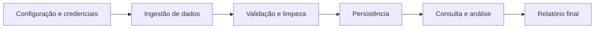

# Arquitetura em camadas do projeto

## Objetivo

Documentar a organização da solução de monitoramento ambiental, com foco em separação de responsabilidades, modularização e fluxo de processamento dos dados.

A arquitetura escolhida para o projeto é uma arquitetura em camadas, adequada ao fluxo de ingestão, validação, persistência e análise estatística. Ela organiza o sistema em módulos com papéis bem definidos, reduz acoplamento e facilita a evolução do código.

## Visão geral

O sistema é composto por cinco principais camadas:

1. Configuração e ambiente
2. Modelo de domínio
3. Serviços e regras de negócio
4. Persistência e acesso a dados
5. Orquestração e execução

Esse modelo permite que as decisões de negócio e os dados fluam de forma ordenada, desde a coleta até a geração do relatório final.

## 1. Camada de configuração

Responsável por preparar o ambiente da aplicação e proteger dados sensíveis.

### Funções

- carregar variáveis de ambiente
- acessar credenciais e endpoints
- configurar conexão com o banco
- determinar parâmetros do projeto

### Componentes esperados

- `.env`
- `.env.example`
- arquivos de configuração
- leitura de parâmetros do ambiente

### Exemplo de responsabilidade

A aplicação não deve expor diretamente senhas, tokens ou URLs no código-fonte. Esse valor deve ser carregado via ambiente ou arquivo de configuração seguro.

## 2. Camada de domínio

Responsável por representar as entidades do problema em análise.

### Entidades principais

- `Cidade`
- `Operador`
- `Estacao`
- `Leitura`

### Responsabilidade

Essa camada define:

- atributos de cada entidade
- relacionamentos entre entidades
- regras básicas do domínio
- estrutura dos dados que entram e saem do sistema

### Exemplo

Uma estação pertence a uma cidade e pode gerar várias leituras ao longo do tempo. A leitura contém valores como temperatura, pH, vazão, condutividade e oxigênio dissolvido.

## 3. Camada de serviços

Responsável pela lógica da aplicação e pela transformação dos dados entre as etapas do pipeline.

### Funções principais

- consumir dados da API REST configurada
- converter o payload bruto para o modelo interno
- validar estrutura, campos obrigatórios e intervalos
- limpar e padronizar dados
- remover ou anonimizar dados sensíveis
- calcular métricas estatísticas
- identificar outliers
- gerar relatórios

### Exemplos de serviços possíveis

- `IngestionService`
- `ValidationService`
- `CleaningService`
- `AnalyticsService`
- `ReportingService`

### Observação

Essa camada é o coração do sistema, porque conecta a entrada bruta de dados com a saída útil para análise e tomada de decisão.

### Normalização do payload

O cliente de dados entrega o registro bruto com números e booleanos representados como texto. O serviço de normalização deve produzir um registro interno com:

- `Decimal` ou `float` nos parâmetros ambientais e coordenadas;
- `bool` em `operador_ativo` e `estacao_ativa`;
- `datetime` em `data_hora`;
- textos limpos nos códigos, nomes, tipos e `fonte`.

A validação ocorre depois dessa conversão. Registros que não possam ser convertidos ou que violem os intervalos do contrato devem ser rejeitados e registrados.

## 4. Camada de persistência

Responsável por armazenar e consultar os dados no banco.

### Funções

- criar conexão com o banco
- controlar a transação do lote (`DatabaseConnection.transaction()`)
- criar tabelas
- inserir registros
- consultar dados por estação, cidade e período
- executar filtros e agregações

### Componentes esperados

- `connection.py`
- `schema.py` ou `criar_tabelas.py`
- `repositories` para cada entidade

### Repositórios sugeridos

- `cidade_repository.py`
- `estacao_repository.py`
- `leitura_repository.py`
- `operador_repository.py`

Essa camada separa o acesso ao banco da lógica de negócio, o que é uma boa prática para manutenção e testes.

Os repositórios recebem opcionalmente a `DatabaseConnection` que devem usar. Isso permite que `save_readings()` execute todos os inserts do lote na mesma transação, enquanto o uso isolado de um repositório continua abrindo sua própria conexão.

## 5. Camada de orquestração

Responsável por coordenar o fluxo completo do aplicativo.

### Papel principal

A classe principal da aplicação, geralmente `main.py`, orquestra a execução de todo o pipeline:

1. carregar configurações
2. consumir dados brutos
3. normalizar, validar e limpar dados
4. persistir no banco
5. consultar e analisar os registros
6. gerar resultados finais

### Benefício

Essa camada centraliza o funcionamento do sistema, deixando os módulos menores e mais focados.

## Fluxo principal da arquitetura

## Comunicação entre módulos

A comunicação ocorre de forma ordenada e em nível de serviço:

- a camada de configuração fornece parâmetros para a aplicação
- o módulo de ingestão coleta os dados
- o módulo de validação verifica qualidade dos registros
- o módulo de persistência salva os dados válidos
- o módulo de análise extrai e calcula estatísticas
- o módulo de relatório consolida o resultado

A aplicação principal atua como coordenadora do pipeline.

## Visão de comunicação entre módulos

A arquitetura deve ser interpretada como um conjunto de módulos que se comunicam em etapas bem definidas:

- `Configuração` fornece parâmetros e credenciais
- `Ingestão` coleta os dados brutos
- `Validação` verifica a qualidade dos registros
- `Persistência` salva os dados tratados
- `Análise` consulta, calcula e interpreta os resultados
- `Relatório` consolida a resposta final

Essa comunicação é em fluxo sequencial e orientada a pipeline, e não em uma interação de interface visual ou controller/web.

## Benefícios da arquitetura em camadas

- separação clara das responsabilidades
- organização mais simples do projeto
- redução de acoplamento entre módulos
- maior facilidade para testar funções isoladas
- melhora na manutenção e evolução da aplicação
- fácil expansão para novas fontes de dados e novas análises

## Conclusão

A arquitetura em camadas é a mais adequada para o projeto atual, porque ele funciona como um pipeline de dados ambientais, e não como um sistema de interface de usuário tradicional. Essa abordagem torna o fluxo de processamento mais claro, modular e fácil de evoluir.
