```mermaid
flowchart TD
	inicio((Inicio)) --> configurar[Carregar configuracoes e credenciais]
	configurar --> credenciais{Credenciais e configuracoes validas?}

	credenciais -- Nao --> erro_config[Registrar erro sem expor credenciais]
	erro_config --> fim_erro((Fim com erro))
	credenciais -- Sim --> fonte[Consumir API REST ou arquivo JSON]

	fonte --> carga{Carga recebida com sucesso?}
	carga -- Nao --> registrar_falha[Registrar falha de ingestao]
	registrar_falha --> fim_erro
	carga -- Sim --> parse[Converter JSON em listas e dicionarios]

	parse --> estrutura{Estrutura e tipos validos?}
	estrutura -- Nao --> rejeitar[Rejeitar carga e registrar inconsistencias]
	rejeitar --> fim_erro
	estrutura -- Sim --> limpar[Tratar campos ausentes ou nulos]

	limpar --> dados_sensiveis{Existem dados sensiveis?}
	dados_sensiveis -- Sim --> anonimizar[Anonimizar ou remover identificadores sensiveis]
	dados_sensiveis -- Nao --> validar
	anonimizar --> validar[Validar registros limpos]

	validar --> registros{Existem registros validos?}
	registros -- Nao --> fim_sem_dados((Fim sem dados para processar))
	registros -- Sim --> persistir[Inserir estacoes e leituras no banco relacional]

	persistir --> banco{Persistencia concluida?}
	banco -- Nao --> erro_banco[Registrar erro de persistencia]
	erro_banco --> fim_erro
	banco -- Sim --> consultar[Executar consultas SQL]

	consultar --> extrair[Extrair dados por estacao e periodo]
	extrair --> estatistica[Calcular media, mediana e desvio padrao]
	estatistica --> dispersao[Calcular intervalo interquartil - IQR]
	dispersao --> outliers[Identificar outliers pela regra do IQR]
	outliers --> resultado[Gerar resultado textual ou relatorio]

	resultado --> testes[Executar testes unitarios e validacoes]
	testes --> testes_ok{Testes aprovados?}
	testes_ok -- Nao --> corrigir[Corrigir codigo e repetir validacoes]
	corrigir --> testes
	testes_ok -- Sim --> documentar[Atualizar README e documentacao tecnica]

	documentar --> branch[Criar ou atualizar branch de funcionalidade]
	branch --> commit[Registrar commits legiveis]
	commit --> pull_request[Publicar branch e abrir Pull Request]
	pull_request --> revisar{Pull Request aprovado?}
	revisar -- Nao --> corrigir_pr[Aplicar ajustes solicitados]
	corrigir_pr --> testes
	revisar -- Sim --> entrega[Realizar entrega no GitHub]
	entrega --> fim((Fim com sucesso))

	classDef inicioFim fill:#d9ead3,stroke:#38761d,stroke-width:2px,color:#000;
	classDef decisao fill:#fff2cc,stroke:#bf9000,stroke-width:1px,color:#000;
	classDef erro fill:#f4cccc,stroke:#990000,stroke-width:1px,color:#000;
	classDef processamento fill:#d9eaf7,stroke:#3d85c6,stroke-width:1px,color:#000;

	class inicio,fim,fim_erro,fim_sem_dados inicioFim;
	class credenciais,carga,estrutura,dados_sensiveis,registros,banco,testes_ok,revisar decisao;
	class erro_config,registrar_falha,rejeitar,erro_banco erro;
	class configurar,fonte,parse,limpar,anonimizar,validar,persistir,consultar,extrair,estatistica,dispersao,outliers,resultado,testes,corrigir,documentar,branch,commit,pull_request,corrigir_pr,entrega processamento;
```

## Explicação de cada fase

### 1. Carregar configurações e credenciais
Esta etapa prepara o sistema antes de qualquer operação. Ela pode incluir:

- leitura de variáveis de ambiente;
- carregamento de arquivos como `.env`, `.json` ou `.yaml`;
- configuração da URL da API, banco de dados e parâmetros do projeto;
- leitura de chaves, tokens e credenciais de autenticação;
- validação se os dados essenciais foram preenchidos corretamente.

Em resumo, essa fase garante que o sistema saiba onde buscar os dados e como acessá-los de forma segura.

### 2. Validação inicial
O sistema verifica se as configurações e credenciais foram carregadas corretamente. Se houver falha, o processo encerra com erro para evitar uso indevido de credenciais ou acesso sem autorização.

### 3. Limpeza e normalização dos dados
Nesta fase os dados recebidos são tratados para remover ou corrigir:

- campos vazios;
- valores nulos;
- inconsistências de formato;
- dados incompletos.

### 4. Tratamento de dados sensíveis
Se houver dados pessoais ou sensíveis, eles são removidos ou anonimizados antes de seguir para o armazenamento.

### 5. Persistência no banco
Os dados válidos são salvos em banco para futura consulta e análise.

### 6. Análise estatística
O sistema consulta os dados armazenados, calcula métricas e identifica padrões, como médias, desvios e valores atípicos.

### 7. Testes e validação
Antes de concluir, o fluxo verifica se os resultados estão corretos. Caso falhe, o processo volta para correção e reexecução.

### 8. Conclusão
Quando tudo está validado, o processo chega ao fim com sucesso e os resultados ficam prontos para uso ou entrega.
