```mermaid
flowchart TD
	inicio((Inicio)) --> configurar[Configurar logs, carregar configuracoes e chaves]
	configurar --> credenciais{Configuracao e chaves validas?}

	credenciais -- Nao --> erro_config[Registrar CRITICAL sem expor segredos]
	erro_config --> fim_erro((Fim com erro))
	credenciais -- Sim --> fonte[Consumir API REST em FONTE_DADOS]

	fonte --> carga{Lista de objetos recebida?}
	carga -- Nao --> registrar_falha[Registrar falha de ingestao]
	registrar_falha --> fim_erro
	carga -- Sim --> contrato{Registro atende o contrato?}
	contrato -- Nao --> log_contrato[Registrar no log de rejeitados]
	log_contrato --> deduplicar
	contrato -- Sim --> bronze[Bronze: gravar o registro como chegou em JSON]
	bronze --> deduplicar[Silver: remover registro_codigo repetido]
	deduplicar --> normalizar[Normalizar: textos, numeros, datas, cabecalho + itens]

	normalizar --> conversao{Valor convertivel?}
	conversao -- Nao --> log_norm[Rejeitar item ou leitura e registrar no log]
	log_norm --> anonimizar
	conversao -- Sim --> anonimizar[Anonimizar CPF e nome, criptografar e-mail, descartar originais]

	anonimizar --> parametros[Sincronizar parametros: cadastrar novos sem faixa]
	parametros --> validar[Validar cada registro: completude, acuracia, referencia, unicidade]
	validar --> silver[Silver: gravar os validos em Parquet]
	silver --> gold[Gold: gravar dimensoes e fato para o Power BI]
	gold --> log_val[Registrar no log de rejeitados as leituras e medicoes recusadas]

	log_val --> registros{Existem registros validos?}
	registros -- Nao --> fim_sem_dados((Fim sem dados para gravar))
	registros -- Sim --> persistir[Gravar em uma transacao: MERGE cadastros, substituir particoes estacao + dia]

	persistir --> banco{Commit concluido?}
	banco -- Nao --> erro_banco[Rollback do lote e registrar erro]
	erro_banco --> fim_erro
	banco -- Sim --> resumo[Registrar resumo da ingestao]

	resumo --> analise[Analise estatistica: metricas e anomalias IQR ou Z-Score - python main.py --analise]
	analise --> testes[Executar testes unitarios e validacoes]
	testes --> testes_ok{Testes aprovados?}
	testes_ok -- Nao --> corrigir[Corrigir codigo e repetir validacoes]
	corrigir --> testes
	testes_ok -- Sim --> documentar[Atualizar README e documentacao tecnica]

	documentar --> branch[Criar ou atualizar branch de funcionalidade]
	branch --> commit[Registrar commits legiveis]
	commit --> pull_request[Publicar branch e abrir Pull Request]
	pull_request --> revisar{Pull Request aprovado?}
	revisar -- Nao --> corrigir_pr[Aplicar ajustes solicitados]
	corrigir_pr --> testes
	revisar -- Sim --> entrega[Realizar entrega no GitHub]
	entrega --> fim((Fim com sucesso))

	classDef inicioFim fill:#d9ead3,stroke:#38761d,stroke-width:2px,color:#000;
	classDef decisao fill:#fff2cc,stroke:#bf9000,stroke-width:1px,color:#000;
	classDef erro fill:#f4cccc,stroke:#990000,stroke-width:1px,color:#000;
	classDef processamento fill:#d9eaf7,stroke:#3d85c6,stroke-width:1px,color:#000;

	class inicio,fim,fim_erro,fim_sem_dados inicioFim;
	class credenciais,carga,contrato,conversao,registros,banco,testes_ok,revisar decisao;
	class erro_config,registrar_falha,log_contrato,log_norm,erro_banco erro;
	class configurar,fonte,bronze,deduplicar,normalizar,anonimizar,parametros,validar,silver,gold,log_val,persistir,resumo,analise,testes,corrigir,documentar,branch,commit,pull_request,corrigir_pr,entrega processamento;
```

## Explicação de cada fase

### 1. Carregar configurações e credenciais

Etapa inicial de segurança e preparação do ambiente (`iniciar_aplicacao()` em `main.py`):

- configura os logs (`src/logger.py`): arquivo da execução e arquivo de rejeitados em `logs/`;
- lê as variáveis de ambiente do `.env`: `AZURE_SQL_CONNECTIONSTRING`, `FONTE_DADOS` (URL da API, também gravada em `Leituras.fonte`), `CHAVE_CRIPTOGRAFIA` e `CHAVE_HASH`;
- valida se as obrigatórias estão preenchidas e se a chave de criptografia é uma chave Fernet válida;
- entrega as chaves ao `src/security.py`.

Se algo falhar, a aplicação registra a causa com nível `CRITICAL`, sem mostrar senhas nem chaves, e termina com código `1`.

### 2. Coleta

Busca o lote em `GET {FONTE_DADOS}/api/v1/data-set`. Se a resposta não for uma lista de objetos, a execução para.

### 3. Normalização

Acontece na camada Silver do data lake (parte A do `run_pipeline()`). Antes dela, a Bronze confere cada registro pelo contrato: o que não atende vai para o log de rejeitados, e o que atende é gravado como chegou em `data_lake/bronze/`. A Silver lê a Bronze e remove `registro_codigo` repetido. Depois, limpa os textos, converte números e datas e separa cada registro em cabeçalho mais uma lista de medições, uma por parâmetro. Um valor que não pode ser convertido rejeita só aquela medição ou leitura e vai para o log de rejeitados; o resto do lote segue.

### 4. Tratamento de dados sensíveis

CPF e nome viram hash SHA-256 (ou HMAC-SHA256 com a CHAVE_HASH) e o e-mail é criptografado (Fernet). Os valores originais não seguem para as próximas etapas. Regras em [seguranca-lgpd.md](../seguranca-lgpd.md).

### 5. Parâmetros e validação

Parâmetros novos são cadastrados sem faixa. A validação devolve um resultado por registro (`valido`, `campos_nulos`, `itens_invalidos`, `motivos`); tudo o que foi recusado vai para o log de rejeitados. Regras em [contrato-dados.md](../contrato-dados.md).

### 6. Persistência no banco

Os registros válidos são gravados numa única transação: municípios, operadores e estações por `MERGE`, e leituras e medições substituindo as partições estação + dia, sem duplicar ao reexecutar. Se o commit falhar, nada do lote fica gravado. Depois do commit, o resumo da execução é registrado no log. Antes desta etapa, a Silver já gravou os válidos em Parquet e a Gold, as dimensões e a fato do Power BI; o banco recebe o resultado da validação feita na Silver (parte B do `run_pipeline()`).

### 7. Análise estatística

Executada à parte (`python main.py --analise` ou pela CLI), sobre as medições gravadas. Calcula média, mediana, desvio padrão, variância e IQR por estação + parâmetro e sinaliza como anômala a medição fora do IQR ou com \|Z\| > 3, com o indicador de alerta de qualidade. Cada anomalia vai numa linha `WARNING` do log; nada é removido ([analise-estatistica.md](../analise-estatistica.md)).

### 8. Testes e validação

Antes de concluir, os testes automatizados (`python -m pytest tests`) verificam os resultados. Se falharem, o processo volta para correção.

### 9. Conclusão

Com tudo validado, a entrega segue por branch, commits e Pull Request.
