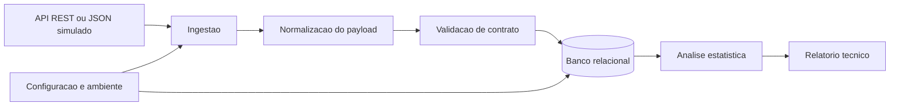

# Diagrama de contexto

O sistema recebe registros ambientais de uma API REST ou de um arquivo JSON simulado. O payload bruto passa por normalização e validação antes de ser persistido. A análise consulta os dados por cidade, operador, estação, período e fonte para gerar o relatório final.

## Entradas

- dados cadastrais de cidade, operador e estação;
- leituras meteorológicas e de qualidade da água;
- configuração do ambiente e conexão com o banco.

## Saídas

- registros persistidos e consultáveis;
- métricas estatísticas;
- identificação de outliers;
- relatório técnico.
