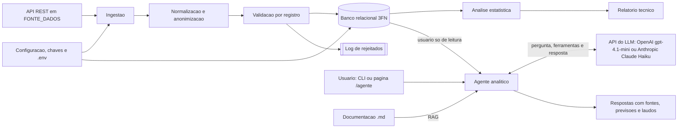

# Diagrama de contexto

O sistema recebe registros ambientais exclusivamente da API REST configurada em `FONTE_DADOS`, que no ambiente atual serve um dataset simulado. O payload bruto passa pelo Data Lake em `data_lake/`: a Bronze guarda o que atende o contrato, e na Silver o lote é normalizado, os dados pessoais do operador são anonimizados e cada registro é validado; a Gold prepara o modelo estrela do Power BI. Os válidos são gravados no banco relacional (modelo 3FN); os recusados vão para o log de rejeitados. A análise estatística consulta o banco para gerar o relatório.

O agente analítico é uma camada de **leitura**: responde perguntas em linguagem natural com um LLM externo (API da OpenAI ou da Anthropic, conforme `AGENTE_LLM_FORNECEDOR`) que escolhe ferramentas Python. Essas ferramentas leem o banco com um usuário só de leitura e a documentação do projeto por RAG. O agente não grava nada no banco, e os dados pessoais dos operadores nunca chegam ao LLM. Detalhes em [agente/arquitetura.md](../agente/arquitetura.md).

## Entradas

- registros de leitura com estado, município, estação, operador (com CPF, nome e e-mail) e as medições de cada parâmetro;
- configuração do ambiente: conexão com o banco, URL da API e chaves de criptografia (`.env`);
- domínio carregado por script: estados e parâmetros com faixa de valores (`sql/dml_populacao.sql`);
- perguntas do usuário ao agente analítico (CLI ou página `/agente`), com a configuração `AGENTE_*` e a chave da Anthropic no `.env`.

## Saídas

- leituras e medições gravadas no banco, sem duplicidade e com dados pessoais protegidos;
- log da execução com o resumo da ingestão e log de tudo o que não foi importado;
- métricas estatísticas por estação e parâmetro, anomalias com indicador de alerta de qualidade (log `WARNING`) e relatório técnico (log, CLI e CSV em `relatorios/`);
- respostas do agente com as fontes (ferramentas e documentos usados), previsões com a margem de erro e laudos de anomalias em `relatorios/`, sinalizados como gerados por IA.
