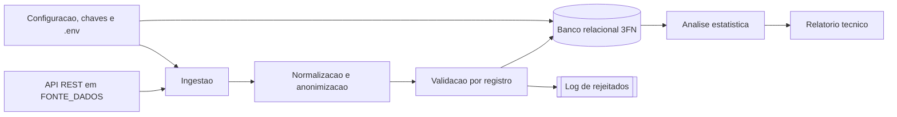

# Diagrama de contexto

O sistema recebe registros ambientais exclusivamente da API REST configurada em `FONTE_DADOS`, que no ambiente atual serve um dataset simulado. O payload bruto é normalizado, os dados pessoais do operador são anonimizados e cada registro é validado. Os válidos são gravados no banco relacional (modelo 3FN); os recusados vão para o log de rejeitados. O Data Lake (Bronze, Silver e Gold) não será implementado neste projeto. A análise estatística consulta o banco para gerar o relatório.

## Entradas

- registros de leitura com estado, município, estação, operador (com CPF, nome e e-mail) e as medições de cada parâmetro;
- configuração do ambiente: conexão com o banco, URL da API e chaves de criptografia (`.env`);
- domínio carregado por script: estados e parâmetros com faixa de valores (`sql/dml_populacao.sql`).

## Saídas

- leituras e medições gravadas no banco, sem duplicidade e com dados pessoais protegidos;
- log da execução com o resumo da ingestão e log de tudo o que não foi importado;
- métricas estatísticas por estação e parâmetro, anomalias com indicador de alerta de qualidade (log `WARNING`) e relatório técnico (log, CLI e CSV em `relatorios/`).
