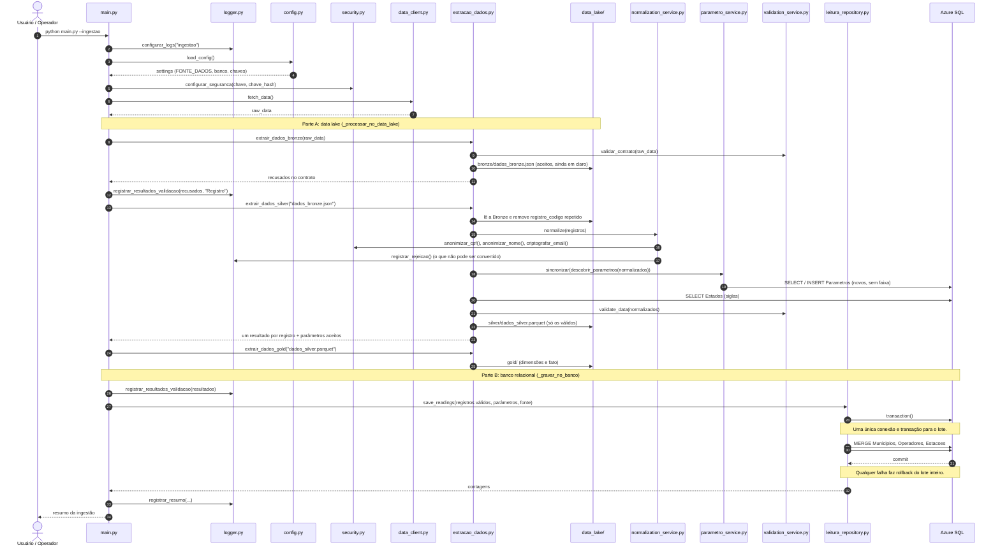
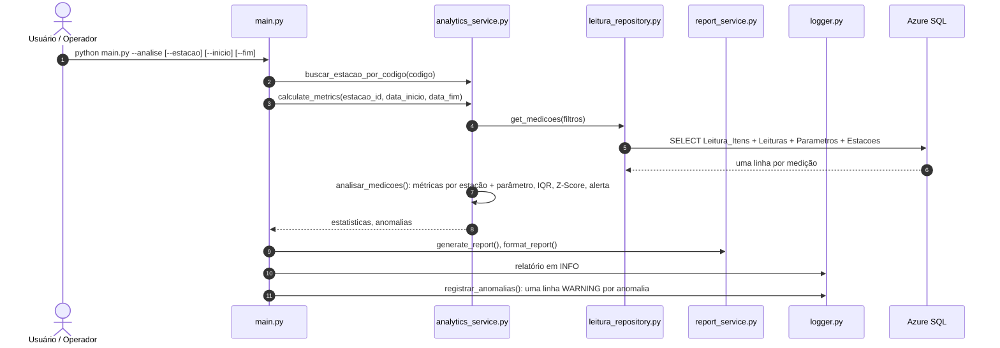

# Diagrama de sequência

Fluxo da ingestão (`python main.py --ingestao`), como está implementado.

## Explicação das etapas

### 1. Inicialização (`main.py` → `logger.py`, `config.py`, `security.py`)

`iniciar_aplicacao(etapa)` executa, nesta ordem, `configurar_logs(etapa)`, `load_config()` e `configurar_seguranca()`. A etapa vem do argumento (`--ingestao` = `ingestao`, `--analise` = `analise`, sem argumento = `consulta`) e vai para o cabeçalho dos dois arquivos de log. A configuração exige `AZURE_SQL_CONNECTIONSTRING`, `FONTE_DADOS` (URL da API, até 100 caracteres) e `CHAVE_CRIPTOGRAFIA`. Uma falha aqui é registrada com nível `CRITICAL` e encerra com código `1`, sem expor segredos. Com `--analise`, executa a análise (seção abaixo); sem argumentos, abre a CLI de consulta.

### 2. Coleta (`data_client.py`)

`fetch_data()` busca `GET {FONTE_DADOS}/api/v1/data-set` e exige uma lista de objetos. Nova tentativa com espera crescente (1 s, 2 s, 4 s; 4 tentativas) para queda de conexão, timeout, HTTP 5xx e 429 (respeitando `Retry-After`), no máximo 30 requisições por minuto, resposta vazia tratada como lote vazio (`WARNING`) e falha definitiva como `FonteIndisponivelError` (`ERROR` e depois `CRITICAL`). Com lote vazio, a `run_pipeline()` registra o resumo zerado e termina sem abrir conexão com o banco.

### 3. Data lake (`extracao_dados.py`, chamado por `_processar_no_data_lake()`)

As etapas 3 a 5 acontecem dentro das camadas do data lake, gravadas em `data_lake/`. A **Bronze** confere cada registro pelo contrato (`ValidationService.validar_contrato()`), grava os aceitos como chegaram em `bronze/dados_bronze.json` (ainda com dado pessoal em claro, por isso a pasta fica fora do Git) e devolve os recusados, que o `main.py` envia ao log de rejeitados. A **Silver** lê a Bronze, remove `registro_codigo` repetido (fica a última ocorrência) e executa a normalização, os parâmetros e a validação descritos abaixo; os válidos vão para `silver/dados_silver.parquet`, e o resultado de todos os registros volta ao `main.py`. A **Gold** monta dimensões e fato a partir da Silver, para a API do Power BI, e não participa da gravação no banco.

Normalização e anonimização (`normalization_service.py`): limpa os textos, converte números e datas e separa cada registro em cabeçalho mais itens, um por parâmetro (`*_tipo_codigo`). Anonimiza o operador com `src/security.py` e não copia CPF, nome e e-mail originais. O que não pode ser convertido vai para o log de rejeitados sem interromper o lote. Formato completo em [contrato-dados.md](../contrato-dados.md).

### 4. Parâmetros e referências (`parametro_service.py`, `estado_repository.py`)

`ParametroService.sincronizar()` cadastra os parâmetros novos sem faixa e rejeita, com ERROR, os que não podem ser usados (sem unidade, nome de outro código ou unidade diferente da cadastrada). As siglas de `Estados` também são lidas do banco.

### 5. Validação (`validation_service.py`) e log de rejeitados

`ValidationService.validate_data()`, com as faixas, as siglas e os parâmetros aceitos lidos do banco, devolve um resultado por registro com `valido`, `campos_nulos`, `itens_invalidos`, `motivos` e o registro só com as medições válidas. Ela não grava nem loga. Já na parte B (`_gravar_no_banco()`), `registrar_resultados_validacao()` grava o log de rejeitados a partir desses resultados, e só `ValidationService.registros_validos(resultados)` segue para a gravação.

### 6. Gravação (`leitura_repository.py` → banco)

`save_readings()` abre uma transação (`DatabaseConnection.transaction()`) e chama, na mesma conexão, `importar_municipios`, `importar_operadores` e `importar_estacoes` (`MERGE` pela chave natural) e `importar_leituras` → `substituir_leituras()`. Esta última carrega o lote em tabelas temporárias, apaga as leituras das partições estação + dia do lote (e as de mesmo `codigo_registro`), itens primeiro, e insere leituras e itens com operações de conjunto. O commit ocorre só ao final; qualquer falha desfaz o lote. O schema não é criado pelo pipeline: vem de `sql/ddl_banco_relacional.sql` e `sql/migrations/`.

### 7. Resumo (`logger.py`)

Depois do commit, `registrar_resumo()` grava no log a linha `Resumo da ingestão`, que é também o retorno de `run_pipeline()`. `rejeitados_na_normalizacao` conta quem não chegou à validação: recusado pelo contrato na Bronze, repetido removido na Silver ou recusado na normalização.

## Análise e relatório (`python main.py --analise`)

A análise não grava nada no banco: o indicador de alerta fica no resultado, no log e no CSV da CLI (decisão D9). A CLI usa o mesmo `calculate_metrics()`, com a estação e o período escolhidos no menu. Regras: [analise-estatistica.md](../analise-estatistica.md).

## Observação

Este diagrama representa a comunicação entre os módulos da ingestão e deve ser atualizado sempre que o fluxo do código mudar. As sequências do agente analítico (pergunta numérica, RAG, recusa e indexação) estão em [agente/arquitetura.md](../agente/arquitetura.md) e [agente/rag.md](../agente/rag.md).
