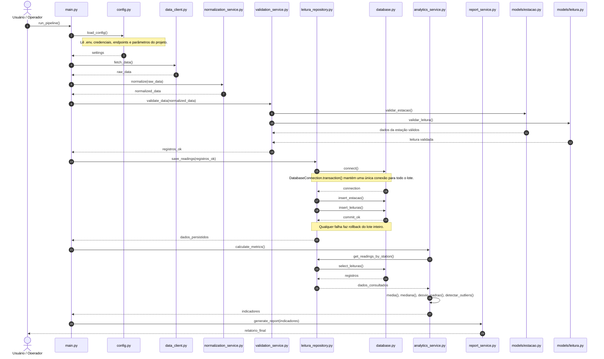

# Diagrama de sequência

## Explicação das etapas com classes e métodos

### 1. `main.py` -> `config.py`
Antes de qualquer etapa, `main.py` executa `iniciar_aplicacao()`: `configurar_logs()` (`src/logger.py`), `load_config()` e `configurar_seguranca()` (`src/security.py`). Uma falha nesse ponto é registrada com nível `CRITICAL` e encerra a aplicação com código `1`. O pipeline segue em `run_pipeline()`. Esse método chama `config.py` para carregar as configurações do ambiente por meio do método `load_config()`. A responsabilidade dessa etapa é preparar a aplicação corretamente antes do processamento.

### 2. `main.py` -> `data_client.py`
A aplicação solicita dados ao cliente da fonte externa por meio do método `fetch_data()`. Esse módulo é responsável por buscar os registros exclusivamente na API configurada em `MOCK_API` e entregar os dados brutos.

### 3. `normalization_service.py`

O serviço de normalização limpa os textos, converte números e `data_hora_ciclo` e separa cada registro em cabeçalho mais uma lista de itens, um por parâmetro (`*_tipo_codigo`). Em seguida, anonimiza o operador com `src/security.py` e não copia CPF, nome e e-mail originais. O que não pode ser convertido vai para o log de rejeitados sem interromper o lote. O formato de saída está na seção 3 de [analise-implementacao.md](../analise-implementacao.md). Ele não substitui a validação: apenas prepara o registro para que ela seja executada de forma previsível.

### 4. `validation_service.py` -> modelos
Antes de validar, `main.py` chama `ParametroService.sincronizar()` com os parâmetros descobertos na normalização: os novos são cadastrados em `Parametros` sem faixa, e os que não podem ser usados (sem unidade, nome de outro código ou unidade diferente da cadastrada) são rejeitados com ERROR. Também lê as siglas de `Estados`. A validação é feita por `ValidationService.validate_data()`, com as faixas, as siglas e os parâmetros aceitos lidos do banco, antes de qualquer gravação, e não grava nem loga: devolve um resultado por registro com `valido`, `campos_nulos`, `itens_invalidos`, `motivos` e o registro só com as medições válidas (contrato na seção 4 de [analise-implementacao.md](../analise-implementacao.md)). Em seguida, `main.py` chama `registrar_resultados_validacao()` (`src/logger.py`), que grava o log de rejeitados, e envia à persistência só `ValidationService.registros_validos(resultados)`.

### 5. `leitura_repository.py` -> `database.py`
Após a validação, os registros são enviados ao repositório `leitura_repository.py`, que executa `save_readings()`. Esse repositório abre uma transação em `DatabaseConnection` (`src/database/connection.py`) e grava, na mesma conexão, cidades, operadores, estações (`insert_estacao()`) e leituras (`insert_leituras()`). O commit ocorre somente ao final; qualquer falha desfaz o lote inteiro. O schema não é criado pelo pipeline: ele já deve existir, criado pelo `sql/ddl_banco_relacional.sql` e mantido por `sql/migrations/`.

### 6. `analytics_service.py`
Depois de salvar os dados, a análise é executada pelo serviço `analytics_service.py`, por meio do método `calculate_metrics()`. Esse serviço consulta o repositório por meio de `get_readings_by_station()` e aplica operações matemáticas como `media()`, `mediana()`, `desvio_padrao()` e `detectar_outliers()`.

No código, `AnaliticsService.calculate_metrics()` recebe o escopo (`cidade_id` ou `estacao_id`) e o período, e usa a mesma conexão da persistência. A consulta `get_readings_by_station()` corresponde aos métodos `get_leituras_*_by_estacao()` e `get_leituras_*_by_cidade()` de `LeituraRepository`; média, mediana e desvio padrão são calculados em `__analisar_leituras()`, e os outliers pelo IQR em `__identificar_outliers()`. O resultado consolida os grupos meteorológico e de qualidade da água.

### 7. `report_service.py`
Por fim, a geração de relatório fica sob responsabilidade do serviço `report_service.py`, cujo método `generate_report()` recebe os indicadores calculados e devolve uma saída final para o usuário.

No código, `generate_report()` devolve o relatório estruturado (escopo, período, estatísticas e outliers de cada grupo), que é o retorno de `run_pipeline()`. Para exibição no console, `ReportService.format_report()` converte esse relatório em texto, que `main.py` registra no log de execução (`logs/pipeline_*.log`).

## Observação

Este diagrama agora representa a comunicação entre as classes principais do projeto, incluindo arquivos, classes e métodos esperados. Ele deve ser mantido como referência da estrutura comportamental do sistema e atualizado sempre que o código mudar.
