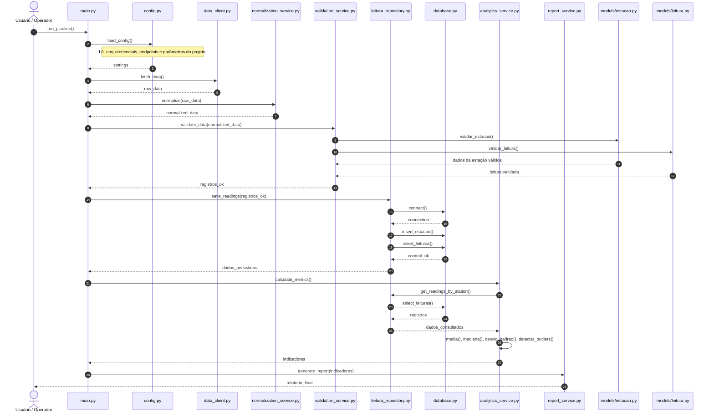

# Diagrama de sequência

## Explicação das etapas com classes e métodos

### 1. `main.py` -> `config.py`
O fluxo começa em `main.py`, executando o método `run_pipeline()`. Esse método chama `config.py` para carregar as configurações do ambiente por meio do método `load_config()`. A responsabilidade dessa etapa é preparar a aplicação corretamente antes do processamento.

### 2. `main.py` -> `data_client.py`
A aplicação solicita dados ao cliente da fonte externa por meio do método `fetch_data()`. Esse módulo é responsável por buscar os registros em API ou em arquivo JSON e entregar os dados brutos.

### 3. `normalization_service.py`

O serviço de normalização converte números e booleanos recebidos como strings, transforma `data_hora` em data/hora e limpa os campos textuais. Ele não substitui a validação: apenas prepara o registro para que ela seja executada de forma previsível.

### 4. `validation_service.py` -> modelos
A validação é feita pelo serviço `validation_service.py`, usando métodos como `validate_data()`. Ele valida as entidades do domínio, como `Estacao` e `Leitura`, acessando métodos específicos como `validar_estacao()` e `validar_leitura()`. Esse passo garante que os dados tenham estrutura e tipos consistentes.

### 5. `leitura_repository.py` -> `database.py`
Após a validação, os registros são enviados ao repositório `leitura_repository.py`, que executa `save_readings()`. Esse repositório acessa `database.py` para abrir a conexão com o banco e realizar operações como `insert_estacao()` e `insert_leituras()`. Esse processo persiste os dados em banco relacional.

### 6. `analytics_service.py`
Depois de salvar os dados, a análise é executada pelo serviço `analytics_service.py`, por meio do método `calculate_metrics()`. Esse serviço consulta o repositório por meio de `get_readings_by_station()` e aplica operações matemáticas como `media()`, `mediana()`, `desvio_padrao()` e `detectar_outliers()`.

### 7. `report_service.py`
Por fim, a geração de relatório fica sob responsabilidade do serviço `report_service.py`, cujo método `generate_report()` recebe os indicadores calculados e devolve uma saída final para o usuário.

## Observação

Este diagrama agora representa a comunicação entre as classes principais do projeto, incluindo arquivos, classes e métodos esperados. Ele deve ser mantido como referência da estrutura comportamental do sistema e atualizado sempre que o código mudar.
