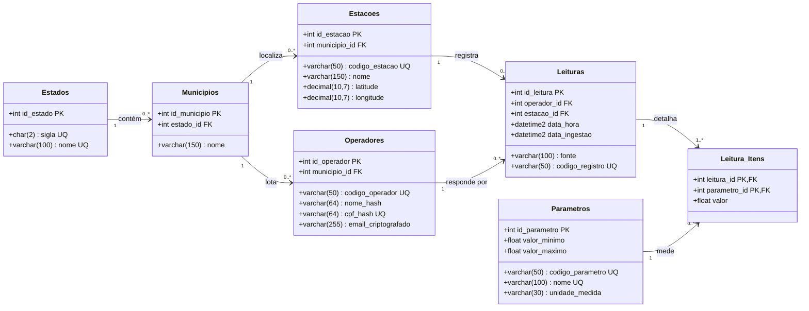

# Modelo de Dados

Referência do banco relacional operacional da Parte 2. O schema é mantido **somente** por scripts SQL:

- [sql/ddl_banco_relacional.sql](../sql/ddl_banco_relacional.sql): estado completo e atual (tabelas, chaves e índices);
- [sql/migrations/](../sql/migrations/): alterações incrementais para bancos que já têm dados;
- [sql/dml_populacao.sql](../sql/dml_populacao.sql): carga inicial de domínio (estados e parâmetros).

Como executar e como criar uma migration: seção 4 de [manual-execucao.md](manual-execucao.md).

## Requisito e decisão de tecnologia

O projeto final ([projeto_final.pdf](projeto_final.pdf), item 3.3) pede um banco operacional **estritamente na 3ª Forma Normal**, com `Estacoes`, `Operadores` (anonimizados), `Parametros` (domínio), `Leituras` (cabeçalho) e `Leitura_Itens` (N:M com chave primária composta). O modelo adotado segue essa estrutura e acrescenta `Estados` e `Municipios` para normalizar a localização. O banco usado é o Azure SQL; o enunciado da Parte 1 citava SQLite ou PostgreSQL.

## Visão geral

Cada **leitura** é um evento: uma estação, num instante, com um operador responsável. As **medições** da leitura ficam em `Leitura_Itens`, uma linha por **parâmetro** medido. Um parâmetro novo no payload vira uma linha em `Parametros`, sem `ALTER TABLE`.

## Estrutura das tabelas

Todas as colunas são `NOT NULL`, exceto as indicadas.

### `Estados`

Unidades federativas. Carregadas pelo `dml_populacao.sql` (27 UFs), porque o payload só traz a sigla e `nome` é obrigatório.

| Coluna | Tipo | Regra |
|---|---|---|
| `id_estado` | `INT IDENTITY` | PK |
| `sigla` | `CHAR(2)` | `UNIQUE` |
| `nome` | `VARCHAR(100)` | `UNIQUE` |

### `Municipios`

| Coluna | Tipo | Regra |
|---|---|---|
| `id_municipio` | `INT IDENTITY` | PK |
| `nome` | `VARCHAR(150)` | `UNIQUE (nome, estado_id)` |
| `estado_id` | `INT` | FK → `Estados` |

### `Estacoes`

| Coluna | Tipo | Regra |
|---|---|---|
| `id_estacao` | `INT IDENTITY` | PK |
| `codigo_estacao` | `VARCHAR(50)` | `UNIQUE`; vem de `estacao_codigo` |
| `nome` | `VARCHAR(150)` | |
| `municipio_id` | `INT` | FK → `Municipios` |
| `latitude` | `DECIMAL(10,7)` | `CHECK` entre -90 e 90 |
| `longitude` | `DECIMAL(10,7)` | `CHECK` entre -180 e 180 |

### `Operadores`

Somente dados já protegidos por `src/security.py` ([seguranca-lgpd.md](seguranca-lgpd.md)).

| Coluna | Tipo | Regra |
|---|---|---|
| `id_operador` | `INT IDENTITY` | PK |
| `codigo_operador` | `VARCHAR(50)` | `UNIQUE`; vem de `operador_codigo` |
| `nome_hash` | `VARCHAR(64)` | SHA-256 (ou HMAC-SHA256 com pepper) do nome |
| `cpf_hash` | `VARCHAR(64)` | `UNIQUE`; SHA-256 (ou HMAC) do CPF só com dígitos |
| `municipio_id` | `INT` | FK → `Municipios` |
| `email_criptografado` | `VARCHAR(255) NULL` | token Fernet, reversível com a `CHAVE_CRIPTOGRAFIA` (migration V002) |

### `Parametros`

Domínio dos parâmetros medidos. Os 11 do payload atual vêm do `dml_populacao.sql`; um parâmetro novo é cadastrado automaticamente pela ingestão, sem faixa.

| Coluna | Tipo | Regra |
|---|---|---|
| `id_parametro` | `INT IDENTITY` | PK |
| `codigo_parametro` | `VARCHAR(50)` | `UNIQUE`; valor de `<param>_tipo_codigo` no payload (ex.: `TIP-PH`) |
| `nome` | `VARCHAR(100)` | `UNIQUE`; nome legível |
| `unidade_medida` | `VARCHAR(30)` | |
| `valor_minimo` | `FLOAT NULL` | faixa de validade física; `NULL` = sem limite |
| `valor_maximo` | `FLOAT NULL` | idem |

### `Leituras` (cabeçalho)

| Coluna | Tipo | Regra |
|---|---|---|
| `id_leitura` | `INT IDENTITY` | PK |
| `operador_id` | `INT` | FK → `Operadores` |
| `estacao_id` | `INT` | FK → `Estacoes` |
| `data_hora` | `DATETIME2` | `data_hora_ciclo` do payload |
| `fonte` | `VARCHAR(100)` | valor de `FONTE_DADOS` (URL da API) |
| `data_ingestao` | `DATETIME2` | `DEFAULT GETDATE()` |
| `codigo_registro` | `VARCHAR(50)` | `UNIQUE`; `registro_codigo` do payload, chave natural (migration V001) |

### `Leitura_Itens` (detalhe, N:M)

| Coluna | Tipo | Regra |
|---|---|---|
| `leitura_id` | `INT` | PK composta, FK → `Leituras` |
| `parametro_id` | `INT` | PK composta, FK → `Parametros` |
| `valor` | `FLOAT` | medição nula ou fora da faixa não vira item |

### Índices

`IX_Municipios_Estado`, `IX_Estacoes_Municipio`, `IX_Operadores_Municipio`, `IX_Leituras_DataHora`, `IX_Leituras_Estacao`, `IX_Leituras_Operador`, `IX_LeituraItens_Parametro` e `IX_Leituras_Estacao_DataHora`. Este último foi criado pela V001 e é usado pela substituição de partição.

## Integridade e idempotência

A reexecução da ingestão para o mesmo período (backfill) **não duplica nada** ([projeto_final.pdf](projeto_final.pdf), item 3.7):

| Tabela | Como é gravada | Chave |
|---|---|---|
| `Estados` | só leitura (vem do DML) | `sigla` |
| `Municipios` | `MERGE`, insere se não existir | `(nome, estado_id)` |
| `Operadores` | `MERGE`, insere ou atualiza | `codigo_operador` |
| `Estacoes` | `MERGE`, insere ou atualiza nome, município e coordenadas | `codigo_estacao` |
| `Parametros` | `INSERT ... WHERE NOT EXISTS` | `codigo_parametro` |
| `Leituras` + `Leitura_Itens` | **substituição de partição**: apaga as leituras da mesma estação e dia (e as de mesmo `codigo_registro`), itens primeiro, e insere o lote | partição = estação + dia; `codigo_registro` |

- Tudo roda numa **única transação** (`LeituraRepository.save_readings` → `DatabaseConnection.transaction()`): se uma etapa falhar, nada do lote fica gravado.
- O lote vai para tabelas temporárias da sessão (`#lote`, `#itens`) e é gravado com operações de conjunto, sem uma ida ao banco por linha.
- Uma partição em que todos os registros do lote são inválidos não é tocada.
- Validado no banco `impacta` com o dataset completo carregado duas vezes: as contagens ficaram idênticas e não houve nenhuma duplicidade (relatório da fase 8 em [analise-implementacao.md](analise-implementacao.md)).

## Situação atual do schema

- O banco `impacta` está igual ao DDL, com as migrations `V001` (`codigo_registro`) e `V002` (`email_criptografado`) aplicadas.
- O DML de domínio foi aplicado: 27 estados e 11 parâmetros.
- Até a primeira carga real (fase 9 do [TODO](todo-idempotencia.md)), `Municipios`, `Operadores`, `Estacoes`, `Leituras` e `Leitura_Itens` estão vazias.
- O banco ainda tem a tabela `dbo.sysdiagrams`, criada pelo SSMS, que não interfere.

## Consultas SQL do trabalho

O enunciado pede consultas com `JOIN`, agregação por estação e filtro por período. Essas consultas estão em [sql/queries_analiticas.sql](../sql/queries_analiticas.sql), sobre `Leituras` + `Leitura_Itens` + `Parametros` + `Estacoes`: métricas por estação e parâmetro, quartis e limites IQR, anomalias com o indicador de alerta, volume por dia e medições por parâmetro. Os resultados batem com o relatório de `python main.py --analise` (teste de integração). As consultas de conferência pós-carga (duplicidade, órfãos e faixas) estão na fase 9 do TODO.
