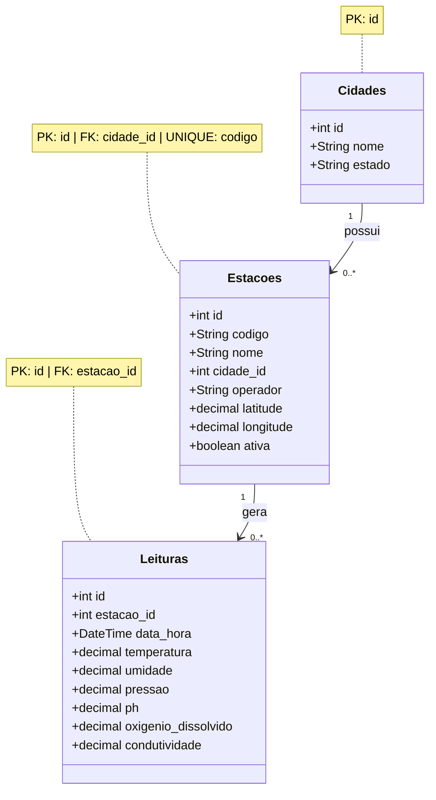

# Modelo de Dados

## Visão Geral
O modelo foi estruturado de forma relacional, permitindo que uma cidade possua várias estações de monitoramento e que cada estação registre várias leituras ao longo do tempo.

A estrutura é composta por três entidades principais:

* `Cidades`
* `Estacoes`
* `Leituras`

## Diagrama de Classes

## Considerações

O modelo foi estruturado para separar:

* informações geográficas;
* informações cadastrais das estações;
* dados temporais das medições.

Essa separação reduz a repetição de informações e permite que uma estação tenha um histórico de várias leituras sem precisar duplicar seus dados cadastrais.

A utilização de uma entidade específica para cidades também permite que várias estações compartilhem a mesma cidade sem repetir informações como nome e estado em cada registro.

A tabela de leituras concentra os valores obtidos ao longo do tempo, permitindo posteriormente realizar consultas, filtros e análises dos parâmetros ambientais.
