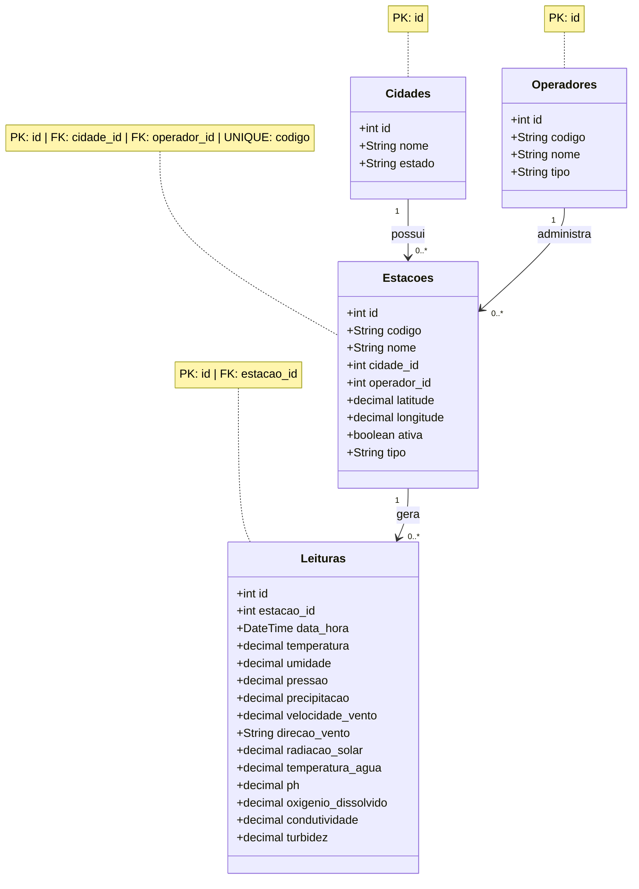

# Modelo de Dados

## Visão Geral
O modelo foi estruturado de forma relacional para representar a relação entre cidades, operadores, estações de monitoramento e as leituras coletadas ao longo do tempo. A estrutura permite que cada cidade tenha várias estações, que cada operador seja responsável por diversas estações e que cada estação registre múltiplas medições em diferentes datas e horários.

A estrutura é composta por quatro entidades principais:

* `Cidades`
* `Operadores`
* `Estacoes`
* `Leituras`

## Diagrama de Entidades

## Estrutura das Tabelas

### `Cidades`
Armazena as informações básicas das cidades onde as estações estão localizadas.

- `id`: identificador único da cidade
- `nome`: nome da cidade
- `estado`: unidade federativa

### `Operadores`
Representa os responsáveis ou entidades que operam as estações de monitoramento.

- `id`: identificador único do operador
- `codigo`: código de identificação do operador
- `nome`: nome do operador
- `tipo`: tipo de operador

### `Estacoes`
Contém os dados cadastrais e geográficos da estação.

- `id`: identificador único da estação
- `codigo`: código interno da estação
- `nome`: nome da estação
- `cidade_id`: chave estrangeira para a cidade
- `operador_id`: chave estrangeira para o operador
- `latitude`: latitude geográfica
- `longitude`: longitude geográfica
- `ativa`: indica se a estação está ativa
- `tipo`: tipo da estação

### `Leituras`
Armazena os registros de monitoramento coletados em cada estação ao longo do tempo.

- `id`: identificador único da leitura
- `estacao_id`: chave estrangeira para a estação
- `data_hora`: data e hora da medição
- `temperatura`: temperatura do ambiente
- `umidade`: umidade relativa do ar
- `pressao`: pressão atmosférica
- `precipitacao`: volume de precipitação
- `velocidade_vento`: velocidade do vento
- `direcao_vento`: direção do vento
- `radiacao_solar`: radiação solar
- `temperatura_agua`: temperatura da água
- `ph`: potencial hidrogeniônico da água
- `oxigenio_dissolvido`: nível de oxigênio dissolvido
- `condutividade`: condutividade elétrica
- `turbidez`: nível de turbidez

## Considerações

O modelo foi organizado para separar claramente:

* dados geográficos e cadastrais das cidades;
* informações dos operadores;
* dados estruturais das estações;
* registros históricos das medições.

Essa organização evita redundância de informações e facilita consultas por cidade, operador, estação e período de coleta. A tabela de leituras funciona como o principal conjunto de dados analíticos, permitindo filtros, agregações e análises ambientais ao longo do tempo.
